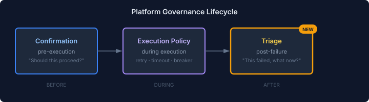
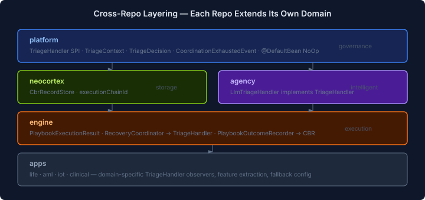

# The Gap Between Retry and Give Up

Platform's governance package has had `ExecutionPolicy` for a while — mechanical retry with backoff, timeouts, circuit breakers. When an operation fails, you retry it. When retries exhaust, you give up. Clean and simple.

Too simple, it turns out.

The trigger was playbook failure handling. When an LLM-generated playbook runs and step 3 of 7 fails because a device went offline or a data source changed its API, mechanical retry is useless. You'd just re-run the same steps and hit the same wall. What you actually want is for something intelligent to look at what failed, suggest a modification — skip the failed step, replace it, adjust parameters — and try again with the modified plan.

That's not retry. It's triage.

## Finding the Gap

I wanted to understand where this belongs in the platform. CaseHub has four repos in the dependency chain: platform → neocortex → engine → agency. Playbook execution lives in engine. CBR (Case-Based Reasoning) lives in neocortex. Agentic orchestration lives in agency. Platform provides foundational SPIs.

The easy answer was "put it in engine, where playbooks execute." But the pattern isn't playbook-specific. Any coordinated execution — a workflow, an agent tool-use loop, a callback chain — can partially fail in ways that mechanical retry won't fix. Every domain that generates plans will encounter this.

The hard question: is there a genuine platform-level concept here, or would that be premature abstraction?

## The Dependency Graph Decides

Claude mapped the actual build graph across all four repos. The critical finding: agency already depends on engine. I'd been arguing that platform should own the SPI to keep agency independent of engine — but that edge already exists. The dependency argument didn't differentiate.

So what does?

I looked at what platform's governance package already owns:



**Confirmation** is the pre-execution gate: "Should this proceed?" An SPI, a no-op default, a CDI event pattern.

**ExecutionPolicy** is the during-execution policy: retry, timeout, circuit breaker.

Between "retries exhausted" and "operation abandoned" — nothing. That's the gap. Platform has mechanical failure handling but no intelligent failure handling. When PolicyEnforcer runs out of retries, the operation just dies.

**Triage** fills that gap. Same architectural pattern as confirmation: an SPI interface (`TriageHandler`), a context record (`TriageContext`), a decision type (`TriageDecision` — sealed: `Retry` with modifications, or `Abandon`), and a CDI event for when even triage gives up (`CoordinationExhaustedEvent`). The `@DefaultBean` no-op returns Abandon for everything — preserving existing behaviour until an intelligent handler is on the classpath.

## Each Layer Extends Its Own Domain

Once the governance gap was clear, the cross-repo layering fell out naturally:



Platform defines the contract. Engine wires it into the existing `RecoveryCoordinator` — which already sits at exactly the right point in the execution path, between retry exhaustion and the `WorkerRetriesExhaustedEvent`. Agency provides the LLM-backed handler. Neocortex gets a minor schema addition for linking triage attempts as a chain.

No repo had to reach outside its domain. No new dependency edges. The `@DefaultBean` pattern means apps without agency get existing behaviour; apps with agency get intelligent failure recovery. Progressive capability, not a flag day.

```java
public sealed interface TriageDecision {

    record Retry(Map<String, Object> modifications) implements TriageDecision {
        public Retry {
            modifications = modifications != null ? Map.copyOf(modifications) : Map.of();
        }
    }

    record Abandon(String reason) implements TriageDecision {}
}
```

The handler returns `Retry` with a modifications map, or `Abandon` with a reason. Engine interprets the modifications (skip a step, change a parameter). Agency's LLM handler doesn't need playbook-specific code — the LLM reads the failure context as structured data and suggests modifications. The domain specificity stays in the map keys, not the types.

## What Got Dropped

The original issue included `CbrCaseEntry` in platform — a convenience type for storing CBR records through the memory SPI. Mid-implementation I realised platform has no business knowing about CBR. That's neocortex vocabulary leaking into a zero-dependency foundation module. Engine's bridge translates execution outcomes into neocortex's CBR model. Platform just provides the triage contract.

The instinct to pull everything into the lowest layer is strong. Sometimes the right answer is to leave a concept where it belongs and let the bridge do its job.

The four issues are up across platform, engine, agency, and neocortex. Platform's piece is landed — the SPI, the no-op, Quarkus CDI wiring, and Spring auto-config. Engine's `RecoveryCoordinator` wiring is the next and biggest piece.
