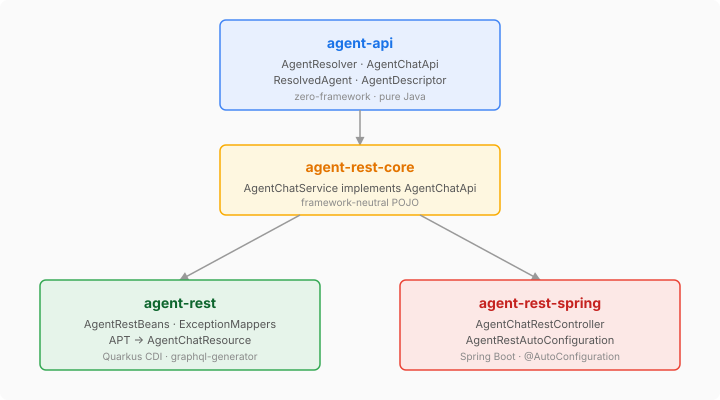

# Giving Agents an HTTP Front Door

Until now, casehub agents were reachable three ways: in-JVM via `AgentProvider.invoke()`, through a terminal-level CLI session, or over an async messaging bus. All useful, but none of them give you a structured HTTP endpoint you can `curl` at a deployed instance and get a JSON response back. That blocks functional testing of deployed agents, external integrations, and any API-first access pattern.

The fix is straightforward — wrap `AgentProvider.invokeBlocking()` in an `@McpDomain` SPI and let the platform's code generators produce the REST, GraphQL, and MCP endpoints. Two operations: `listAgents` and `invoke`.

## Where the design decisions live

The interesting part wasn't the implementation — it was the SPI boundary design.

**AgentResolver belongs in agent-api, not in the REST module.** The temptation was to keep the resolver close to its only consumer (the REST endpoint). But resolution is a general concern: MCP tools, batch processors, and session pipelines all might want to look up an agent by name. Putting it in agent-api follows the same pattern as `ModelRegistry` in platform-api — the resolution SPI lives where the domain's contracts live, not where one particular consumer happens to wire it up.

**Metadata map, not named fields.** The issue proposed `ResolvedAgent(agentId, systemPrompt, slot, domainVocabulary)` — with `slot` and `domainVocabulary` being eidos-specific concepts. Baking those into a platform-level SPI would leak a consumer's domain model into the shared API. The solution is the same pattern `EndpointDescriptor.properties()` and `RegistryEntry.metadata()` already use: an opaque `Map<String, String>` that the platform passes through without interpretation. Eidos puts whatever it needs in there; the platform never parses it.

**listAgents exists because of MCP.** The initial design had only an `invoke` mutation. But every `@McpDomain` in the codebase that wraps a runtime resource exposes a list/discover query — `ModelRegistryApi.listModels`, `DeliveryChannelApi.listChannels`, `TemporalDriverService.list`. Without it, an LLM interacting via the `casehub_action` MCP tool has no way to discover valid agent IDs. The pattern is universal enough that breaking it would be the wrong call.

## The module split

Three new modules, following the established `-core` / Quarkus / Spring pattern:

- **agent-rest-core** — `AgentChatService` implements `AgentChatApi`. Pure Java, no framework. Takes `AgentProvider` and `AgentResolver` via constructor injection. Handles the two invocation modes: explicit (caller provides `systemPrompt` + `userPrompt`) and resolved (caller provides `agentId`, service looks it up via the resolver). Caller-supplied `model` and `timeoutSeconds` override resolved values when present.

- **agent-rest** — Quarkus CDI wiring. The `graphql-generator` APT picks up `@McpDomain("agent-chat")` from agent-api's Jandex index and generates `AgentChatResource` with `GET /api/agent-chat/list-agents` and `POST /api/agent-chat/invoke`. Exception mappers translate `AgentTimeoutException` → 504 and rate limit exceptions → 429 with `Retry-After`.

- **agent-rest-spring** — Hand-written `@RestController` and `@AutoConfiguration`. The `graphql-spring-generator` could have generated this, but for two endpoints the generator wiring is heavier than the code itself.

## NoOp as graceful degradation

`NoOpAgentResolver` returns `Optional.empty()` on resolve and `List.of()` on discover. When no real resolver is on the classpath, `listAgents` returns an empty list and explicit mode (systemPrompt + userPrompt) works fine — the endpoint degrades to a direct `AgentProvider` wrapper. Resolved mode errors with a clear message: "Unknown agent: {agentId}". No silent failures.

## What comes next — and whether this survives it

`invoke` is stateless — request in, response out, connection closed. A REST endpoint is the cheapest possible thing for this. But the platform has richer capabilities with no HTTP surface yet: `AgentProvider.openSession()` for multi-turn conversations, `SessionPoolRegistry` for pre-warmed sticky sessions with cached chat models. Building separate REST modules for each (session endpoints, pool borrow/return, introspection) would mean designing and maintaining N independent API surfaces.

A different approach worth exploring: a mechanical sidecar agent. Not LLM-powered — a runtime component that introspects the CDI container, discovers what's present (`AgentProvider`, `SessionPoolRegistry`, `SessionRegistry`, capacity signals), and auto-exposes structured endpoints for whatever it finds. One classpath dependency activates the whole surface. Text passes through without interpretation; lifecycle operations (open, close, borrow, return, evict) are deterministic. An LLM could sit on top as a consumer of the sidecar's structured API, but the sidecar itself is infrastructure, not intelligence.

If the sidecar is discovery-based, it naturally scales to what's available. With only `AgentProvider` on the classpath, it would expose exactly what `agent-rest` exposes today. With session pools present, pool endpoints appear. No per-capability module needed.

Which raises a question: if the sidecar serves the same invoke endpoint, does the `agent-rest` module still need to exist? The endpoint is a public API — consumers depend on `POST /api/agent-chat/invoke` and don't care which module serves it. Either the sidecar keeps the same path and `agent-rest` is redundant, or deployments that don't want the full sidecar keep `agent-rest` as a standalone module. That's a concrete decision for the sidecar design work (#674), not something to speculate about here.
