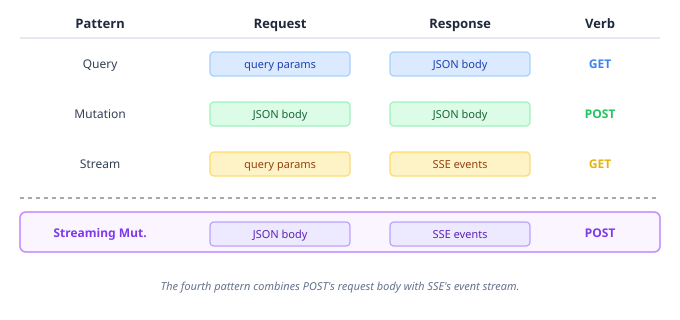
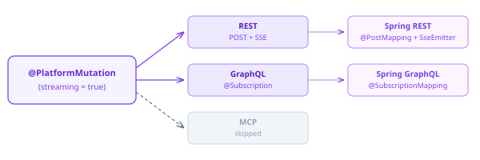

# The Fourth HTTP Pattern

The graphql-generator APT knows three HTTP patterns. Queries map to GET, mutations map to POST, streams map to GET with SSE. Each maps cleanly to a single annotation: `@PlatformQuery`, `@PlatformMutation`, `@PlatformStream`. The generator reads the annotation, picks the HTTP verb, and produces the right JAX-RS scaffolding. Straightforward.

Then agent invocation arrived, and broke the model.

## The problem with streaming agents

An LLM agent invocation needs two things simultaneously: a complex request body (system prompt, model config, MCP server list) and a streaming response (token-by-token text deltas, tool calls, completion events). Neither of the existing patterns fits.



GET can't carry a request body (technically it can, but most infrastructure drops it). `@PlatformStream` over GET works for subscriptions — "watch this resource" — where a UUID or filter string in the query params is enough context. But "invoke this model with this system prompt and this tool configuration and stream the results back" isn't a subscription. It's a mutation that happens to produce its output incrementally.

## One attribute, zero new annotations

The solution was to extend `@PlatformMutation` with a `streaming` boolean:

```java
@PlatformMutation(value = "Invoke an agent (streaming)", streaming = true)
Multi<AgentEvent> invokeStream(AgentSessionConfig config, String agentId);
```

When `streaming = true`, the generator changes three things at once. The REST resource gets `@POST` + `@Produces(SERVER_SENT_EVENTS)` + `@RestStreamElementType(APPLICATION_JSON)`. The GraphQL resolver maps to `@Subscription` instead of `@Mutation`. And the MCP tool registration skips the method entirely — streaming operations don't fit the tool call/response model.

The Spring side mirrors this: `@PostMapping` with `produces = TEXT_EVENT_STREAM_VALUE`, and the reactive `Flow.Publisher` return type bridges to an `SseEmitter` with a virtual-thread subscriber.

## Why this matters beyond agents

Every LLM vendor's API uses this exact pattern. OpenAI's `/chat/completions` with `stream: true` is POST+SSE. Anthropic's Messages API is POST+SSE. Google's Gemini streaming is POST+SSE. It's the industry's answer to "I need to send you a complex request and get a stream back."

The interesting thing is that HTTP/2 makes this pattern unnecessary — multiplexed streams over a single connection can carry bidirectional data without the SSE framing overhead. But the industry standardised on HTTP/1.1 SSE for LLM streaming because it works through every proxy, load balancer, and CDN without configuration. The pragmatic choice won.

Having `@PlatformMutation(streaming = true)` in the generator means any SPI method that returns `Multi<T>` and needs a request body gets the right HTTP surface automatically — not just agent invocations. Webhook-triggered analysis pipelines, document processing streams, real-time search results — anything that fits the "send config, receive events" shape.



The generator now handles four HTTP patterns from two annotation attributes. The taxonomy is complete — queries read state, mutations change state, streams observe state, and streaming mutations change state while reporting progress. Every combination of {request shape} × {response shape} that HTTP supports has a path through the SPI layer.
