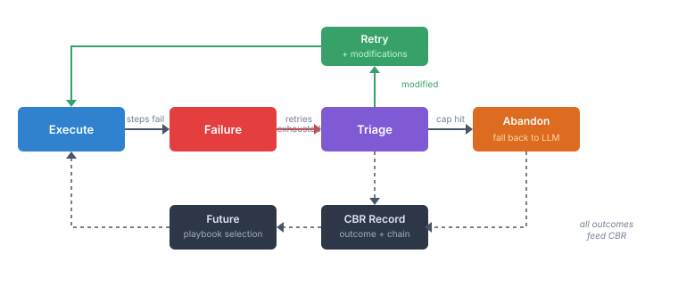
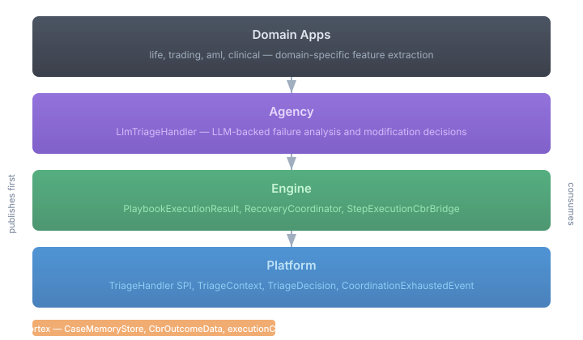

# When Playbooks Fail: CaseHub's Four-Layer Feedback Loop

The worst thing a playbook can do is fail silently. A connector times out, a pre-check returns garbage data, three of five steps succeed but two don't — and the case just sits there. The domain worker receives incomplete context and makes a bad decision, or no decision at all. No feedback loop means the same broken playbook gets selected again next time.

CaseHub's answer is a feedback cycle that spans four repos, each extending its own domain. No repo reaches into another's business. The result is a system where playbooks learn from failure — and where the architecture enforces that separation cleanly enough that each layer can evolve independently.

## The Cycle

A playbook executes. If steps fail, the engine's mechanical retry handles transient problems — network blips, temporary unavailability. When retries exhaust, the interesting part begins.

The engine builds a `TriageContext` — operation ID, failure summary, step-level detail, execution context — and calls `TriageHandler.evaluate()`. The triage handler is a platform SPI. The default implementation returns Abandon for everything. But when the agency module is on the classpath, an `LlmTriageHandler` displaces it via CDI priority — and now an LLM is analysing the failure, deciding whether to retry with modifications (skip a broken step, substitute parameters, reorder) or give up.

If it retries: the modifications flow back through the engine, the playbook re-executes with adjustments. If it abandons: `CoordinationExhaustedEvent` fires, and the case falls back to direct LLM tool calls — the domain worker does it the old way, step by step. No silent failure. Always a fallback.

Every outcome — success, modified retry, abandon — feeds into CBR. Next time a similar playbook runs against similar inputs, the system knows: "last time this failed, and triage fixed it by skipping step 3." Or: "this playbook always fails for this provider — use the alternative."

## The Layers

Each repo extends its own domain. Platform doesn't know about playbooks. Engine doesn't know about LLMs. Agency doesn't know about workflow state machines.

**Platform** provides the governance SPIs — `TriageHandler`, `TriageContext`, `TriageDecision` (a sealed interface: `Retry` with a modifications map, or `Abandon` with a reason). These are the same zero-dependency types that sit alongside `ExecutionPolicy` and `OperationConfirmationProvider`. Platform also provides the fallback signal: `CoordinationExhaustedEvent`. And a `NoOpTriageHandler` as the `@DefaultBean` — so apps without intelligent triage keep working exactly as before.

**Engine** provides the execution infrastructure — `PlaybookExecutionResult` with step-level detail (`StepResult`: step ID, status, elapsed time, error), the `RecoveryCoordinator` that wires retries to triage, and `PlaybookTriageModification` types for applying changes to playbooks before re-execution.

**Agency** provides the intelligence — `LlmTriageHandler` calls an LLM via `AgentProvider.invokeBlocking()`, feeds it the failure context as structured JSON, and parses the response into Retry or Abandon. The LLM doesn't need domain-specific code. It reads the step results, the error messages, the execution context, and makes a judgment call. This is what LLMs are good at.

**Neocortex** provides the memory — `CaseMemoryStore` for storage, `CbrOutcomeData` for structured outcomes, `executionChainId` for linking triage attempts into chains so CBR retrieval can answer: "this playbook needed three attempts last time — prefer a different one."

## Why This Layering Matters

Progressive capability via `@DefaultBean`. An app that depends only on platform gets `NoOpTriageHandler` — failure propagates as it always did. Add agency to the classpath and intelligent triage activates. Add neocortex and outcomes feed CBR for adaptive selection. Each layer is optional. Each adds capability without changing the layers below.

The alternative — a monolithic playbook-failure-handler that knows about LLMs, CBR, workflow state, and domain context — would work for one application. CaseHub has six consumer repos and counting. IoT playbooks that fail because a device went offline need the same triage cycle as AML investigation playbooks that fail because a data source changed its API. The mechanism is universal. The intelligence is pluggable. The memory is shared.

This is the pattern CaseHub keeps reaching for: governance as SPIs, execution as wiring, intelligence as displacing implementations, memory as a shared substrate. The playbook feedback loop is just the latest expression of it.
