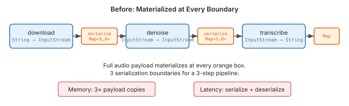
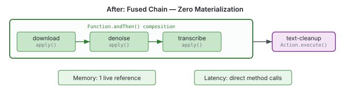
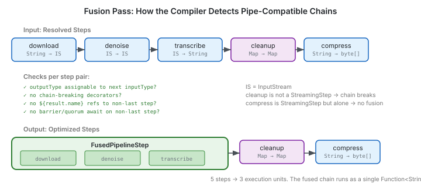

Every step engine has the same problem. Step A runs, produces a result, serializes it. Step B deserializes, runs, produces a result, serializes it. Step C deserializes, runs. Three steps, three full materialization cycles. For orchestration logic — route this case, check that condition, fire a notification — this is fine. The data is small, the overhead is invisible.

But the moment your pipeline handles binary data, the model falls apart.

A WhatsApp voice note arrives. The playbook needs to download the audio, denoise it, run speech-to-text, then clean up the transcript. Four stages, each a natural transform. Under the current model, the full audio payload — potentially megabytes of PCM data — gets serialized into a `Map<String, Object>` after each step, then deserialized at the next. Three unnecessary copies of the entire audio buffer.



The cost isn't just memory. It's latency from serialization, GC pressure from intermediate copies, and the conceptual absurdity of a system designed for orchestration being forced to also be a data shuttle.

## The Insight: Let the Compiler Do It

I wanted the YAML surface to stay exactly the same. Playbook authors shouldn't need to know about streaming internals — they write steps, the engine handles execution. The difference is what happens at compile time.

The playbook compiler already walks the YAML and resolves each step to a concrete action. We added a fusion pass after resolution. It checks consecutive steps for three things: does each implement `StreamingStep<I,O>`? Is the output type of step N assignable to the input type of step N+1? Does anything structurally prevent fusion — a variable reference to an intermediate result, a barrier awaiting a mid-chain step, a decorator that changes execution semantics?

If all checks pass, the compiler collapses the sequence into a single `FusedPipelineStep`. At runtime, instead of three independent execute-serialize-deserialize cycles, the engine composes the steps via `Function.andThen()` — a direct Java method chain. Data flows through `apply()` calls with zero materialization.



The practical difference: for the voice note pipeline, audio bytes flow from download through denoise through transcription as a single piped `InputStream`. No intermediate copies. No serialization. Java-speed function composition.

## Two Kinds of Stream, Same Interface

The design supports two fundamentally different data patterns through the same `StreamingStep<I,O>` interface.

**Byte streams** — continuous binary data where laziness comes from `InputStream`'s read model. Audio processing, document ingestion, image transformation. Each `apply()` wraps the upstream stream:

```java
@Plugin(value = "denoise", streaming = true)
public record DenoisePlugin(@Optional String model) {
    @Execute
    public InputStream apply(InputStream audio) {
        return new DenoisedInputStream(audio, model != null ? model : "gtcrn");
    }
}
```

**Typed transforms** — domain objects processed as a 1:1 pipeline. IoT sensor events, financial transactions, log entries. Each `apply()` takes one typed object and returns another:

```java
@Plugin(value = "anomaly-detect", streaming = true)
public record AnomalyDetectPlugin(@Optional Double threshold) {
    @Execute
    public AnnotatedEvent apply(SensorEvent event) {
        return new AnnotatedEvent(event, event.temperature() > threshold);
    }
}
```

Same compiler, same fusion pass, same `Function.andThen()` composition. The type system handles the distinction — `isAssignableFrom()` checks work identically for `InputStream` chains and domain object chains.

## What the Fusion Pass Actually Checks



The pass isn't just type matching. It has to be conservative — a false positive (incorrectly fusing steps) causes a correctness bug, while a false negative (missing a fusion opportunity) only costs performance.

**Decorator classification** matters. A `timeout: 30s` on a mid-chain step is fusible — the inline wrapper wraps that step's `apply()` call with a deadline. A `background: true` breaks the chain — it spawns async execution, which is incompatible with synchronous function composition. We classified every decorator as fusible or chain-breaking, and the fusion pass checks each step's decorator set before extending a candidate chain.

**Variable references** are trickier. If downstream YAML references `${result.denoise.output}`, the denoise step's result must be recorded individually — it can't be absorbed into a fused chain where only the final step's name survives. The pass scans all downstream steps for `${result.<name>}` patterns and treats referenced steps as fusion boundaries.

**Barrier and quorum references** need the same treatment. A `barrier: { await: [denoise] }` downstream means the denoise step must complete independently — the fusion pass scans `await:` and `of:` lists across the entire step tree.

## Per-Step Decorators at Zero Cost

The design allows decorators on individual steps within a fused chain — but only when they're actually declared. No decorator on a step means no wrapper in the chain. The composed function for a three-step pipeline where only the first step has a timeout looks like:

```
timeout(download.apply).andThen(denoise.apply).andThen(transcribe.apply)
```

Two steps execute as bare `apply()` calls. One has a timeout wrapper. The overhead is exactly where the author asked for it and nowhere else.

## Resource Lifecycle

`InputStream` chains have a resource management concern that typed-object chains don't: if step 2 of 3 throws, who closes the streams?

The chain wrapper tracks the last successfully produced intermediate. On exception, if it implements `AutoCloseable`, the wrapper closes it. Since well-behaved `InputStream` implementations cascade `close()` to their upstream (this is standard Java — `FilterInputStream`, `BufferedInputStream`, and every wrapping stream does this), closing the last intermediate propagates through the entire chain. This isn't a new contract imposed by fusion — it's the existing `InputStream` contract, which the fusion engine relies on rather than reinventing.

## What This Opens Up

The immediate motivation was audio processing for inbound channel connectors. But the architecture is more general than the motivating use case.

Document ingestion pipelines — PDF extraction, OCR, text chunking, embedding generation — are the same shape. So are image processing chains for visual inspection or medical imaging. IoT sensor processing — where millions of events per second flow through filtering, enrichment, and anomaly detection — benefits from eliminating serialization overhead at scale.

The playbook engine was designed for orchestration. It still is. But now it can also host data pipelines without forcing every intermediate result through a serialization boundary that exists for orchestration's benefit, not the data's.
