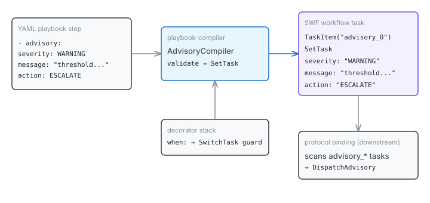

# When Playbooks Talk Back

A playbook that can only execute steps is half a language. It can count events, set state, match patterns, branch on conditions — but it can't tell you what it found. The `advisory` step closes that gap. It's how a protocol playbook communicates its evaluation result: this conversation has gone off-script, and here's how badly.

## What advisory does

Protocol playbooks in CaseHub monitor channel communication patterns. A contribution-required protocol counts consecutive messages from the same sender. A task-completion protocol tracks open commands. When a threshold is breached, the playbook needs to say something — not execute something, but emit a structured signal that the binding layer can collect and route.

That signal is an advisory. Three fields:

| Field | Values | Purpose |
|-------|--------|---------|
| `severity` | INFO, WARNING, CRITICAL | How urgent this is |
| `message` | free text | What happened |
| `action` | LOG, ESCALATE, INVESTIGATE, REROUTE | What the binding should consider doing |

In YAML, it looks like any other step:

```yaml
- advisory:
    severity: WARNING
    message: "sender has sent too many consecutive messages"
    action: LOG
  when: "${consecutiveCount >= config.maxConsecutive}"
```

The `when:` decorator is the interesting part. Advisories aren't unconditional announcements — they fire only when a condition is met. The playbook compiler already handles `when:` as a decorator that wraps any step in a `SwitchTask` guard, so advisory gets conditional emission for free. No special-casing required.

## How compilation works

The playbook compiler maintains a registry of step types — each one knows how to transform its YAML representation into a Serverless Workflow SDK task. Signal compiles to a marker `SetTask`. Delay compiles to a `WaitTask`. Advisory follows the same pattern.



`AdvisoryCompiler` validates that all three fields are present, then stores them as properties in a `SetTaskConfiguration`. The compiled task is named `advisory_N` (where N is the step index), which gives the downstream protocol binding a stable naming convention to scan for.

```java
var setConfig = new SetTaskConfiguration()
        .withAdditionalProperty("severity", String.valueOf(config.get("severity")))
        .withAdditionalProperty("message", String.valueOf(config.get("message")))
        .withAdditionalProperty("action", String.valueOf(config.get("action")));
```

The approach is deliberately minimal. The compiler doesn't know what happens to an advisory after compilation — it doesn't import protocol types, doesn't validate severity values against an enum, doesn't check that the action is meaningful. It stores strings. The binding layer downstream is responsible for interpreting them. This keeps the compiler dependency-free and the coupling one-directional: the binding knows about the compiler's output format, but the compiler knows nothing about the binding.

## Why this matters beyond protocol playbooks

Advisory as a step type makes playbooks a two-way communication channel. Until now, every step type in the compiler was either structural (block, if, forEach, parallel) or side-effecting (signal, delay, rest-request). Advisory is neither — it's declarative output. The playbook declares what it observed without prescribing what to do about it.

This distinction matters because it separates evaluation from action. A protocol playbook evaluates communication patterns; the governance layer decides what to do about the evaluation. The advisory is the contract between them — structured enough to be machine-readable, human enough to carry a meaningful message.

The same pattern would work for any playbook that needs to report findings: compliance checks that flag violations, data quality rules that surface anomalies, SLA monitors that report threshold crossings. The step type is generic; the interpretation is domain-specific.

There's also a subtler point about the compiler's architecture. Fourteen step types existed before advisory, each mapping to a different SWF task type or composition pattern. Advisory maps to `SetTask` — the same no-op marker that `signal` and `log` use. The interesting work isn't in the task type; it's in the naming convention (`advisory_N`) and the property storage. The compiler doesn't need new SWF concepts to express new semantics. It reuses the simplest task type and lets the properties carry the meaning.

That's the kind of extensibility that comes from getting the abstraction level right. The SWF SDK provides the execution skeleton. The compiler provides the naming and structure. The domain binding provides the interpretation. Each layer does exactly one thing.
