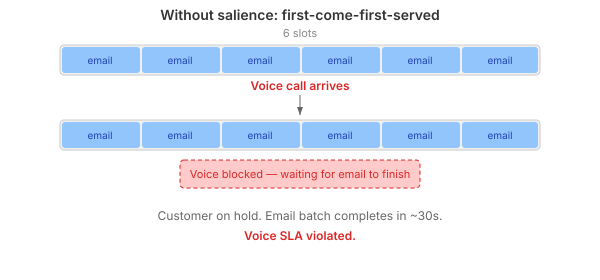
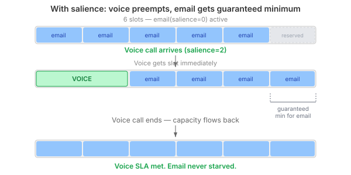
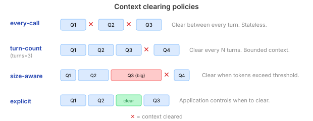

# When agents share a runway

A contact centre runs three channels: voice, chat, email. All three use LLM agents. All three share the same pool of model capacity. Voice calls can't wait. Email can.

That sentence hides the entire design problem. If you treat agent capacity as a flat pool — a semaphore, a connection count, a max-concurrent limit — then whoever gets there first wins. An email batch that happens to arrive before a voice call will consume all the slots, and the customer on the phone hears silence.



This is not a hypothetical. Any multi-channel deployment that runs agents through a shared capacity gate hits this the moment traffic patterns diverge. Voice is bursty and latency-sensitive. Email is batchy and latency-tolerant. Treating them equally is wrong.

## Salience: who yields to whom

The fix is a scheduling concept I'm calling *salience*. Each pool gets an integer priority. Higher-salience pools monopolise capacity while they're active. Lower-salience pools yield. When the high-salience pool goes idle, capacity flows back.

```yaml
pools:
  voice:
    backend: claude
    max-active: 10
    salience: 2
    clearing:
      policy: every-call
  email:
    backend: claude
    max-active: 5
    salience: 0
    clearing:
      policy: size-aware
      threshold: 16000
```

Voice gets salience 2. Email gets 0. When a voice call arrives and capacity is tight, voice gets the slot. Email waits — but email was already waiting anyway (it's asynchronous). The SLA that matters is the voice one.



The important constraint: **every pool gets a guaranteed minimum allocation**. Salience is not starvation. With 6 slots and 2 pools, each pool is guaranteed at least 1. A high-salience pool can take 5 of 6, but not all 6. Without this floor, a busy voice channel could starve email entirely — and email tickets would pile up with no agent processing them at all.

The implementation uses `ReentrantLock` with a `Condition` for fair signalling. No `synchronized` blocks — virtual threads pin on intrinsic locks, and this entire stack runs on virtual threads.

## Clearing: the context window is not infinite

A related problem: when do you clear conversation context? An agent running multi-turn sessions accumulates tokens. Eventually it hits the context window limit, or the cost per query becomes unreasonable because every turn reprocesses the entire history.

Four policies, each serving a different use case:



**every-call** — clear between every query. The agent has no memory of the previous turn. Right for voice calls where each interaction is a separate customer.

**turn-count** — clear after N turns. Bounded context window. Right for chat sessions where recent history matters but you don't need the full transcript from an hour ago.

**size-aware** — clear when estimated token count exceeds a threshold. Adaptive. Right for email where some threads are short and some are long — you don't want to clear a 3-turn thread just because you set `turns: 5`, but you do want to clear before the context window fills.

**explicit** — the playbook controls when to clear via `agent-session-clear`. Right when the application knows the semantic boundary — for example, clearing between two different customer issues handled by the same session.

These policies are declared per pool, not per session. A voice pool always clears every call. An email pool uses size-aware clearing at 16k tokens. The playbook author doesn't think about context management — the pool configuration handles it.

## What this looks like in YAML

The whole point is that a playbook author expresses intent, not plumbing. Five step types cover the full lifecycle:

```yaml
steps:
  - agent-session-open:
      session: analyst
      system: "You are a financial analyst."
      pool: analysts

  - agent-query:
      session: analyst
      user: "What's the risk profile of 60/30/10 equities/bonds/cash?"
      output: risk_assessment

  - agent-session-clear:
      session: analyst

  - agent-query:
      session: analyst
      user: "New topic: summarise these quarterly earnings."
      output: earnings_summary

  - agent-session-close:
      session: analyst
```

Open a session, query it, clear it, query again, close it. The pool handles checkout, admission, clearing policy, and capacity scheduling. The backend — Claude, OpenAI, Ollama, whatever is configured in the manifest — is resolved at runtime.

## Why this matters beyond contact centres

The contact centre is the clearest example because the priority ordering is obvious — voice > chat > email. But the pattern applies anywhere agents share capacity with different latency requirements:

- **Case management** — an urgent triage agent needs capacity ahead of a background summarisation agent
- **Document processing** — an interactive review agent takes priority over a batch classification pipeline
- **Multi-agent workflows** — a coordination agent that's blocking human work gets salience over analysis agents running in the background

The common thread: shared LLM capacity is a scarce resource. Flat scheduling wastes it. Priority-aware scheduling with guaranteed minimums allocates it where it matters without starving anything.

The next step is a simulation harness that exercises these patterns under realistic contention — simulated LLM nodes with latency, capped concurrency, and actual blocking. The scheduling logic exists; proving it works under pressure is the remaining work.
