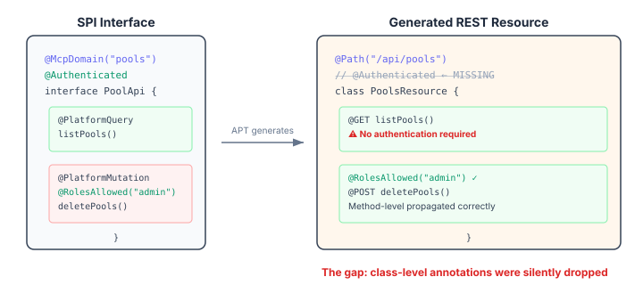
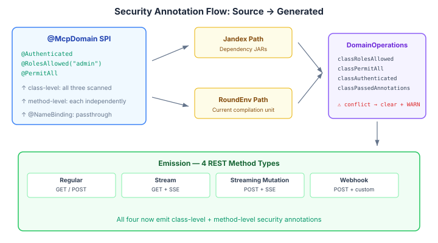

# The Security Annotations Your Generator Silently Drops

Code generators are trust amplifiers. When they work, they eliminate an entire class of drift between your source-of-truth definitions and the code that actually runs. When they have a gap, they amplify that too — silently, across every generated endpoint.

We found one of those gaps in the CaseHub graphql-generator, the annotation processor that turns `@McpDomain` SPI interfaces into JAX-RS REST resources. The generator was faithfully copying method-level `@RolesAllowed` annotations to the generated REST endpoints. But class-level security annotations — the ones that say "every endpoint on this interface requires authentication" — were quietly dropped.



## Why class-level matters

Jakarta Security's annotation model is hierarchical. You put `@RolesAllowed("admin")` on a class, and every method inherits it. You override selectively with `@PermitAll` on the health-check endpoint. This is the standard pattern for securing a JAX-RS resource — one declaration at the top, exceptions where needed.

The generator understood the exceptions but not the rule. Method-level annotations propagated correctly because each `ResolvedOperation` already carried `rolesAllowed` and `permitAll` fields. The class-level annotations had no equivalent storage in `DomainOperations` — the intermediate model between scanning and code emission. They were read, never stored, never written.

The result: a hand-written `PoolResource` with `@Authenticated` at the class level gets replaced by a generated `PoolsResource` with no authentication at all. Every endpoint is now open. The tests that verified the deprecated endpoint's security were deleted alongside it.

This is the specific failure mode that makes code generators dangerous when they're almost-but-not-quite complete. The generated code compiles, the tests pass, the API responds correctly. The security constraint simply isn't there.

## The `@Authenticated` problem

Jakarta Security gives you `@RolesAllowed` and `@PermitAll` — both in `jakarta.annotation.security`, both zero-dependency. Quarkus adds `@Authenticated`, which means "any logged-in user, regardless of role." It lives in `io.quarkus.security`, a Quarkus-specific package.

The generator runs as a Java annotation processor during compilation. It scans SPI interfaces via Jandex (for dependencies) and the RoundEnvironment API (for the current compilation unit). Both paths need to recognise all three annotations.

For `@RolesAllowed` and `@PermitAll`, this is straightforward — they're Jakarta standard annotations, available everywhere. For `@Authenticated`, there's a tension: the SPI interfaces live in `platform-api`, which is zero-dependency. You can't import a Quarkus annotation there.

The fix is to scan by DotName string — `DotName.createSimple("io.quarkus.security.Authenticated")` — without importing the class. The annotation processor runs during Quarkus compilation where the class is on the classpath. SPIs in `platform-api` use `@RolesAllowed` (Jakarta standard); SPIs in Quarkus modules can use `@Authenticated`. The generator handles both.

## Multi-class domains

One wrinkle: a `@McpDomain` can aggregate methods from multiple SPI classes. Two interfaces annotated with `@McpDomain("pools")` contribute methods to the same generated resource. If one has `@Authenticated` and the other has `@RolesAllowed("admin")`, what goes on the generated class?

The answer is nothing. Conflicting class-level annotations across contributing classes produce a WARNING and the generator omits class-level security entirely. Method-level annotations — which are per-operation and unambiguous — still propagate correctly.

This is a safe default. The alternative — picking one class's annotations over the other — creates a security decision the generator has no basis to make. Better to be explicit about the conflict and force method-level declarations.

## What this actually looks like

The scanning happens in two parallel paths — Jandex for dependency JARs, RoundEnvironment for the current compilation unit. Both feed into `DomainOperations`, which now carries four new fields for class-level security state. The emission stage reads those fields and writes them onto the generated class declaration.



The generated REST resource now looks like what you'd write by hand:

```java
@Path("/api/pools")
@Produces(MediaType.APPLICATION_JSON)
@ApplicationScoped
@io.quarkus.security.Authenticated          // ← from SPI class
public class PoolsResource {

    @RolesAllowed("admin")                   // ← from SPI method
    @POST
    @Path("/delete-pools")
    public Response deletePools(...) { ... }

    @PermitAll                               // ← method override
    @GET
    @Path("/health")
    public Response health() { ... }
}
```

## The broader point

Code generators earn their keep by eliminating classes of bugs — if the SPI is right, every generated endpoint is right. But they only deliver on that promise when they're complete. A generator that handles 90% of the source annotations creates a false sense of security for the other 10%. The developer looks at the SPI, sees `@Authenticated`, and assumes the generated code has it. It doesn't.

The fix here was mechanical — four fields on an intermediate model, some scanning logic in two paths, emission in four method types. The interesting part isn't the code. It's that the gap existed for months, across dozens of generated endpoints, and was only caught when a deprecated hand-written resource was deleted and its security test went with it.

If you're building code generators, audit the full annotation surface of your source types. Not just the ones you intended to propagate — all of them. The ones you forgot are the ones that bite.
