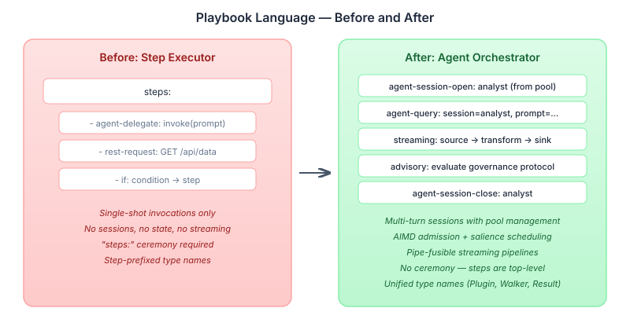

# Playbooks Learn to Orchestrate

A month ago, the playbook language could do one thing with an agent: fire a prompt and get a response back. `agent-delegate` — single-shot, stateless, no memory of what happened three steps ago. The Java API had sessions, pools, admission strategies, and salience-based scheduling. None of it was reachable from YAML.

That's fixed now. The language grew in three directions at once — agent interaction, data streaming, and governance — and each one changed what a playbook can express.

## Sessions and pools

The core addition is six agent step types that expose the full session lifecycle:

```yaml
agent-session-open:
  name: analyst
  pool: research-pool
  model: tier:FLAGSHIP

agent-query:
  session: analyst
  prompt: "Summarise the findings so far"

agent-session-clear:
  session: analyst

agent-session-close:
  session: analyst
```

`agent-invoke` replaces the old `agent-delegate` — same single-shot semantics, but optionally pool-backed. The session types (`open`, `query`, `clear`, `close`) are new. A session maintains context across multiple queries: the agent remembers what it was told, accumulates state, and can be cleared or closed when the conversation is done.

Pools manage the lifecycle. A pool declaration specifies the clearing policy, idle eviction, prompt size limits, and how many concurrent sessions to allow. Pools can be declared in `agent-config.yaml` at the manifest level or inline in the playbook itself — whichever makes sense for the deployment.



### AIMD admission and salience

Two mechanisms control how work flows through pools.

**AIMD admission** (Additive Increase, Multiplicative Decrease) manages concurrency adaptively. The pool starts with a small number of permits and grows linearly when requests succeed. When a request fails or times out, permits drop by half — the same algorithm TCP uses for congestion control. The result: the pool learns the backend's capacity without configuration. If the LLM provider starts rate-limiting, the pool backs off automatically.

**Salience-based scheduling** handles priority. A higher-salience task monopolises the pool until it goes idle; equal-salience tasks round-robin. This matters for interactive versus background work — a user-facing query shouldn't wait behind a batch analysis job, and the YAML can express that directly:

```yaml
agent-invoke:
  pool: shared-pool
  salience: 10
  prompt: "User is waiting for this answer"
```

## Streaming pipelines

The streaming step type brings data pipelines into playbooks. A `streaming` step declares a source, zero or more transforms, and a sink. The engine fuses adjacent steps into a single pipeline — no intermediate buffering, no copying.

```yaml
streaming:
  source: http-get /api/events
  transform:
    - filter: "$.severity == 'HIGH'"
    - map: "{ alert: $.message, time: $.timestamp }"
  sink: agent-invoke summarise-alerts
```

The compiler produces a `FusedPipelineStep` — a sealed variant in the step hierarchy. The fusion pass runs during Walker resolution, so it's transparent to the rest of the engine. Resource cleanup is guaranteed: if any stage fails, upstream sources and downstream sinks are closed in the correct order. We built integration tests that verify this with byte streams, typed transforms, and mixed pipelines.

The `@Plugin(streaming = true)` annotation and `Definition` streaming support mean custom plugins can participate in pipelines. A plugin that produces a stream of records can be fused with a downstream transform without the playbook author knowing or caring about the plumbing.

## The protocol evaluation arc

This one's worth telling because the outcome was deletion, not addition.

We built a `PlaybookProtocolEvaluator` — a bridge that compiled YAML state machines into `OrcStateMachine` plus `EventRouter` pairs, creating a runtime for channel governance protocols. The idea was that a YAML playbook could declare protocol states (e.g., "when a message arrives on the compliance channel, evaluate these rules") and the protocol evaluator would run them as a specialised subsystem.

It worked. Then we realised it shouldn't exist. The standard playbook executor already handles state machines, event routing, and conditional evaluation. The protocol evaluator was reimplementing capabilities the engine already had, with a slightly different entry point. Every bug fix in the main executor would need to be duplicated. Every new feature would need two implementations.

So we removed it. Protocol evaluation now uses the standard playbook executor — a protocol is just a playbook with a different trigger. The `advisory` step type was registered so that governance evaluation can be invoked as a normal step within any playbook, rather than requiring a separate subsystem.

The lesson is familiar but still worth restating: when a specialised component reimplements general infrastructure, delete the specialisation.

## Cleaning up the language surface

Two changes simplified the language itself, independent of new capabilities.

**The `steps:` ceremony is gone.** Playbook files used to require a `steps:` key wrapping the actual step declarations. That wrapper carried no information — every playbook had one, it always contained the same thing, and it added a level of nesting that made files harder to read. Steps are now top-level in the playbook document.

**Type names dropped the "Step" prefix.** `StepWalker` became `Walker`. `StepResult` became `Result`. `StepPlugin` became `Plugin`. `YamlStepDefinitionSource` became `YamlDefinitionSource`. These names were legacy from when the engine was literally a step executor — now that playbooks handle sessions, streams, and protocols, the step-specific naming was misleading. The unification also fixed a real bug: `Walker.RESERVED_KEYS` and `StepSchemaComposer.DECORATOR_KEYS` were maintained separately and had diverged, causing decorators like `when`, `timeout`, and `retry` to be silently dropped in some code paths.

## 3-document YAML

A smaller but practically important change: the Java-side parser now supports YAML's multi-document format — three `---`-separated sections in one file. This enables playbooks that separate metadata, configuration, and steps into distinct document sections. The parser handles this transparently; existing single-document playbooks continue to work unchanged.

## What this adds up to

The playbook language started as an imperative step executor — do this, then this, then this. It's now an agent orchestration language. A single YAML file can open a pool of agent sessions, route work through them with adaptive admission control, pipe data through a streaming transform pipeline, evaluate governance protocols as advisory steps, and close sessions when the work is done.

The Java API was always capable of this. What changed is that YAML can express it without dropping down to code. For deployments where configuration is YAML-driven — where ops teams manage playbooks without touching Java — that's the difference between "possible if you write a custom provider" and "add six lines to the YAML."
