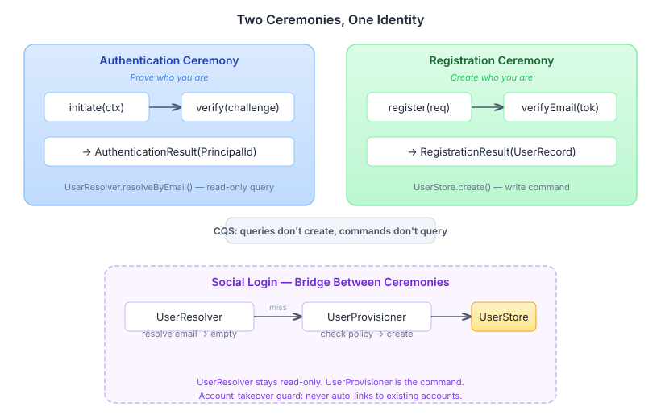
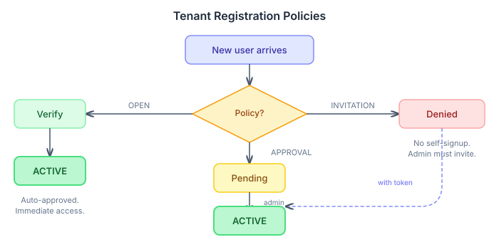

# Registration as Infrastructure

When we built the authentication subsystem, we made a deliberate choice: users must exist before they can authenticate. Decision D11 in the identity authentication spec said it plainly — "platform is infrastructure, not a user registration system." Pre-existing SCIM identity was the contract. You show up in the directory, or you don't get in.

That worked for enterprise deployments where an admin provisions users in an external directory. It doesn't work for anything else. No self-signup means no organic growth, no consumer apps, no "Sign in with Google" for first-time users. The gap was obvious — we just deferred it until the authentication foundation was solid.

Now the foundation is solid, and the gap needs closing.

## The contract that didn't hold

The social login code revealed the real problem. When a user logged in via Google without a SCIM identity, `AbstractOAuthAuthenticationProvider.resolveOrCreateActorId()` did this:

```java
private String resolveOrCreateActorId(OAuthIdentity identity, String tenancyId) {
    if (identity.email() != null) {
        var resolved = userResolver.resolveByEmail(identity.email(), tenancyId);
        if (resolved.isPresent()) {
            return resolved.get().id();
        }
    }
    return identity.externalId(); // silent fallback
}
```

That final `return identity.externalId()` is the bug. No user record gets created. No groups. No lifecycle status. No admin visibility. The user authenticates successfully — with a raw Google subject ID as their actor ID — and the system has no idea who they are. An identity binding exists, but it points to nothing.

The `NoOpUserResolver` (the default implementation) always returns empty, so every social login in a non-SCIM deployment hit this path. Quietly. No exception, no log, nothing.

## Two ceremonies, not one

The first instinct is to make `UserResolver` smarter — if it can't find a user, create one. I designed exactly that: a `UserStoreUserResolver` that creates on miss.

Claude caught the problem in the decision review. `UserResolver.resolveByEmail()` is a query. It has no documented side effects. Every caller assumes it's safe to call for checking whether a user exists — duplicate detection, pre-flight checks, audit queries. Turning a query into a command violates Command-Query Separation, and it violates it in the most dangerous way: silently. The method signature doesn't change. The caller doesn't know they just created a user.

The right answer is two separate SPIs, because authentication and registration are two separate ceremonies:



Authentication proves who you are. Registration creates who you are. They happen to share a surface in social login (you click "Sign in with Google" and the system doesn't know yet whether you're authenticating or registering), but the operations underneath are fundamentally different. A query for one, a command for the other.

`UserResolver` stays read-only. A new `UserProvisioner` SPI handles the command:

```java
public interface UserProvisioner {
    Optional<PrincipalId> provisionFromSocialLogin(
        String email, String tenancyId, String provider, boolean emailVerified);
}
```

The modified `resolveOrCreateActorId()` tries the resolver first, then the provisioner:

```java
var resolved = userResolver.resolveByEmail(identity.email(), tenancyId);
if (resolved.isPresent()) return resolved.get().id();

var provisioned = userProvisioner.provisionFromSocialLogin(
    identity.email(), tenancyId, method(), identity.emailVerified());
if (provisioned.isPresent()) return provisioned.get().id();

throw new UnknownIdentityException(method(), "...");
```

That `throw` at the end is important — the old silent fallback to `externalId` is gone. If neither resolver nor provisioner produces a result, authentication fails explicitly. Fail-fast, not fail-quiet.

## The account takeover you don't see coming

Here's a scenario that's easy to miss. Alice registers with email and password. An attacker creates a Google account using alice@example.com (Google will verify it — they just need access to the email temporarily). Attacker clicks "Sign in with Google." Google's `email_verified` is true. The provisioner looks up alice@example.com, finds Alice's existing account, and... links the Google identity to it?

No. `UserStoreProvisioner` never auto-links a new social login to an existing account. If `UserStore.findByEmail()` returns a user, provisioning returns empty. The attacker gets `UnknownIdentityException`. Alice's account stays hers.

To link a social identity to an existing account, the user must already be authenticated and explicitly request the link from account settings. Proof of account ownership first, linking second. The auto-link shortcut is the attack vector — removing it is the fix.

## Three policies, one preference key

Different tenants have different trust models. An internal tool for a 50-person company wants auto-approve. A healthcare platform needs admin sign-off on every registration. A closed beta wants invitation-only access.



One preference key — `casehub.registration.mode` — controls this per tenant. Three values: `OPEN`, `APPROVAL_REQUIRED`, `INVITATION_ONLY`. The default is `OPEN`.

The invitation path is worth explaining because it bypasses the approval gate. An admin creates an invitation bound to a specific email with pre-assigned groups. The token is cryptographically random, SHA-256 hashed before storage (raw token returned only at creation time). When the invited user registers — via social login or email/password — the invitation is consumed and the user is immediately activated with the assigned groups. The admin already approved them by creating the invitation.

## Why Argon2id, not bcrypt

The original design used bcrypt. The decision review flagged it: OWASP's primary recommendation for new password storage systems is Argon2id, not bcrypt. bcrypt is the second choice — the legacy-compatible fallback for systems that already use it.

The difference matters. bcrypt is CPU-hard only. Argon2id is memory-hard — it requires a configurable amount of RAM per hash operation, which makes GPU and ASIC attacks dramatically more expensive. bcrypt also silently truncates passwords beyond 72 bytes. In a greenfield system, there's no reason to start with the second-best option.

The dependency concern turned out to be unfounded. I'd assumed Argon2 meant Bouncy Castle (a large, complex library). It doesn't. `argon2-jvm` from de.mkammerer is Apache 2.0 licensed, wraps libsodium, and is about 50KB. Spring Security has shipped Argon2 support via this library since 5.3.

Parameters: 64 MiB memory, 3 iterations, parallelism 1. These are OWASP's recommended minimums for interactive logins. Configurable per deployment via `casehub.registration.argon2.*` properties.

## The module boundary decision

All the new SPIs — `UserStore`, `PasswordCredentialStore`, `InvitationStore`, `RegistrationService`, `UserProvisioner`, `EmailSender` — need a home. The instinct is `platform-api`, where the other SPIs live. But `platform-api` has a rule: a type belongs there only if multiple peer repos need it.

Registration is consumed by the registration modules themselves and by `authn-social-core` (which needs `UserProvisioner`). That's one consumer, not multiple. The `agent-api` module set the precedent — `AgentProvider` lives in `agent-api`, not `platform-api`, precisely because it doesn't meet the multi-repo threshold.

So: `registration-api`. Zero-dependency, pure Java, follows the same pattern. The only new types in `platform-api` are the cross-cutting ones: `RegistrationEventListener` (because `registration-core` needs to fire events without CDI), `AccountNotActiveException` (because the authn exception hierarchy lives there), and `UserStatusResolver` (because the JWT issuer needs to check status during token refresh).

The total is 10 new modules following the established `-core` / Quarkus / Spring / `-inmem` / `-jpa` pattern. That sounds like a lot. In practice, most of them are thin — the in-memory stores are ConcurrentHashMap wrappers, the Quarkus and Spring modules are CDI/auto-config wiring, the JPA modules are entities and Hibernate. The real logic lives in `registration-core`: the ceremony flows, the provisioner, the password hasher, the email verification.

This is what "registration as infrastructure" means. Not a feature bolted onto a specific application, but a composable set of SPIs that any casehub deployment can pick up by classpath presence. SCIM-managed deployments ignore it entirely — SCIM stays read-only, `NoOpUserProvisioner` returns empty, the authn flow works exactly as before. Self-managed deployments add the registration modules, and users can create their own identities.

The design explicitly revises epic #525's Decision D11. "Platform is not a user registration system" was the right call when the priority was authentication for known users. Now that authentication is solid, the platform can be a registration system too — when the deployer asks for it.
