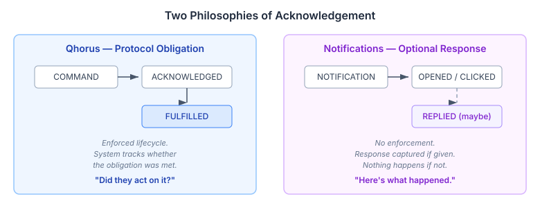
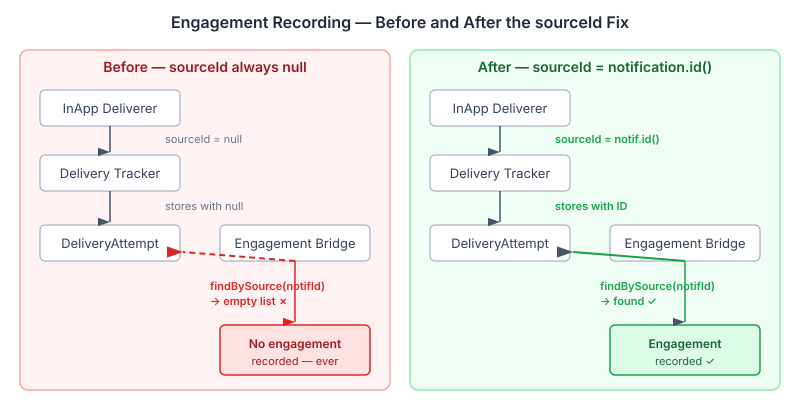

# The Engagement Bridge That Never Crossed

CaseHub has two communication systems with fundamentally different philosophies. Qhorus is structured messaging between agents — commands create obligations, acknowledgements are tracked, commitments have lifecycles. Platform notifications are laissez-faire: "here's something that happened." The recipient reads it, dismisses it, maybe responds. No obligation, no protocol.



The engagement tracking system sits on the notification side. It records what users do with delivered notifications — opened, clicked, dismissed, replied, converted. The vocabulary was declared months ago. Three of the five values were never wired.

I went in to fix that and found something worse: the two that were supposedly wired had never worked either.

## The Silent Null

The engagement bridge pattern is straightforward. When a user marks a notification as read, the `NotificationStore` fires a `NotificationStatusChanged` CDI event. `InAppEngagementBridge` observes it, looks up the corresponding delivery attempt, and records an OPENED engagement event via `EngagementRecorder`.

The bridge finds the delivery attempt by calling `store.findBySource(notification.id(), NOTIFICATION, tenancyId)` — a query that matches on the `sourceId` field of the delivery attempt. Simple enough.

Except every delivery attempt in the system had `sourceId = null`.

`NotificationDispatcher` creates notifications and tracks their delivery. It passes `null` as the sourceId to `DeliveryTracker.recordSuccess()`. The `InAppNotificationDeliverer` stores the notification and returns a `DeliveryResult` — but at the time it was designed, `DeliveryResult` only carried a boolean success flag and a failure reason. No way to communicate the stored notification's ID back to the dispatcher.

The bridge queries for attempts matching a notification ID. The attempts have no notification ID. The query returns nothing. The bridge logs a debug message and moves on. No engagement recorded. No error. No warning.



The tests passed because they pre-populated delivery attempts with correct sourceIds. They tested the bridge in isolation, never through the actual dispatch path. The bug was invisible to every layer of testing.

## The Fix

`DeliveryResult` gained a third field — `sourceId` — with a backward-compatible two-argument constructor so existing callers don't break. `InAppNotificationDeliverer.deliver()` now captures the stored notification's ID and returns it in the result. The dispatcher captures the sourceId from each delivery result and passes it to the tracker.

```java
public record DeliveryResult(
        boolean success,
        String failureReason,
        String sourceId
) {
    public DeliveryResult(boolean success, String failureReason) {
        this(success, failureReason, null);
    }
}
```

One new field. One constructor change. One line in the deliverer. The entire engagement tracking system — OPENED, DISMISSED, CLICKED, REPLIED — goes from non-functional to working.

## Wiring What Was Declared

With the bridge actually connected, I could wire the three values that had been sitting in the enum since the original implementation.

**CLICKED** and **REPLIED** follow the same pattern as OPENED and DISMISSED. `NotificationApi` gains `trackClick(id)` and `reply(id, ReplyRequest)`. `NotificationService` validates ownership, fires a CDI event via `fireAsync()`, and `InAppEngagementBridge` observes it and records the engagement. The existing `EngagementRecorder.record(attempt, type, metadata)` handles all five types unchanged — the plumbing was always there.

**CONVERTED** stays domain-level. The platform can't know what "conversion" means for a specific business domain. Domains call the existing `recordDirect()` REST endpoint when a notification-triggered action reaches its business goal.

## ReplyHint — Optional Response Without Protocol

The interesting design question wasn't CLICKED or CONVERTED — it was REPLIED. The messaging-vs-notifications doc already had this line: "When wired, REPLIED will carry a metadata value — enabling optional response capture without protocol obligation."

The distinction matters. Qhorus tracks "did they act on it?" with enforced lifecycle — a COMMAND creates an obligation that the system follows to resolution. A notification reply captures "they responded with this value." If they don't respond, nothing happens. No escalation, no timeout, no state machine.

A notification might not even accept replies. Most don't. The `ReplyHint` is nullable on every notification — when absent, the UI renders no response widget and the API rejects reply attempts. When present, it tells the UI what to render:

```java
public record ReplyHint(ReplyType type, List<String> options) { ... }

public enum ReplyType {
    ACKNOWLEDGE,   // confirm receipt — no value
    FREE_TEXT,     // open string response
    OPTIONS        // pick from provided list
}
```

The resolution strategy is pluggable. `ReplyHintResolver` is an SPI with a `@DefaultBean` passthrough — domains override to derive hints from notification category, source, or template. Most deployments never touch it. The ones that need "approve/reject" buttons on escalation notifications configure a resolver that adds `ReplyHint.options(List.of("approve", "reject"))` for the right categories.

## What Fell Out of the Review

An adversarial code review after the initial implementation caught the sourceId bug. The review traced every path from API call to engagement event storage and found the `null` gap. The tests had been passing because they tested components in isolation — each component did the right thing with the data it was given, but the data flowing between them was wrong.

The fix included an integration test that does what the original tests should have done: dispatches a notification through the full pipeline, then verifies the bridge can find the delivery attempt and record engagement against it. That test would have caught this on day one.

The engagement vocabulary — five enum values — had been in the codebase for months. The infrastructure to record, store, and query engagement events was complete. The bridge pattern was correct. The SPI callback path for external channels worked. The direct recording endpoint worked. The only thing that didn't work was the automated path through the notification pipeline. The one path most users would rely on.

A record with a null field, a query that matched nothing, a debug log nobody reads. The system was architecturally sound and operationally broken.
