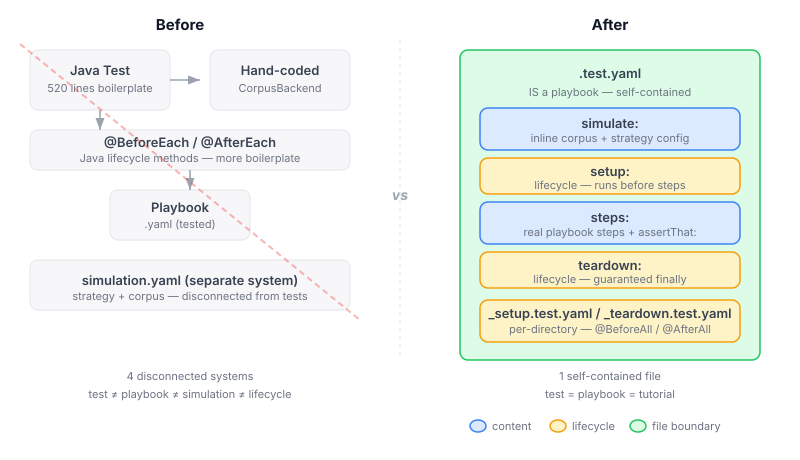

# Your Test File Is a Playbook. That's the Point.

The standard way to test a YAML playbook is to write a Java test that constructs a simulated environment by hand, wires up mock backends, runs the playbook through some executor, and then asserts on the results. For CaseHub, that meant `AgentExampleExecutionTest` — 520 lines of Java to test a 5-step playbook. Most of those lines are boilerplate: building corpus backends with if-contains patterns, constructing session pipelines, manually managing handler lists. The actual test logic — "did the agent respond with something about equities?" — drowns in setup.

The fix isn't better test utilities. The fix is eliminating the test/playbook distinction entirely.

## A .test.yaml File IS a Playbook

The core insight is embarrassingly simple once you see it. A test does three things: set up an environment, run some steps, check the results. A playbook does the middle part already. So a test file should be a playbook that also declares its simulation context and includes assertion steps.

```yaml
name: Session preserves conversation context

simulate:
  agent:
    - prompt: "risk profile"
      response: "Moderate risk: 60% equities."
    - prompt: "rebalancing"
      response: "Shift 10% equities to bonds."

steps:
  - agent-session-open:
      pool: financial-advisor
    capture: session
  - agent-session-query:
      session: ${session}
      prompt: "What's my risk profile?"
    capture: risk
  - assertThat: ${risk}
    contains: 'equities'
  - agent-session-close:
      session: ${session}
```

That's 20 lines. It replaces roughly 80 lines of Java. And a developer reading it understands both what the playbook does and what correct behaviour looks like — something the Java test never communicated unless you already knew the codebase.

## The simulate: Block Reuses What Already Exists

The simulation infrastructure — `SimulationRuntime`, overlay stack, strategies like key-lookup and nearest-match, `YamlSimulationConfig` parsing — all of it already works. The simulate block is a YAML surface for the existing `pushOverlay` / `popOverlay` API. The test runner parses the block, resolves aliases (`agent` → `agent-provider.invoke`), normalises field names (`prompt`/`response` → `key`/`output`), builds an overlay, pushes it before step execution, pops it after. No new simulation infrastructure needed.



The `agent` alias is the first shorthand — it resolves to `agent-provider.invoke` with `strategy: key` and `key-extractor: "field:user-prompt"` as defaults. The full simulation.yaml syntax is available when you need nearest-match scoring or custom extractors. But the common case — "when the agent hears X, respond with Y" — is two lines.

## assertThat: Subject-First Behavioural Assertions

The early prototype used expression-based assertions: `assert: ${response} contains 'equities'`. That's the old JUnit `assertTrue` pattern — a boolean expression that passes or fails. The error message can only say "expression was false."

`assertThat` is the subject-first alternative. The subject is the scalar value; matchers are sibling YAML keys:

```yaml
- assertThat: ${response}
  contains: 'equities'
  startsWith: 'Moderate'
```

When this fails, the framework knows the subject and the expectation separately, so it reports both:

```
Subject: ${response}
Actual: "The portfolio is balanced."
Failed:
  contains: 'equities' — actual value does not contain 'equities'
  startsWith: 'Moderate' — actual value starts with 'The'
```

Multiple matchers on the same subject all evaluate — you see every failure, not just the first. Twelve built-in matchers cover the common cases: `contains`, `equals`, `matches`, `hasSize`, `startsWith`, `endsWith`, `greaterThan`, `greaterThanOrEqual`, `lessThan`, `not-null`, `not-empty`, `empty`.

`assert` stays for simple boolean checks where a subject + matcher would be ceremony: `assert: ${results.succeeded}`. Two step names, two purposes.

## Tests as Tutorials

This is where the format pays off beyond test coverage. A `.test.yaml` file that reads well enough to teach someone how the system works validates two things at once: that the behaviour is correct, and that the explanation is accurate.

Convention-based ordering makes this concrete:

```
tutorials/
  01-basics/
    01-invoke.test.yaml
    02-capture.test.yaml
  02-sessions/
    01-context.test.yaml
  03-events/
    01-emit.test.yaml
```

Each file is self-contained. A developer opens `01-invoke.test.yaml` and sees: here's how to call an agent, here's what the response looks like, here's what correct means. The simulation data is right there — no hunting for corpus files or test fixtures. The JUnit Platform TestEngine discovers these files natively, so IntelliJ shows green/red per tutorial, and `mvn test` runs them alongside Java tests with no extra configuration.

The goal is helpdesk as the first 100% YAML application with 100% YAML tests. Every Java assertion gets a YAML equivalent. The tutorials become the onboarding documentation. If a tutorial test fails, either the application is broken or the tutorial is wrong — both worth knowing.

## Multiple Tests Per File

A single-test file is clean for tutorials. But for related tests — the kind of thing that would be methods in one JUnit class — a `tests:` list keeps them together:

```yaml
name: Agent session basics

simulate:
  agent:
    - prompt: "risk"
      response: "moderate risk"

tests:
  - name: Open and close cleanly
    steps:
      - agent-session-open:
          pool: financial-advisor
        capture: session
      - agent-session-close:
          session: ${session}

  - name: Query preserves context
    steps:
      - agent-session-open:
          pool: financial-advisor
        capture: session
      - agent-session-query:
          session: ${session}
          prompt: "risk"
        capture: result
      - assertThat: ${result}
        contains: 'moderate'
```

Each test entry produces its own result with the same metadata: name, status, duration, failures, simulation context. IntelliJ shows multi-test files as expandable containers with green/red per entry. `steps:` and `tests:` are mutually exclusive — a file has one or the other.

## Three Lifecycle Scopes

JUnit has `@BeforeEach`/`@AfterEach` (per test) and `@BeforeAll`/`@AfterAll` (per class). JUnit 5's `@Suite` doesn't have native before/after hooks at the suite level. YAML tests cover all three — and add hierarchical directory nesting that JUnit doesn't have.

**Per-test:** `setup:`/`teardown:` inside each `tests:` entry. Runs before/after that specific test.

**Per-file:** File-level `setup:`/`teardown:` (top-level keys). Runs once per file, wrapping all tests. Variables captured in file-level setup are visible to all tests.

**Per-directory:** `_setup.test.yaml`/`_teardown.test.yaml` convention files. Runs once per directory. Nests hierarchically — parent `_setup` runs before child `_setup`.

```yaml
name: Agent sessions

setup:                              # per-file — once before all tests
  - emit-event: test.init-pool

tests:
  - name: Open and close
    setup:                          # per-test — before THIS test
      - emit-event: test.seed-session
    steps:
      - agent-session-open:
          pool: financial-advisor
        capture: session
      - agent-session-close:
          session: ${session}
    teardown:                       # per-test — after THIS test (finally)
      - emit-event: test.clear-session

  - name: Query context
    steps:
      - agent-session-open:
          pool: financial-advisor
        capture: session
      - agent-session-query:
          session: ${session}
          prompt: "risk"
        capture: result
      - assertThat: ${result}
        contains: 'moderate'

teardown:                           # per-file — once after all tests (finally)
  - emit-event: test.destroy-pool
```

Teardown blocks at every scope run in finally — guaranteed even on failure. Variables from steps are NOT visible in teardown to avoid depending on potentially failed state.

```
tutorials/
  _setup.test.yaml              # suite setup — before everything
  01-basics/
    _setup.test.yaml            # level setup — before this directory
    01-invoke.test.yaml
    02-session-tests.test.yaml  # multi-test file
    _teardown.test.yaml         # level teardown
  _teardown.test.yaml           # suite teardown — after everything
```

The full JUnit lifecycle model — and then some — expressed in YAML, with no Java.

## Coordination as Test Orchestration

This is where the "test IS a playbook" model earns its real payoff. Testing concurrent systems in Java means fighting the test framework: `CountDownLatch`, `CompletableFuture.allOf`, manual timeout threads, fragile synchronisation. The test code ends up harder to understand than the production code. And it only tests the aggregate outcome — "did everything finish?" — not the coordination behaviour itself.

Playbooks already have high-level coordination primitives: `race:`, `barrier:`, `quorum:`, `select:`, `parallel:` with advance-after policies, `timeout:` decorators. These aren't just execution utilities — they express coordination semantics. Because tests are playbooks, these become the test's orchestration language. The test doesn't just run concurrent things and check results; it describes the coordination scenario it's verifying.

**Race:** Test that a circuit breaker activates before a slow backend responds. The `race:` primitive means "first to complete wins, others are cancelled." The test verifies which branch won — the coordination outcome, not just the final value.

```yaml
name: Circuit breaker beats slow backend

steps:
  - race:
      - block backend:
          - delay: 3s
          - agent-invoke:
              prompt: "slow query"
            capture: response
      - block breaker:
          - delay: 1s
          - emit-event: circuit.open
            data: { reason: "timeout-threshold" }
    capture: winner
  - assertThat: ${winner}
    equals: 'breaker'
  - assertThat: ${events.last('circuit.open')}
    not-null: true
```

**Barrier:** Test that a consumer waits for a producer before processing. The `barrier:` primitive is a named synchronisation point — the test verifies that the handoff happens correctly, not just that both sides eventually finish.

```yaml
name: Consumer waits for producer handoff

steps:
  - parallel:
      - block producer:
          - delay: 500ms
          - emit-event: data.batch-ready
            data: { batchId: 1, records: 500 }
      - block consumer:
          - barrier:
              await: [producer]
              timeout: 3s
          - assertThat: ${events.last('data.batch-ready').data.records}
            equals: 500
```

The `barrier:` here is the assertion mechanism. If the producer never completes, the barrier times out and the test fails with "barrier timed out waiting for [producer]" — a meaningful coordination failure, not a generic timeout.

**Quorum:** Test that a consensus protocol reaches agreement. `advance-after: 2` means "2 of 3 must agree before we proceed." The remaining branch gets cancelled. The test verifies the consensus semantics, not just that two things happened to finish.

```yaml
name: Quorum consensus within deadline

simulate:
  agent:
    strategy: sequential
    corpus:
      - key: "classify"
        output: "high-risk"
      - key: "classify"
        output: "high-risk"
      - key: "classify"
        output: "low-risk"

steps:
  - parallel:
      advance-after: 2
      cancel-remaining: true
      steps:
        - agent-invoke:
            prompt: "classify"
          capture: vote1
        - agent-invoke:
            prompt: "classify"
          capture: vote2
        - agent-invoke:
            prompt: "classify"
          capture: vote3
    timeout: 5s
  - assertThat: ${vote1.text}
    equals: 'high-risk'
  - assertThat: ${vote2.text}
    equals: 'high-risk'
```

**Select:** Test that the system responds to the correct event out of multiple possibilities. `select:` waits for one of several event sources — the test verifies which branch activates.

```yaml
name: Priority escalation triggers before standard routing

steps:
  - select:
      - subscribe: priority-channel
        - assertThat: ${events.last('priority.escalation')}
          not-null: true
      - subscribe: standard-channel
        - assert: false
          message: "Standard channel should not have activated"
```

The common thread: every coordination pattern — fan-out/fan-in, race conditions, deadline enforcement, synchronisation barriers, consensus, event selection — is already a playbook primitive with well-defined semantics. The test expresses the coordination scenario declaratively, and the assertion is on the coordination outcome, not just the aggregate result. When a test fails, it fails with coordination-level detail: "barrier timed out waiting for [producer]", "race won by [breaker] not [backend]", "quorum not reached — only 1 of 2 required."

No latches, no futures, no thread pools. The coordination language IS the test language.

## What Collapses Along the Way

The temporal simulation driver — `TemporalSimulationDriver`, `TimedSequence`, `EventSequenceRunner` — reimplements what the playbook executor already does. A temporal sequence is "fire event A, wait, fire event B." A playbook with `delay:` and `emit-event:` steps does the same thing, but gets retry decorators, error handling, and observability for free. The protocol evaluator was deleted for the same reason — it reimplemented engine capabilities.

The corpus/strategy layer stays. `SimulationRuntime`, `SimulationStrategy`, `YamlSimulationConfig` — these are data and algorithms, not orchestration. They feed the simulate block. Only the temporal driving layer collapses, because it was always a playbook in disguise.
