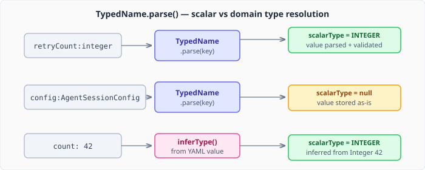
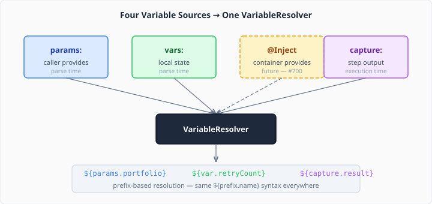

# Playbooks Deserve a Type System

A playbook that can't declare its inputs is a playbook that can't be trusted. Until now, CaseHub playbooks had exactly two ways to introduce a variable: `capture:` a step's output, or iterate with `forEach:`. No declarations, no defaults, no type constraints, no way for a caller to know what a sub-playbook expects. Variables appeared by convention and failed by surprise.

That's the kind of design that works fine in a demo and falls apart the moment someone writes their second playbook.

## The problem isn't missing variables — it's missing contracts

The real cost of undeclared variables isn't a runtime null. It's the absence of a contract between playbook author and playbook caller. When `run-playbook: risk-assessment.yaml` takes a `portfolio` parameter, that fact lives nowhere except in the author's head and the `${params.portfolio}` reference buried in step 14. A caller has to read the entire playbook to discover what it needs. Miss a required value and you get a silent empty string — not a parse error, not a validation failure, just wrong results.

This is the same problem that `YamlModuleParameter` already solves for modules. Modules declare their inputs with types, defaults, and constraints. Callers get validation at parse time. The module system has had this for months. Playbooks had nothing.

## What `vars:` and `params:` look like

Two new top-level sections in any playbook, using the `name:type:` compound key syntax from the YAML type system work:

```yaml
params:
  portfolio:string:              # required — no default
  tier:string: "standard"        # optional — default provided

vars:
  retryCount:integer: 0
  threshold:number: 0.85

steps:
  - agent-invoke:
      prompt: "Assess ${params.portfolio} at tier ${params.tier}"
      capture: result
```

`params:` is the public interface — what callers provide. `vars:` is internal state — local variables with defaults. Both use the same `name:type:` syntax that CSV headers and typed variables already use. No new syntax to learn.

The distinction matters. A caller invoking `run-playbook:` sees the params contract and nothing else. Internal vars are implementation details. This separation is borrowed directly from the module system's parameter model.

## Three ways to declare a type



The `name:type:` key syntax handles three cases:

**Explicit scalar** — `retryCount:integer: 0`. The four scalar types (STRING, INTEGER, BOOLEAN, NUMBER) get full parse-time validation. An integer declared as integer that receives `"hello"` fails immediately with a clear error message, not at step 14 when the arithmetic breaks.

**Domain type** — `config:AgentSessionConfig:`. Any type name that isn't one of the four scalars is stored as an opaque label. The value stays as a `Map<String,Object>`. No deserialization, no classpath resolution — that's the domain of the type-safe expression work coming next. But the label is there in the schema, ready for tooling, documentation, and future validation.

**Inferred** — `count: 42`. No colon in the key means no explicit type. The parser infers from the YAML-parsed value: `Integer` → INTEGER, `Boolean` → BOOLEAN, `Double` → NUMBER, `String` → STRING. If inference fails (null value, no annotation), it's a parse error. Every variable must have a type — declared or inferred.

## Constraints without a new model

For `params:` that need more than a type, the long form reuses `YamlModuleParameter` directly:

```yaml
params:
  maxRetries:integer:
    default: 3
    minimum: 1
    maximum: 10
  tier:string:
    default: "standard"
    allowedValues: ["basic", "standard", "premium"]
```

Same constraint vocabulary as modules: `minimum`, `maximum`, `minLength`, `maxLength`, `pattern`, `allowedValues`. Same `ParameterValidator` engine. One constraint model, one validation path, zero new infrastructure. A param that violates a constraint fails at parse time with a `ParameterViolation` that names the parameter, the constraint, and the actual value.

This was a deliberate decision. Building a separate `PlaybookParameter` type would have duplicated the constraint logic and created a second validation path to maintain. The module system's model is battle-tested and covers the playbook case exactly.

## How it flows through the pipeline



All variable sources — `params:`, `vars:`, the future `@Inject`, and the existing `capture:` — feed the same `VariableResolver` with prefix-based resolution. `${params.portfolio}` hits the params source. `${var.retryCount}` hits the vars source. `${capture.result}` hits the capture source. Same syntax, different provenance.

The parser lives in yaml-core (`PlaybookVariableParser`) and returns a plain data record — declared params as `YamlModuleParameter` entries, vars as a `TypedMap`. The compiler wraps this in a `PlaybookVariableContext` that knows how to build a `VariableResolver` and validate caller-provided values. `CompilationResult` carries the context so downstream consumers — the runtime, the test runner, sub-playbook invocation — all have access to the declared contract.

## Sub-playbook validation: fail fast, not fail mysterious

The `run-playbook` step now validates at invocation time. When a sub-playbook declares `params:`, the caller's `vars:` are checked against the declarations before a single step runs:

```yaml
- run-playbook: risk-assessment.yaml
  vars:
    portfolio: "growth-fund"
```

Missing a required param? Parse error. Wrong type? Parse error. Value outside `allowedValues`? Parse error. All before execution, all with clear messages naming the parameter and the violation.

Compare that to the previous behaviour: the sub-playbook runs, `${params.portfolio}` resolves to empty, the agent gets a prompt about `""`, and the caller spends twenty minutes wondering why the assessment returned nonsense.

## What this opens up

The variable declaration system is the foundation layer for three things that follow:

**Type-safe expressions** — `${var.retryCount}` knows it's an integer. Expression engines can enforce arithmetic operations on numeric types and reject string concatenation of integers at compile time. That's the next piece of work.

**`@Inject` annotations** — container-provided values (config, secrets, service connections) declared with the same `name:type:` syntax and populated at startup rather than parse time. Same resolver, different source.

**Playbook imports** — when playbook A imports playbook B as a module, A's `vars:` can satisfy B's `params:`. The type system ensures the contract matches at compile time, not at the moment the imported playbook tries to use a value that doesn't exist.

Each of these builds on the variable declaration layer without changing it. The resolver is extensible — adding a new source is `resolver.withScope("inject", source)`, not a rewrite.

Production playbooks need contracts, not conventions. This is the first step toward playbooks that can be composed, validated, and trusted to fail clearly when something is wrong.
