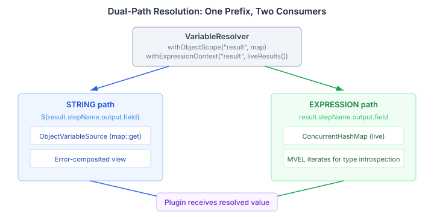

# When the Parser Already Knows

Every `assertThat` in a CaseHub playbook looks like this:

```yaml
- assertThat: ${results.output.risk_assessment}
  contains: 'equities'
```

The `${}` wrapper tells the parser "this is an expression, resolve it." But the parser already knows. The `assertThat` plugin's schema declares `_subject` as its primary input — and that input is always an expression. The author is telling the parser what the schema told it at registration time.

This is the kind of redundancy that starts small and compounds. Every expression-typed field in every playbook step carries the same ceremony. Authors internalise it as "that's just how YAML works here" and stop noticing. But it's friction that doesn't need to exist.

## The real cost isn't the characters

Writing `${}` is cheap. The cost is elsewhere.

Look at `AssertThatPlugin.resolveSubject()` — thirty lines of boilerplate that every expression-consuming plugin has to replicate:

```java
private Object resolveSubject(Object rawSubject, ServiceRegistry services) {
    String subjectStr = String.valueOf(rawSubject);
    if (!subjectStr.startsWith("${") || !subjectStr.endsWith("}")) {
        return rawSubject;
    }
    // Manually strip ${...}
    // Manually look up ExpressionEngineRegistry
    // Manually compile and evaluate
    // ...
}
```

The plugin does what the resolution layer should have done. It strips syntax the author shouldn't have had to write. It looks up services the framework should have provided. It compiles and evaluates expressions that the type system already declared this parameter would receive. The information was there — the wiring just didn't use it.

This is a pattern I've seen in every plugin system that grows organically. The host defines a type system for registration. That type system carries metadata about each parameter. But resolution ignores it — everything goes through the same string-expansion path. Plugins end up reimplementing type-aware handling ad-hoc, each one slightly differently, each one a maintenance surface.

## What the type system already knows

CaseHub's plugin system has a `Definition` with typed `Parameter` inputs. A step like `assertThat` registers with the system and declares its parameters — name, type, whether required. The `ParameterType` enum covers the usual suspects: STRING, INTEGER, NUMBER, BOOLEAN, ARRAY, OBJECT.

But there's no EXPRESSION.

So when `CatalogStepRunner` resolves parameters, it calls `resolver.resolveMap()` on everything — blanket string-template expansion. The `Definition.inputs()` type map is sitting right there, already retrieved from the registry. It's just never consulted.


## Type-aware resolution

`ParameterType` gains an `EXPRESSION` variant. A new `TypeAwareParamResolver` sits inside `CatalogStepRunner` and routes parameters by their declared type:

- **STRING and friends** → `VariableResolver` (string-template `${...}` expansion, unchanged)
- **EXPRESSION** → `ExpressionEngine.compile().eval()` with context built from the resolver's scopes

The separation is clean. EXPRESSION params never touch VariableResolver. STRING params never touch ExpressionEngine. No ambiguity about which path produced the result.

The `hasExpressionParams()` guard checks the plugin's `Definition` before creating a `TypeAwareParamResolver` — plugins that don't declare any EXPRESSION parameters take the unchanged `resolveMap()` path. Zero overhead for existing plugins, zero migration required.

A new `@Expression` annotation marks plugin record fields:

```java
@Plugin("assertThat")
public record AssertThatPlugin(
        @Required @Expression Object subject,
        String message
) { ... }
```

The plugin processor picks up `@Expression`, emits `"format": "expression"` in the JSON Schema, and generates uncast `Object` extraction in the binder — MVEL returns typed results, not always strings. At runtime, `AptPluginSource` reads the format and maps it to `ParameterType.EXPRESSION`.

After this, the playbook author writes:

```yaml
- assertThat: results.output.risk_assessment
  contains: 'equities'
```

And `AssertThatPlugin.resolveSubject()` — all thirty lines of it — is deleted. The plugin receives the evaluated value directly. The ceremony is gone from both sides of the boundary.

## The scope problem MVEL exposed

The design review surfaced something I hadn't thought through: MVEL's `getTypeMap()` iterates the expression context map at compile time for type introspection. A lazy proxy map with an empty `entrySet()` would silently produce an empty type map, and MVEL would fail to resolve any identifier registered through that scope.

This ruled out lazy proxy maps entirely. The working design uses concrete Map-backed scope registration — `withObjectScope("results", capturedOutput)` instead of `withObjectScope("results", capturedOutput::get)`. The functional overload still works for string resolution; the Map overload enables expression evaluation.

The result scope needed dual registration. `StructuralStepEvaluator` registers the `result` prefix twice: a functional `ObjectVariableSource` for STRING resolution (which handles error compositing — `${result.stepName.error.message}`) and a live `ConcurrentHashMap` view via `liveResults()` for EXPRESSION evaluation (which gives MVEL the concrete, iterable map it needs).



Sequential step references work because the map is live — step 3 can reference step 2's output because `recordSuccess()` writes to the same `ConcurrentHashMap` that `buildExpressionContext()` returns. No snapshot, no stale data, no synchronisation ceremony.

## Why this matters beyond CaseHub

The underlying principle is general: **if your type system knows what a parameter is, your resolution layer should use that information.** Most plugin systems — YAML-based or otherwise — define typed parameter schemas at registration time and then ignore them during resolution. Everything gets string-expanded, and plugins reinvent type-aware handling in their own execute methods.

The cost compounds in three directions. Plugin authors write boilerplate that the framework should handle. Users write ceremony that the schema makes redundant. And the framework loses the ability to optimise — it can't skip expression compilation for STRING params or skip string expansion for EXPRESSION params because it doesn't know which is which.

The fix is straightforward once you see it. Route resolution through the type map that already exists. Let the schema author's declaration drive runtime behaviour. Move the type-awareness from the plugin to the framework, where it belongs.

`ParameterType.EXPRESSION` is the specific change. The pattern — **type-driven resolution routing** — applies anywhere a host system dispatches to plugins with typed parameter schemas.
