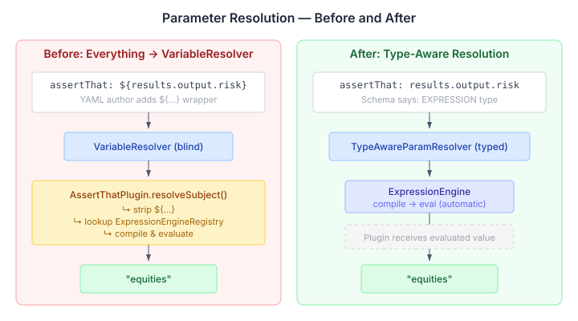

# When the Parser Already Knows

Every `assertThat` in a CaseHub playbook looks like this:

```yaml
- assertThat: ${results.output.risk_assessment}
  contains: 'equities'
```

The `${}` wrapper tells the parser "this is an expression, resolve it." But the parser already knows. The `assertThat` plugin's schema declares `_subject` as its primary input — and that input is always an expression. The author is telling the parser what the schema told it at registration time.

This is the kind of redundancy that starts small and compounds. Every expression-typed field in every playbook step carries the same ceremony. Authors internalise it as "that's just how YAML works here" and stop noticing. But it's friction that doesn't need to exist.

## The real cost isn't the characters

Writing `${}` is cheap. The cost is elsewhere.

Look at `AssertThatPlugin.resolveSubject()` — thirty lines of boilerplate that every expression-consuming plugin has to replicate:

```java
private Object resolveSubject(Object rawSubject, ServiceRegistry services) {
    String subjectStr = String.valueOf(rawSubject);
    if (!subjectStr.startsWith("${") || !subjectStr.endsWith("}")) {
        return rawSubject;
    }
    // Manually strip ${...}
    // Manually look up ExpressionEngineRegistry
    // Manually compile and evaluate
    // ...
}
```

The plugin does what the resolution layer should have done. It strips syntax the author shouldn't have had to write. It looks up services the framework should have provided. It compiles and evaluates expressions that the type system already declared this parameter would receive. The information was there — the wiring just didn't use it.

## What the type system already knows

CaseHub's plugin system has a `Definition` with typed `Parameter` inputs. A step like `assertThat` registers with the system and declares its parameters — name, type, whether required. The `ParameterType` enum covers the usual suspects: STRING, INTEGER, NUMBER, BOOLEAN, ARRAY, OBJECT.

But there's no EXPRESSION.

So when `CatalogStepRunner` resolves parameters, it calls `resolver.resolveMap()` on everything — blanket string-template expansion. The `Definition.inputs()` type map is sitting right there, already retrieved from the registry. It's just never consulted.



## The design

`ParameterType` gains an `EXPRESSION` variant. A new `TypeAwareParamResolver` sits inside `CatalogStepRunner` and routes parameters by their declared type:

- **STRING and friends** → `VariableResolver` (string-template `${...}` expansion, unchanged)
- **EXPRESSION** → `ExpressionEngine.compile().eval()` with context built from the resolver's scopes

The separation is clean. EXPRESSION params never touch VariableResolver. STRING params never touch ExpressionEngine. No ambiguity about which path produced the result.

The expression context comes from the same data the resolver already has — the `var`, `results`, `params` scopes. A new `buildExpressionContext()` method on `VariableResolver` exports its Map-backed scopes as concrete maps that MVEL can iterate for type introspection at compile time.

A new `@Expression` annotation marks plugin record fields:

```java
@Plugin("assertThat")
public record AssertThatPlugin(
        @Required @Expression Object subject,
        String message
) { ... }
```

The plugin processor picks up `@Expression`, emits `"format": "expression"` in the JSON Schema, and generates uncast `Object` extraction in the binder (MVEL returns typed results, not always strings). At runtime, `AptPluginSource` reads the format and maps it to `ParameterType.EXPRESSION`. The `hasExpressionParams()` guard means zero overhead for plugins that don't use it.

After all this, the playbook author writes:

```yaml
- assertThat: results.output.risk_assessment
  contains: 'equities'
```

And `AssertThatPlugin.resolveSubject()` — all thirty lines of it — gets deleted. The plugin receives the evaluated value directly. The ceremony is gone from both sides of the boundary.

## Where it gets interesting

The design review surfaced something I hadn't thought through: MVEL's `getTypeMap()` iterates the expression context map at compile time for type introspection. A lazy proxy map with an empty `entrySet()` would silently produce an empty type map, and MVEL would fail to resolve any identifier registered through that scope.

This ruled out the elegant lazy-map approach. The working design uses concrete Map-backed scope registration — `withObjectScope("results", capturedOutput)` instead of `withObjectScope("results", capturedOutput::get)`. The functional overload still works for string resolution; the Map overload enables expression evaluation.

The result scope needed special handling. `StructuralStepEvaluator` builds the `result` scope from a `StepResultStore` with error compositing — failed steps produce error maps, successful steps produce output maps. For expression evaluation, a live `ConcurrentHashMap` view of the results (via `liveResults()`) gives MVEL the concrete, iterable map it needs, while the functional `ObjectVariableSource` continues to handle the error-composited `${result.stepName.error.message}` path.

Two paths, one prefix. The `result` scope has a functional source for STRING resolution and a live map for EXPRESSION resolution. Sequential step references work because the map is live — step 3 can reference step 2's output because `recordSuccess()` writes to the same `ConcurrentHashMap` that `buildExpressionContext()` returns.

## What this opens up

The immediate payoff is cleaner playbooks and less plugin boilerplate. But the larger value is that the type system now participates in resolution. Once `ParameterType` knows about expressions, other things follow naturally: the `when:` decorator could use the same type-aware path instead of its separate `ConditionEvaluator`. Plugin parameters could declare TRANSFORM or FILTER contexts for per-field engine selection. And the playbook testing framework from [#703](https://github.com/casehubio/platform/issues/703) — where I added `vars:` and `params:` declarations — can now let test assertions use bare expressions instead of `${}` wrappers, closing the loop between type declarations and type-aware evaluation.

The implementation plan is written — seven tasks across three batches. The foundation types are zero-risk (adding enum values and annotations), the resolution engine is the core work, and the plugin processor changes are mechanical. Backward compatibility is preserved: existing `${...}` syntax is accepted and stripped before evaluation, so nothing breaks.
