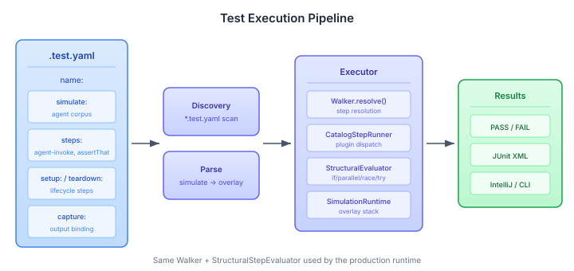
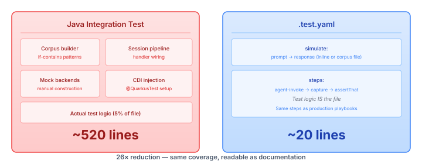

# When the Test Runs the Same Code as Production

Most test frameworks have a split-brain problem. The test constructs a synthetic version of the runtime — mock backends wired by hand, corpus data loaded from test fixtures, assertion logic that reimplements business rules in a different language. The test and the production code share a domain but not a runtime. When they diverge, you get tests that pass and production that doesn't.

CaseHub playbooks are YAML. The test framework we built this week tests them in YAML too — but that's not the interesting part. The interesting part is that the test file runs through the same Walker, the same StructuralStepEvaluator, the same plugin dispatch, and the same SimulationRuntime overlay stack as the production executor. There is no test-specific execution path.



## The Format

A `.test.yaml` file is a playbook that also declares its simulation context and includes assertion steps:

```yaml
name: Session preserves conversation context

simulate:
  agent:
    - prompt: "What's my risk profile?"
      response: "Moderate risk: 60% equities."

steps:
  - agent-invoke:
      prompt: "What's my risk profile?"
    capture: result
  - assertThat: ${result.text}
    contains: 'equities'
    startsWith: 'Moderate'
```

That replaces roughly 500 lines of Java that was mostly corpus construction, CDI wiring, and session pipeline setup. The five lines that were actually test logic — "did the agent say something about equities?" — are now the entire file.



The `simulate:` block maps to the existing `SimulationRuntime.pushOverlay()` API. The test runner parses aliases (`agent` → `agent-provider.invoke`), normalises field names (`prompt`/`response` → `key`/`output`), builds an overlay, pushes it before step execution, and pops it after. No new simulation infrastructure — the overlay stack from the production runtime does the work.

## Why Identity Matters More Than Similarity

Other YAML test frameworks test YAML by parsing it, transforming it into an internal representation, and then running that representation through a custom executor built specifically for tests. The test framework is a parallel universe — similar enough to production that most things work, different enough that some things don't.

This framework doesn't have a test executor. It has the production executor with a test file as input. `Walker.resolve()` resolves steps the same way. `StructuralStepEvaluator` evaluates `if`, `parallel`, `race`, `try/catch` the same way. `CatalogStepRunner` dispatches to the same plugin registry. When a test fails, the failure happened in production code, not in a test-specific approximation of it.

The practical consequence: if you can write a playbook that does something, you can write a test that verifies it. Every structural primitive — `parallel:` with `advance-after` policies, `race:`, `barrier:`, `quorum:`, `select:` — works in tests because they work in playbooks.

## assertThat: What Failed and Why

The early prototype used boolean assertions: `assert: ${response} contains 'equities'`. When that fails, all you know is "expression was false." The `assertThat` step separates subject from expectation:

```yaml
- assertThat: ${result.text}
  contains: 'equities'
  startsWith: 'Moderate'
```

When both matchers fail, the report shows both:

```
Subject: ${result.text}
Actual: "The portfolio is balanced."
Failed:
  contains: 'equities' — actual value does not contain 'equities'
  startsWith: 'Moderate' — actual value starts with 'The'
```

Matchers are sibling YAML keys — not a DSL grammar, not method chains. The Walker's sibling-absorption mechanism (`@Plugin(absorbSiblings = true)`) collects them into the plugin's parameter map alongside a `_subject` entry. Twelve built-in matchers cover the common cases. `assert:` stays for simple boolean checks where a subject + matcher would be ceremony.

## Tests as Tutorials

Convention-based discovery turns tutorial directories into executable documentation:

```
tutorials/
  01-basics/
    01-invoke.test.yaml
    02-assert.test.yaml
  02-events/
    01-emit.test.yaml
```

Each file is self-contained — a developer opens `01-invoke.test.yaml` and sees how to call an agent, what the response looks like, and what correct means. The simulation data is right there. When a tutorial test fails, either the application is broken or the tutorial is wrong. Both worth knowing.

The JUnit Platform TestEngine discovers these files natively. IntelliJ shows green/red per tutorial. `mvn test` runs them alongside Java tests. No plugin configuration, no custom runner, no test annotations. Add the dependency; the tests appear.

Multi-test files group related tests with shared simulation context:

```yaml
name: Agent session basics

tests:
  - name: Open and close
    steps:
      - agent-invoke:
          prompt: "hello"
        capture: result
      - assertThat: ${result.text}
        not-empty: true

  - name: Query response
    steps:
      - agent-invoke:
          prompt: "risk"
        capture: result
      - assertThat: ${result.text}
        contains: 'risk'
```

IntelliJ renders these as expandable container nodes with per-entry results. Lifecycle hooks — `setup:`/`teardown:` at per-test, per-file, and per-directory scopes — cover what JUnit handles with `@BeforeEach` through `@BeforeAll`, plus hierarchical directory nesting that JUnit 5 doesn't have natively.

## The Syntax Gate

One non-obvious decision: we rejected the verbose `block:` + `step: name` syntax and enforced the combined-key form `block name:`. One conditional in the Walker, but it gates every tutorial and example written from here forward. A DSL that tolerates two forms for the same thing teaches the wrong one by accident. For a language that doubles as a teaching tool, that's a defect.

```
Step 3: 'step' is not valid inside 'block' —
  use combined-key syntax: 'block backend:' instead of 'block:' + 'step: backend'
```

The error message shows the correct form. Authors learn the syntax from their mistakes, not from documentation they haven't read.

## What This Enables

The immediate target is helpdesk as the first 100% YAML application with 100% YAML tests. Every Java assertion gets a YAML equivalent. The tutorials become the onboarding documentation. CI runs them with `mvn test`.

The deeper value is that playbook authors don't need to learn a second language to verify their work. The test file is a playbook with `simulate:` and `assertThat:`. If you can write the playbook, you can write the test. If you can read the test, you can understand the playbook. That's not a clever testing trick — it's the natural consequence of making the test format identical to the production format.
