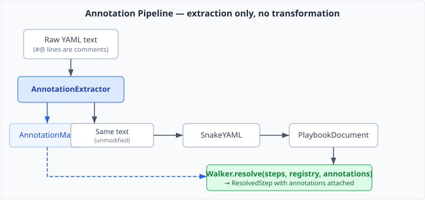
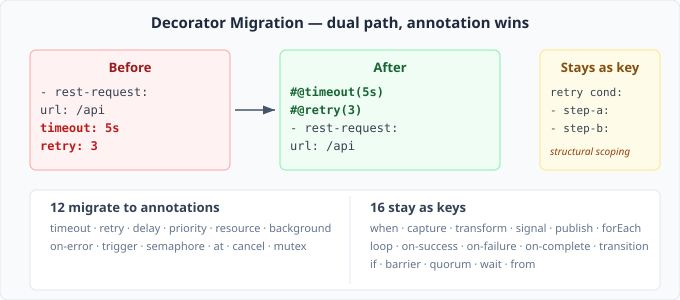

# Metadata That Doesn't Break Your Parser

A CaseHub playbook is a YAML file that isn't really YAML. It has step types, decorators, variable references, expression-typed parameters, a plugin system. Standard YAML editors can check your indentation and bracket matching. They can't validate whether `retry: 3` belongs on a `rest-request` step or tell you that `assertThat` expects an expression, not a string. For authoring CaseHub playbooks, you need a CaseHub-aware editor regardless.

So when the time came to add metadata — descriptions for tooling, roles for governance, `@Inject` for dependency binding — I had a choice. I could keep things YAML-compatible and put metadata in a structured section at the top of the file, separated from the things it describes. Or I could put it where it belongs: directly above the declaration it annotates.

I chose annotations. And then I chose to make them YAML comments.

## Why comments

The obvious approach is bare `@` — familiar from Java, clean to read:

```yaml
@timeout(5s)
- rest-request:
    url: /api/customers
```

The problem: that's not valid YAML. A pre-parser would need to strip those lines before SnakeYAML can touch the file, transforming text in the critical parsing path. Every tool that reads playbooks would need the pre-parser. Every error message would need line-number adjustment. The pre-parser isn't just extraction — it's text transformation, and text transformation has a way of becoming the thing everything depends on.

`#@` avoids this entirely:

```yaml
#@timeout(5s)
- rest-request:
    url: /api/customers
```

SnakeYAML sees a comment. It ignores it. The file parses without any transformation. The `AnnotationExtractor` reads the same text SnakeYAML reads — it just looks for lines starting with `#@` and extracts structured data from them. Extraction and parsing are orthogonal operations on the same input. Neither depends on the other.

The three extra characters are a parser concern, not an authoring concern. The editor renders them as bare `@`. The author never types `#`.



## What annotations look like in practice

A playbook with annotations reads like a Java class with `@Override` and `@Transactional` — metadata declared at the point of use:

```yaml
#@description("Customer onboarding — triggered on case creation")
#@requires(agent, rest-client)
#@roles(admin, case-worker)
name: Customer onboarding

#@Inject(AgentProvider, qualifier: "claude")
claude: agent

#@Inject(CaseMemoryStore)
memory: store

steps:
  #@timeout(2s)
  #@audit("PII access — must be logged")
  - rest-request:
      url: /api/customers/${customerId}
    capture: customer

  #@retry(3, backoff: exponential)
  - agent-invoke:
      provider: claude
      prompt: "Assess risk for ${customer.name}"
    capture: risk
```

The grammar supports positional and named arguments, quoted strings for values with special characters, and no-argument annotations like `#@background`. The `AnnotationParser` handles all of this in yaml-core — zero dependencies, no SnakeYAML, J2CL-transpilable to TypeScript.

## @Inject — when metadata becomes wiring

Most annotations are passive — `@description` and `@requires` are consumed by tooling, not by the runtime. `@Inject` is different. It declares a dependency and binds it to a named variable:

```yaml
#@Inject(AgentProvider, qualifier: "claude")
claude: agent
```

Before any step executes, the runtime resolves every `@Inject` declaration against an `InjectionResolver` — a functional interface in yaml-core. In production, CDI provides the implementation. In tests, `MapServiceRegistry` does. If any binding fails to resolve, the playbook fails fast with a clear message: "AgentProvider not available."

The binding line (`claude: agent`) stays in the YAML as an inert key. SnakeYAML puts it in the content map alongside `name` and `steps`. Nothing reads it — downstream code only looks up known keys. The annotation consumed it during extraction; the content map carries it harmlessly.

This gives playbook authors something they didn't have before: an explicit dependency graph at the top of the file. Read the `@Inject` declarations and you know exactly what the playbook needs. No hunting through step implementations for implicit service lookups. Pre-flight validation catches missing capabilities before step 1 runs, not at step 47.

## The decorator migration

CaseHub playbooks already have decorator keys — `timeout`, `retry`, `mutex`, `delay`. These are policy metadata mixed into the step's data model as regular YAML keys. Twelve of them are annotation candidates: they change *how* or *whether* a step executes, not *what* it does.

The migration runs as a dual path. Both forms work:

```yaml
# Key form (deprecated, still works)
- rest-request:
    url: /api
  timeout: 5s

# Annotation form (preferred)
#@timeout(5s)
- rest-request:
    url: /api
```

Annotation takes precedence on conflict. The Walker merges annotation decorators into the step's decorator map, with deprecation warnings for the key form.



The classification criterion is clean: if removing the element changes *what* the step does, it stays as a key. `capture`, `transform`, `signal`, `forEach` — these are structural. If removing it changes *how* or *whether* the step executes, it's an annotation candidate. `timeout`, `retry`, `background`, `mutex` — these are policy.

Three decorators — `retry`, `timeout`, `mutex` — have a dual form that complicates things. As scalar values (`retry: 3`), they're policy metadata and migrate to annotations. As structural-scoping keys (`retry condition: [step-a, step-b]`), they wrap a step list — something annotations can't express. The structural form stays permanently. The migration tool must distinguish them by value type.

## The general principle

This pattern — structured metadata in comments — isn't new. VMware's ytt uses `#@` for YAML templating overlays. Python's type hints started as comments before gaining first-class syntax. The technique works whenever you have a format that you need to extend without breaking the parsers that already consume it.

The key insight is the separation: extraction and parsing operate on the same input independently. The extractor reads `#@` lines. The parser reads everything else. Neither transforms the input for the other. This is why `#@` works and bare `@` doesn't — the comment prefix isn't just a cosmetic choice, it's the mechanism that keeps extraction and parsing orthogonal.

For anyone building a YAML-based DSL, the question isn't whether you'll need metadata that the YAML spec doesn't support. You will. The question is whether your extension mechanism composes with existing tooling or fights it. Comments compose. Custom syntax fights.
