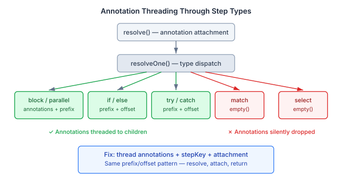
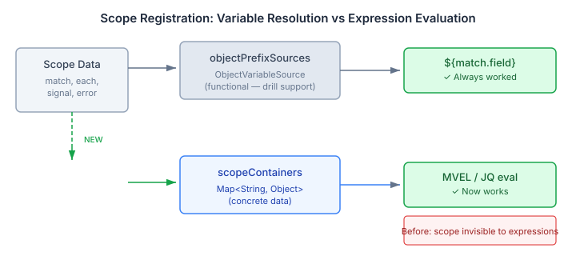

# The Places Your Type System Forgets to Look

Building a type system is the easy part. Making it work everywhere is the hard part.

We shipped `@Expression` type annotations, `AnnotationMap` threading, and `format: expression` in the schema convention across the last few sessions. The infrastructure was solid — pre-parser, argument grammar, hierarchical dotted keys, prefix-based offset tracking through block, if/else, try/catch, and parallel steps. A clean design, well-tested, ready for use. Except it wasn't. Not really.

The pattern breaks silently wherever you forgot to thread it. And "wherever you forgot" is always the code path you didn't think about until someone hit it.

## The annotation gap

The annotation system threads an `AnnotationMap` through recursive step resolution. Each step type — block, parallel, if/else, try/catch — takes the parent's annotation map and step key, constructs a child prefix, and passes both to its children. This is what makes `#@timeout(5s)` on the third step inside a nested block resolve to key `0.2` instead of just `2`.

Match cases and select branches didn't do this.

Both helper methods — `resolveMatchCases` and `resolveSelectBranches` — called `resolveOne` with `AnnotationMap.empty()`. Any annotation inside a match case or select branch was silently dropped. No error, no warning. The annotation just didn't arrive.

The fix is mechanical: add the annotation map and step key to both method signatures, construct the child prefix, and attach annotations after `resolveOne` returns — the same three-step pattern every other step type already uses. The real question is why it was missing.

It was missing because the annotation system was designed and tested on the step types that existed when annotations were built. Match and select were added to the Walker after the initial annotation threading, and whoever extended the Walker for those types copied the pre-annotation call pattern. The test suite covered blocks, if/else, and try/catch. It didn't cover match cases or select branches because those weren't part of the annotation feature. The gap wasn't in the design — it was in the coverage.

This is the failure mode for any system where threading is opt-in rather than enforced by the type system. Every new step type is a potential gap until someone writes the test that catches it.

## The scope visibility gap

A related gap appeared in expression evaluation. The `VariableResolver` maintains two registries: `objectPrefixSources` for `${}` variable resolution, and `scopeContainers` for expression engine evaluation (MVEL, JQ). The first handles `${match.amount}`. The second handles `match.amount > 1000` inside an `@Expression` parameter.

Five scopes — `each`, `match`, `signal`, `from`, `error` — were registered only in `objectPrefixSources`. They used the functional `withObjectScope(String, ObjectVariableSource)` overload, which gives you drill-down variable resolution but doesn't populate `scopeContainers`. That means `${match.amount}` worked, but an `@Expression` parameter referencing `match.amount` threw `ExpressionCompilationException`. Same data, two resolution paths, one of them invisible.

The fix is dual registration: keep the functional source for variable resolution (it handles dot-path drilling that the raw map doesn't), and add `withExpressionContext(prefix, map)` to make the concrete data available to expression engines. For `each`, the expression context carries both the index and the aliased item. For `error`, a simple map of `message` and `step`. Each scope gets registered in both paths.

## The codegen gap

A third gap: the `yaml-codegen` module generates Java records from JSON Schema. After the expression type work, plugin schemas emit `"format": "expression"` on string-typed fields that should receive evaluated expressions. But `TypeGraph.FieldDef` had no `format` field. The parser ignored it. The code generator produced `String` where it should have produced `Object`.

This is a one-line-per-file fix — add `format` to the record, extract it in the parser, check it in the type resolver. But the gap meant that any plugin author who declared an `@Expression` parameter and ran the codegen would get a String field and a ClassCastException at runtime.

## Why completeness matters more than cleverness

These aren't interesting bugs. There's no algorithmic insight, no architectural revelation. They're gaps — places where a capability was built in one code path and not threaded through another. The fix for each one is to follow the pattern already established elsewhere in the same codebase.

But collectively, they represent the difference between a feature that works in demos and a feature that works in production. A type system that threads annotations through blocks but drops them in match cases is a type system that will surprise its users. An expression evaluation layer that resolves variables but can't see scope data is an evaluation layer that will throw at runtime in exactly the case the user assumed it would handle.

The boring work of completeness — checking every code path, verifying every step type, testing every combination — is what turns infrastructure into a platform. The annotation parser was already good. The expression resolver was already good. What they needed was to work in every place a user would expect them to work, not just the places the implementer thought to test.

Anyone building a DSL, a rule engine, or a workflow language will recognise this pattern. The feature is done when every code path threads it through. Not before.
