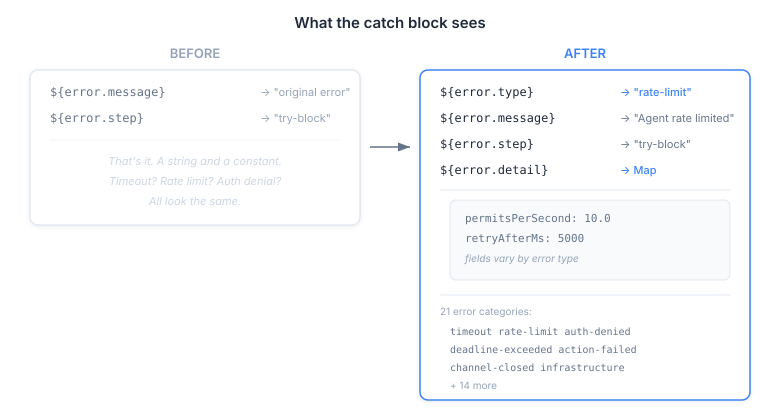
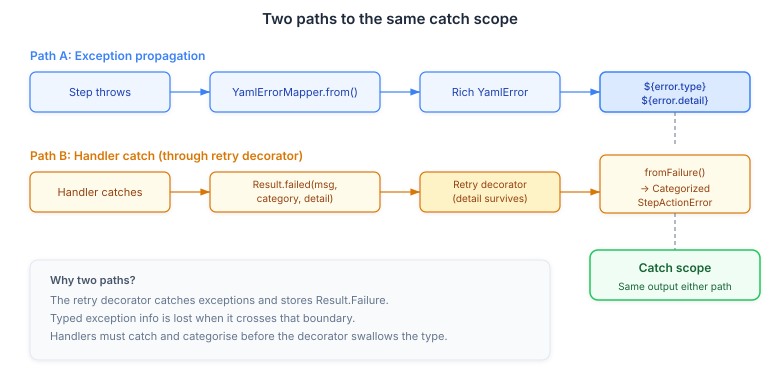

# Your Catch Block Is Lying to You

Every error looks the same from the inside of a catch block. A timeout, a rate limit, an authorisation denial, a dead connection — they all arrive as a string. "Agent timed out." "Agent rate limited." "Access denied." The catch block author reads `${error.message}`, parses the human-readable text with their eyes, and writes control flow around what is essentially a free-form sentence.

This is the error handling equivalent of screen scraping. It works until someone changes the message.

```yaml
catch:
  - if: ${error.message} contains "timed out"
    steps:
      - delay: 5s
      - agent-invoke: { prompt: "Retry assessment" }
```

That `contains "timed out"` is a lie. It looks like control flow, but it's really string matching against a message that nobody promised would stay the same. Rename the exception class, adjust the wording, localise the output — the catch block silently stops matching and falls through to the default.

## The gap was a design debt, not a missing feature

CaseHub's YAML runtime already had a rich error type system. `ErrorCategory` — an enum with values like `TIMEOUT`, `DEADLINE_EXCEEDED`, `CHANNEL_CLOSED`. `YamlError` — a sealed interface hierarchy with structured records carrying typed fields. `YamlErrorMapper` — a classifier that maps Java exceptions to the right `YamlError` record. `buildResultSource()` — a method that already exposed `${result.<step>.error.category}` for completed steps.

All of it existed. None of it reached the catch scope.

The catch block in `evaluateTryCatchFinally` extracted `message` and `step` from the `Result.Failure`. Two strings. The entire type system sitting right there in the codebase, and the one place that needed it most — the place where a playbook author decides what to do about a failure — got the least information.

## What the catch block sees now



Four fields instead of two. `${error.type}` is the kebab-case `ErrorCategory` — `"timeout"`, `"rate-limit"`, `"auth-denied"`, `"deadline-exceeded"`. Twenty-one categories covering coordination errors, runtime failures, and the new agent-specific types. `${error.detail}` is a map of error-type-specific fields — the timeout duration, the permits-per-second on a rate limit, the actor and resource on an auth denial.

```yaml
catch:
  - match: ${error.type}
    cases:
      - pattern: "rate-limit"
        steps:
          - delay: ${error.detail.retryAfterMs}ms
          - agent-invoke: { prompt: "Retry assessment" }
      - pattern: "timeout"
        steps:
          - emit-event: agent.timeout
            data: { step: ${error.step} }
      - pattern: "auth-denied"
        steps:
          - log: "Access denied for ${error.detail.actorId} on ${error.detail.resource}"
      - default:
        steps:
          - emit-event: unhandled.error
            data: { type: ${error.type}, message: ${error.message} }
```

That `match:` on `${error.type}` is not string matching. It's pattern matching against a typed, stable identifier. The categories are enum-backed. The detail map carries the structured data from the exception that caused the failure. A rate limit error tells you the permits-per-second and the suggested retry delay. A timeout tells you the duration. An auth denial tells you the actor, the resource, and the action.

## The retry decorator problem

The interesting architectural wrinkle was the retry decorator. CaseHub's `DecoratorChain` wraps step execution with retry logic — if a step fails, the decorator catches the exception and stores the `Result.Failure` for the next attempt. The problem: `catch (Exception e) { last = Result.failed(e.getMessage()); }`. The typed exception — `AgentRateLimitException` with its `permitsPerSecond()` and `retryAfterMillis()` — is reduced to a string message the moment it crosses the retry boundary.



This created two paths to the catch scope. Exceptions that propagate directly (path A) go through `YamlErrorMapper.from()` and produce rich `YamlError` records — `TimeoutError` with a `Duration`, `RateLimitError` with rate data. Exceptions caught by handlers before the retry decorator (path B) must pack their structured data into `Result.Failure.detail` — a new `Map<String, Object>` field — so it survives the retry loop and reaches `fromFailure()` on the other side.

Both paths produce the same output in the catch scope. A `RateLimitError` from either path gives you `{"permitsPerSecond": 10.0, "retryAfterMs": 5000}` in `${error.detail}`. The dual-path architecture is invisible to the playbook author. They see one catch block with one set of fields. But the infrastructure behind it has to solve the impedance mismatch between Java's exception hierarchy and the `Result`-typed boundary that the retry decorator enforces.

## What this actually changes for playbook authors

String-based error handling makes every catch block fragile and every recovery strategy naive. Typed errors make three things possible that weren't before:

**Discriminated recovery.** A rate limit and a timeout are not the same problem. A rate limit means "wait and try again with the same request." A timeout means "the request may have succeeded but you don't know." An auth denial means "trying again is pointless." With `${error.type}`, each gets its own recovery path.

**Data-driven delays.** `${error.detail.retryAfterMs}` is the delay the provider is asking for. Using it instead of a hardcoded `delay: 5s` means the playbook respects backpressure signals from the underlying system.

**Structured observability.** `emit-event` with `${error.type}` and `${error.detail}` produces events that downstream systems can aggregate, alert on, and trend — without parsing English sentences out of log files.

The underlying principle is not complicated. Error handling deserves the same type information as the happy path. When we built the type system for playbook variables, we made sure `${match.amount}` carried a type through the expression engine. When we built annotations, we made sure `#@timeout(5s)` threaded through every step type. The catch scope was the one place where all that discipline stopped at the boundary and handed the author an untyped string. Now it doesn't.
