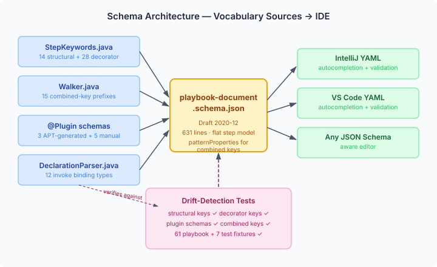

# Teaching Your IDE a New Language

A YAML DSL without IDE support is a guessing game. You know there's a `parallel` keyword somewhere, you're fairly sure `timeout` goes on the step not inside it, and you've been spelling `forEach` wrong for ten minutes. The compiler knows all of this. Your editor doesn't.

CaseHub playbooks are a coordination DSL — steps, decorators, invoke bindings, structural composition — with a vocabulary of about seventy distinct keywords across four categories. That's too many to memorise, too few to justify a custom language server. JSON Schema sits in the middle: enough structure to give IDEs autocompletion and validation, no runtime infrastructure to maintain.

## The vocabulary problem

The playbook vocabulary lives in four places in the Java codebase, none of which were designed to be a vocabulary definition:

- **`StepKeywords.STRUCTURAL_KEYS`** — 14 structural step types (`block`, `parallel`, `try`, `if`, `match`, `select`, `race`, `barrier`, `quorum`, and friends)
- **`StepKeywords.DECORATOR_KEYS`** — 28 decorator keys (`when`, `timeout`, `retry`, `capture`, `mutex`, `loop`, `forEach`, `signal`, and more)
- **`Walker.COMBINED_KEY_PREFIXES`** — 15 types that support the combined-key syntax (`timeout 10s:`, `forEach item in items:`)
- **`DeclarationParser`** — 12 invoke binding types (`mcp`, `rest`, `agent`, `process`, `aria`, and the session lifecycle family)

Add 8 plugin step types (`assert`, `assertThat`, `rest-call`, `agent-invoke`, `emit-event`, `run-playbook`, `process`, `verify-simulation`) and you're past seventy keywords with type-specific parameter shapes.

The gap isn't the vocabulary itself — it's that the information exists only in Java `Set.of()` calls and switch-case dispatch. Nothing exposes it in a format IDEs understand.

## JSON Schema alongside an LSP

We are building a language server for playbooks — it's already started in the pages repo. An LSP gives the richest experience: semantic completions that know what variables are in scope, inline documentation pulled from plugin metadata, go-to-definition for step references and module imports. That's the long game.

JSON Schema is the short game, and it stays useful even after the LSP ships. Three reasons.

First, it works everywhere today with zero setup. Both IntelliJ and VS Code's YAML extension support Draft 2020-12 natively. One comment at the top of a playbook file activates it:

```yaml
# yaml-language-server: $schema=https://casehub.io/yaml-core/playbook-document.schema.json
```

No server process, no extension install, no version coupling. Any editor that speaks JSON Schema gets autocompletion immediately.

Second, it's the fallback. An LSP is a running process that can crash, lag, or lose connection. When it's down, the schema is still there — static, always available, zero dependencies. The two layers complement each other: the LSP handles semantic intelligence (variable scoping, cross-file references, annotation validation), the schema handles structural intelligence (valid keys, parameter shapes, type constraints).

Third, it's consumable outside editors. A CI linter can validate playbook files against the schema before they reach the runtime. A documentation generator can extract the vocabulary and produce a reference page. The LSP serves the editor; the schema serves the ecosystem.

The schema has real limits. It can't validate that `timeout 10s` is a valid duration — the `10s` is embedded in a dynamic YAML key, and `patternProperties` only matches the key pattern, not its embedded value. It can't see `#@` annotations (YAML comments are invisible to it). It validates one YAML document at a time, so the multi-document playbook layout needs a separate schema for each document. These are exactly the gaps the LSP will fill.

## The flat step model

The natural instinct with JSON Schema is to model each step type as a branch in a `oneOf` discriminated union. Each branch requires its type key and defines its specific parameters. The `assert` branch requires `assert`, the `parallel` branch requires `parallel`, and so on.

This doesn't work when every branch also allows decorator keys. With `additionalProperties: true` on each branch (necessary because decorators can appear alongside any step type), multiple branches match every step object. `oneOf` requires exactly one match. A step with `agent-invoke` and `capture` matches the `agentInvokeStep` branch *and* the `combinedKeyStep` branch. The validator rejects it.

The fix is a flat property model. Instead of thirty-two `oneOf` branches, the schema defines one step object type with every known key as a property:

```json
{
  "step": {
    "type": "object",
    "properties": {
      "block": { "$ref": "#/$defs/stepList" },
      "parallel": { ... },
      "try": { "$ref": "#/$defs/stepList" },
      "catch": { "$ref": "#/$defs/stepList" },
      "when": { "type": "string" },
      "timeout": { "type": "string" },
      "capture": { "type": "string" },
      "agent-invoke": {
        "type": "object",
        "properties": { "prompt": { "type": "string" } },
        "required": ["prompt"]
      }
      // ... all 70+ keys
    },
    "patternProperties": {
      "^timeout .+$": { "$ref": "#/$defs/stepList" },
      "^forEach .+$": { "$ref": "#/$defs/stepList" }
      // ... 15 combined-key patterns
    },
    "additionalProperties": true
  }
}
```

This is less precise — it won't tell you that `catch` only makes sense alongside `try` — but it gives clean autocompletion for every keyword, validates parameter shapes for each step type, and never produces false validation errors. For IDE assistance, that's the right tradeoff.



## Drift detection over generation

I considered three approaches to keeping the schema in sync with the runtime vocabulary: generating the schema from Java types, composing it at build time from plugin schemas, or writing it by hand with tests that catch drift.

Generation from Java types fails on impedance mismatch. The Java types model the *runtime* — parsed, compiled playbooks. The schema needs to model the *authored YAML* — kebab-case keys, combined-key syntax, multi-form parameters. `DecoratorStack` doesn't have a `timeout` field that maps to a JSON Schema property; it extracts `timeout` from a raw `Map<String, Object>` by string key.

Build-time composition (scanning `META-INF/yaml-plugins/*.schema.json` and injecting them into a skeleton) works but adds machinery for 8 plugins that change once a quarter.

Hand-written schema with drift tests is the simplest approach that holds. Four tests verify the schema against the source constants:

```java
@Test
void allStructuralKeysPresent() {
    JsonNode stepProps = schemaNode.at("/$defs/step/properties");
    for (String key : StepKeywords.STRUCTURAL_KEYS) {
        assertThat(stepProps.has(key)).isTrue();
    }
}
```

One test per vocabulary source. If someone adds a new decorator to `StepKeywords.DECORATOR_KEYS`, the drift test fails and points at exactly what's missing. The fix is always the same: add the key to the schema.

On top of the drift tests, 61 playbook fixtures and 7 test files validate against the schema. If the schema rejects a valid playbook construct, the fixture test catches it. This is the more valuable protection — it catches schema errors that the drift tests miss, like a `oneOf` that's too restrictive or a missing parameter shape.

## What this opens up

The immediate value is simple: a playbook author types `par` and sees `parallel` in the completion list, with a tooltip showing it takes an array of steps or an object with `advance-after` and `cancel-remaining`. They don't need to check the docs. They don't need to grep the Java source.

When the LSP lands, these layers stack. The schema provides the structural foundation — valid keys, parameter shapes, type constraints — and the LSP adds the semantic layer on top: variable scoping, cross-file module resolution, annotation validation, runtime error diagnostics. Neither replaces the other. A playbook author in VS Code gets schema completions immediately, then richer LSP completions once the server connects. If the server disconnects, the schema completions stay.
