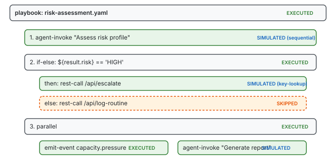

# The Runner Was Already There

I started building a dry-run mode for playbooks and ended up extracting a runner that should have existed from the beginning.

The original design had three separate execution paths for the same YAML steps. `YamlTestExecutor` runs `.test.yaml` files through Walker and StructuralStepEvaluator, collecting pass/fail results. `RunPlaybookPlugin` does the same thing inline when one playbook calls another — parse, resolve, evaluate, collect output. `CompiledStateMachine` compiles playbooks to state machines and executes them through the same StepRunner interface. Three entry points, one execution engine, no shared runner.

The dry-run request made this visible. A dry-run is "execute this playbook with simulation forced on" — that's not a mode, it's a configuration. Push a simulation overlay, run the same pipeline, pop the overlay. The infrastructure for all of this existed. What didn't exist was a class you could hand a playbook path and a config and get back a result.

## The extraction

`PlaybookRunnerCore` is the class that should have existed. It takes a `PluginRegistry`, `ServiceRegistry`, resource root, and an optional `SimulationRuntime`. Two methods: `run(path, config)` and `validate(path)`.

```java
var runner = new PlaybookRunnerCore(plugins, services, root, simulationRuntime);

// Run normally
var result = runner.run(playbook, PlaybookRunConfig.defaults());

// Dry-run with simulation
var result = runner.run(playbook, PlaybookRunConfig.forDryRun());

// Validate structure without executing
var validation = runner.validate(playbook);
```

The `run()` pipeline is what `RunPlaybookPlugin` was doing inline: parse via `PlaybookParser`, resolve variables via `PlaybookVariableParser`, resolve steps via `Walker.resolve()`, evaluate via `StructuralStepEvaluator`, collect results. When `dryRun` is true and a `SimulationRuntime` is present, it pushes an overlay before execution and pops it in the finally block — the same pattern `YamlTestExecutor` uses for `simulate:` blocks.

Once the runner existed, `RunPlaybookPlugin` became a thin delegate — seven lines of real logic mapping `PlaybookRunResult` back to the plugin's output format. The 140-line inline implementation collapsed into a function call.

## Step tracing

The runner also introduced something none of the previous paths had: a step-level execution trace.



`StepTraceNode` is a tree — each node carries an index, type, outcome, duration, and a detail map. Structural steps (if-else, parallel, match, try-catch) contain their branches as children. The tree mirrors the playbook's nesting structure, which means the trace tells you not just *what* happened but *which path* the execution took and *why*.

The outcome enum — `EXECUTED`, `SIMULATED`, `SKIPPED`, `FAILED`, `ERROR` — is the critical distinction a dry-run needs. When simulation handles a call, the trace marks it `SIMULATED` with the strategy name in the detail map. An author looking at the output can see immediately which calls would go to real backends and which would be intercepted.

## How the tracing works

The trace collector uses enter/exit semantics. `StructuralStepEvaluator` calls `beforeStep` before dispatching each step and `afterStep` after it returns. Because the evaluator is recursive — `evaluateIfElse` calls `evaluateBlock` which calls `evaluateInternal` for each child step — the enter/exit calls naturally nest. The collector maintains a stack:

```java
public void beforeStep(ResolvedStep step, int index) {
    stack.push(new Frame(index, step.name(), type, System.nanoTime(), new ArrayList<>()));
}

public void afterStep(ResolvedStep step, int index, Result result, Map<String, Object> detail) {
    Frame frame = stack.pop();
    var node = new StepTraceNode(frame.index(), frame.name(), frame.type(),
            action, outcome, durationMs, detail, frame.children());
    if (stack.isEmpty()) {
        rootChildren.add(node);
    } else {
        stack.peek().children().add(node);
    }
}
```

When the stack is empty, the node is a root-level step. When it's not, the node becomes a child of whoever's currently on top. No explicit tree construction logic — the nesting emerges from the evaluator's own recursion.

## The CLI surface

The existing `YamlTestCli` gained four flags: `--dry-run`, `--corpus`, `--profile`, `--var`. This also fixed an older gap — the CLI wasn't wiring `SimulationRuntime` at all, so `simulate:` blocks in test YAML files were silently ignored. Now both test mode and playbook mode share a properly constructed runtime.

```
$ casehub-test --dry-run examples/risk-assessment.yaml
Dry run: risk-assessment.yaml
  1  SIMULATED  agent-invoke (2ms)
  2  EXECUTED   if-else (0ms)
  3  SIMULATED  rest-call (1ms)

3/3 steps succeeded (4ms)
```

The mode detection is file-extension-based: `.test.yaml` files route through `YamlTestExecutor` (the existing test pipeline), everything else routes through `PlaybookRunnerCore`. Same binary, same plugins, same simulation infrastructure.

## The @McpDomain surface

The `PlaybookApi` interface carries `@McpDomain("playbooks")` with two operations:

- `run(PlaybookRunRequest)` — execute with optional dry-run, vars, corpus override, simulation profile
- `validate(playbookPath)` — structural validation only (Walker.resolve catches unknown keys, missing companions, depth overflow)

The graphql-generator APT produces REST endpoints automatically. A Quarkus CDI module (`playbook-runner`) and a Spring Boot auto-configuration (`playbook-runner-spring`) both delegate to `PlaybookRunnerCore` — same code path, same trace format, same dry-run semantics.

## What this is really about

Dry-run was the feature request, but the real value is the runner. A runner that takes a playbook path and returns a structured result with a trace tree is the primitive that tutorials, CI gates, MCP tooling, and IDE integration all need. Dry-run is one config flag on that primitive.

The simulation layer was always designed as an overlay stack — push config and corpus, execute, pop. What was missing was a class that composed all the pieces: parsing, variable resolution, step walking, tracing, simulation lifecycle. Now there's one place that does it, and everything else delegates.
