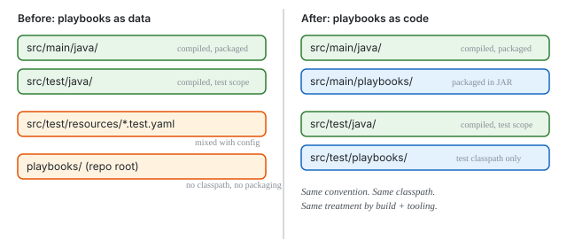

# Playbooks Are Code

We put Java sources in `src/main/java`. Test sources in `src/test/java`. Nobody argues about this. The convention is load-bearing — Maven knows where to find them, the compiler knows what to compile, IDE indexing knows what to index. The directory structure isn't organisation, it's infrastructure.

So where do playbooks go?

For months, the answer was "wherever." Production playbooks sat in a root `playbooks/` directory. Test playbooks ended up in `src/test/resources/` alongside property files and JSON fixtures. The test framework discovered `.test.yaml` files by scanning a directory tree, and the CLI resolved paths relative to the current working directory. It all worked. It was also wrong.

## The tell

The moment that made this obvious: a code review flagged `Path.of(".")` in the CDI bean that runs playbooks. The reviewer was right — in a server process, the current working directory is whatever the container decided. But the fix isn't a config property. The fix is realising that if you need a config property to find your source files, your source files are in the wrong place.

Java sources don't need a config property. They're on the classpath because Maven put them there, because they were in `src/main/java`. The convention handles resolution. Playbooks should work the same way.

## The convention

```
src/main/playbooks/     → packaged into JAR at classpath:playbooks/
src/test/playbooks/     → test classpath only
```

Maven wiring is four lines of XML — a resource directory with a target path:

```xml
<resources>
    <resource>
        <directory>src/main/playbooks</directory>
        <targetPath>playbooks</targetPath>
    </resource>
</resources>
```

The playbook runner resolves from the classpath. No filesystem paths. No config properties. No `Path.of(".")`. Test playbooks shadow or supplement production playbooks via classpath ordering — the same mechanism `application.properties` uses.

## Why this matters beyond playbooks

The deeper principle: **declarative code deserves the same structural treatment as imperative code.** When you put YAML test files in `src/test/resources`, you're saying "this is data." When you put them in `src/test/playbooks`, you're saying "this is a test." The distinction changes how tooling, build systems, and developers treat the files.



Consider what falls out naturally:

**Discovery.** A test framework that scans `src/test/playbooks/` for `.test.yaml` files doesn't need a path argument. The convention *is* the configuration. The same way JUnit discovers test classes in `src/test/java` — you don't tell it where to look.

**Distribution.** A playbook catalog module with `src/main/playbooks/` produces a JAR. Consumers add a Maven dependency and the playbooks appear on their classpath. No file copying, no filesystem assumptions. The same mechanism that distributes Java libraries distributes playbook libraries.

**IDE support.** When playbooks have a dedicated source directory, IDEs can apply language-specific behaviour. Syntax highlighting, schema validation, refactoring, navigation — all triggered by "this directory contains playbooks" rather than "this file happens to end in `.yaml`."

**Test parity.** Java tests go in `src/test/java`. Playbook tests go in `src/test/playbooks`. Both are code that verifies behaviour. Both are on the test classpath. Both are excluded from production artifacts. The parallel is exact.

## The migration that follows

Three Java test classes in `yaml-step-runtime` are boilerplate wrappers around what should be declarative test playbooks: `AgentExampleExecutionTest` (8 interaction patterns), `AgentExamplePlaybookTest` (structural assertions), `PlaybookParsingTest` (61 parse validations). Each is a Java class that manually constructs a plugin registry, builds an executor, runs a playbook, and asserts on the result.

As `.test.yaml` files in `src/test/playbooks/`, the same tests become:

```yaml
name: Risk assessment produces moderate result
simulate:
  agent:
    - prompt: "risk"
      response: "Moderate risk: 60% equities."
steps:
  - run-playbook: examples/risk-assessment.yaml
    capture: result
  - assertThat: ${result.output.text}
    contains: 'Moderate'
```

No registry construction. No executor wiring. No Java imports. The test framework handles all of that — the same way JUnit handles test class instantiation and lifecycle. The author writes the test, not the infrastructure.

## The principle

Every time a declarative language matures past "config files" into "executable behaviour," the same question surfaces: do you treat it as data or as code? Config files live in `resources`. Code lives in source directories with conventions, classpath semantics, and tooling integration.

Playbooks crossed that line. They have variables, parameters, control flow, error handling, assertions, imports. They're executed, tested, versioned, and reviewed. Putting them in `src/test/resources` next to `logback-test.xml` undersells what they are.

The directory structure is the first thing a new developer sees. `src/test/playbooks/` says "these are playbook tests" before anyone reads a line of YAML.
