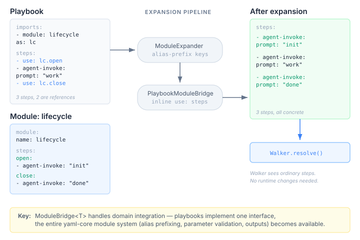

# The Bridge Was the Design

yaml-core has had a module system for months. `ModuleExpander` handles alias prefixing, parameter validation, cross-module reference checking, output resolution, conditional imports, forEach expansion. It was built for case definitions — reusable node configurations that compose into larger workflows. Playbooks never touched it.

The result was predictable. Every test that needed the same agent simulation repeated the setup inline. Every playbook that shared step sequences with another playbook duplicated them. When the third copy of a six-step session lifecycle appeared in a code review, the duplication became hard to defend.

## What was already there

The module system isn't a library you call. It's a pipeline with a domain integration point — `ModuleBridge<T>`. The bridge has two methods that matter:

```java
public interface ModuleBridge<T> {
    T fromSections(Map<String, Map<String, Object>> sections);
    Map<String, Map<String, Object>> toSections(T content);
}
```

`ModuleExpander` works on sections — generic named maps of named entries. It doesn't know what a "step" is or what a "playbook" is. The bridge translates between the domain's content model and the section model. After expansion, the bridge translates back.

Case definitions implemented this months ago. Their sections are node configurations — sensors, actions, rules. The expander merges them with alias-prefixed keys, validates parameters, resolves outputs. The case definition bridge converts between the domain model and the generic sections.

Playbooks needed the same thing.

## What a playbook module looks like

```yaml
module:
  name: session-lifecycle
  parameters:
    timeout:
      type: INTEGER
      default: 30
  outputs:
    default-timeout:
      type: STRING
      value: "${var.timeout}"

steps:
  open-session:
    - agent-invoke:
        prompt: "open session"
  close-session:
    - agent-invoke:
        prompt: "close session"
```

A module declares parameters (typed, constrained, with defaults), outputs (templates resolved from parameters), and named step sequences. The format is a standard `YamlModuleFile` — the same record case definitions use. No new types.

A playbook that imports it:

```yaml
imports:
  - module: session-lifecycle
    as: lc
    parameters:
      timeout: "60"

steps:
  - use: lc.open-session
  - agent-invoke:
      prompt: "do work"
  - use: lc.close-session
```

`use: lc.open-session` is resolved at parse time — the steps get inlined before Walker sees them. After expansion, the playbook has a flat list of concrete steps. Walker, tracing, dry-run, error reporting — none of them changed. Zero runtime modifications.



## The decision that mattered

Inline expansion versus runtime dispatch. A `use:` step could have been a new step type — Walker encounters it, looks up the module, runs the steps in a scoped context. That preserves the abstraction boundary: the trace would show "lc.open-session" as a single node rather than its constituent steps.

I chose inline expansion. Three reasons.

First, consistency. `ModuleExpander` already works by merging sections at parse time — keys get alias-prefixed, content gets merged, the result is a flat structure. Making `use:` a runtime step would introduce a second execution model that contradicts how the module system works everywhere else.

Second, simplicity. The playbook pipeline has a clean insertion point between `PlaybookParser.parse()` and `Walker.resolve()`. Three lines of code in `PlaybookRunnerCore.run()`. No new step type in Walker. No new case in `StructuralStepEvaluator`. No scope isolation logic. The feature is the absence of new runtime machinery.

Third, tracing. When a module step fails, the trace shows exactly which `agent-invoke` failed and what its prompt was. A runtime dispatch would show "lc.open-session failed" — useful for localisation, useless for debugging. The flat trace is what you actually want when something goes wrong.

## Module discovery

Modules are found by convention. `FileSystemModuleLoader` looks for `modules/<name>.yaml` relative to the playbook file, then falls back to `META-INF/playbook-modules/<name>.yaml` on the classpath.

The relative path means test modules sit beside test playbooks — no classpath configuration, no registration. The classpath fallback means shared modules ship as JARs. Add a Maven dependency, the module appears. The same distribution mechanism Java has used for twenty years.

## What this actually enables

Shared simulation configurations are the immediate win. A module can declare a corpus setup as step sequences with parameterized outputs. Instead of every test file repeating the simulation block, they import the module and reference its outputs:

```yaml
imports:
  - module: financial-simulation
    as: fin
    parameters:
      model: "claude-3"

steps:
  - use: fin.configure
  - agent-invoke:
      prompt: "using model ${module.fin.configured-model}"
```

The module's `configured-model` output resolves from its parameters. The playbook references it via `${module.fin.configured-model}`. No deep-merge of simulation blocks, no override semantics, no ambiguity about which config wins. The dependency is explicit and visible.

Step libraries follow naturally. A `session-lifecycle` module with open/close sequences. An `error-recovery` module with retry patterns. A `data-setup` module that provisions test fixtures. Each is a YAML file in a `modules/` directory, imported by name, parameterized for the specific context.

## The principle

When you build an abstraction, you don't know how many domains will use it. `ModuleBridge<T>` was designed for one domain — case definitions. Playbooks are the second. The bridge worked without modification. The module system — parameter validation, output resolution, alias prefixing, extension inheritance — all of it transferred.

That's not a coincidence. It's what happens when the abstraction models the right thing. Sections, named entries, typed parameters, and a domain bridge are general enough to serve any YAML-based composition system. The specifics live in the bridge implementation, not in the module system.

The bridge was two methods. The feature was everything those two methods connected to.
