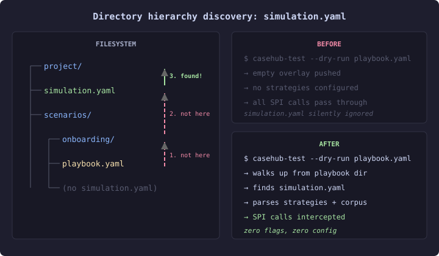

# The Convention That Stopped at the Container

The CDI startup in `simulation-config` does something sensible: it looks for `simulation.yaml` on the classpath, parses it, and configures the simulation runtime. No flags needed. Drop the file, start the app, simulation is active. Convention over configuration at its most obvious.

The CLI runner didn't do this.

`casehub-test --dry-run playbook.yaml` without a `--corpus` flag pushed an empty simulation overlay. No strategies, no corpus, no interception. The `simulation.yaml` sitting right next to the playbook — the one a developer put there specifically for dry-run testing — was silently ignored.

## Why the gap existed

The container and the CLI have different substrate assumptions. CDI discovers resources from the classpath — a flat namespace where `cl.getResourceAsStream("simulation.yaml")` finds anything on the classpath root. The CLI runner operates on the filesystem, where "convention discovery" means walking a directory hierarchy.

`PlaybookRunnerCore.activateSimulation()` had two paths: explicit `--corpus` (parse the given file), or nothing (push an empty overlay). The convention path — discover the file by walking up from the playbook's location — was documented in the spec but never implemented.



## Why it matters for practitioners

Simulation-driven testing only works when simulation is zero-ceremony. Every flag you have to remember, every config file you have to explicitly point at, is friction that pushes developers back toward mocks and stubs. The whole point of convention discovery is that the developer's mental model is "put the file next to the playbook and it works."

This is the same pattern as `.gitconfig` walking up to find the nearest config, or `tsconfig.json` extending from a parent directory, or Maven's `settings.xml` resolution. The filesystem hierarchy is the one convention substrate that every execution context shares — containers, CLIs, CI runners, IDEs. A convention built on the filesystem transfers everywhere. A convention built on the classpath stops at the container boundary.

## The fix

Twenty lines. Walk up from the playbook's parent directory, check for `simulation.yaml` (or `.yml`), parse via `YamlSimulationConfig` if found, fall through to empty overlay if not.

```java
static Path discoverSimulationYaml(Path playbookPath) {
    Path dir = playbookPath.getParent();
    while (dir != null) {
        Path candidate = dir.resolve("simulation.yaml");
        if (Files.exists(candidate)) return candidate;
        candidate = dir.resolve("simulation.yml");
        if (Files.exists(candidate)) return candidate;
        dir = dir.getParent();
    }
    return null;
}
```

The hierarchy walk means a project can share one `simulation.yaml` across many playbooks. Put it at the project root, put playbooks in subdirectories, and every `--dry-run` picks it up. Override by placing a more specific one closer to the playbook — nearest wins, same as every other hierarchy-walking convention.

## The broader lesson

Every framework convention that depends on the framework's own discovery mechanism — classpath scanning, annotation processing, DI container events — is a convention that breaks the moment you step outside that framework. The CLI is the simplest boundary. CI pipelines, embedded runtimes, and test harnesses are others.

The filesystem is the universal substrate. If the convention works there first, it works everywhere else by inclusion. We had it backwards: the CDI convention should have been built on top of the filesystem convention, not the other way around.

That's a twenty-line fix with a design lesson attached.
