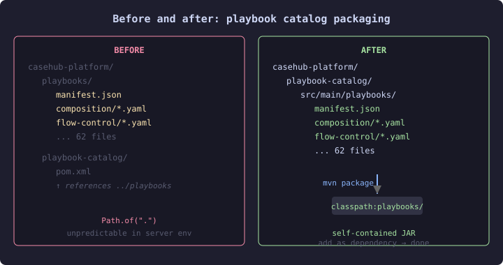

# Playbooks Are Not Source Code Until They Are

For months, the playbook catalog lived at the repository root. Sixty-two YAML files in a `playbooks/` directory, siblings to `pom.xml` and `.gitignore`. The `playbook-catalog` module existed, but it was a shell — its POM reached outside its own boundary with `${project.basedir}/../playbooks` to package someone else's files.

The CDI beans that served these playbooks used `Path.of(".")` as the resource root. In a developer's IDE, that resolves to the project directory. In a Quarkus dev-mode session, same. In a deployed JAR? Wherever the JVM's working directory happens to be — which is not a question you want your playbook resolution to depend on.

## What changed

Two conventions landed in the same session and composed into something neither was designed for independently.

The first was the source directory convention: `src/main/playbooks/` for production playbooks, `src/test/playbooks/` for test fixtures, Maven resource declarations that map both to `classpath:playbooks/`. This mirrors what Java does with `src/main/java` and `src/main/resources` — your source files follow a directory convention, Maven handles the compilation and packaging, consumers find them on the classpath at runtime.

The second was the catalog migration: move the sixty-two playbooks from the repository root into `playbook-catalog/src/main/playbooks/`. Delete the root directory. Make the module self-contained.

The combined effect: `mvn package` produces a JAR with all playbooks at `classpath:playbooks/`. Any consumer — engine, ops, helpdesk — adds a dependency and gets the full catalog. No filesystem paths, no `Path.of(".")`, no configuration.

## Why self-containment matters

A Maven module that references files outside its own directory is fragile in ways that don't surface until deployment. The `${project.basedir}/../playbooks` construct works in the reactor build. It works in CI. It doesn't work when someone publishes the module to a repository and a downstream consumer tries to build against it — the `../playbooks` directory doesn't exist in their checkout.

Self-containment means the module's published artifact contains everything it needs. The POM declares `src/main/playbooks` as a resource directory with `targetPath: playbooks`. Maven copies the files into the JAR. The consumer's classpath includes them. No coordination required.

## The test that proved it

`PlaybookParsingTest` — sixty-one dynamic tests, one per catalog entry — switched from `Path.of("playbooks")` with a filesystem walk-up fallback to classpath resolution. The same test that used to depend on a specific working directory now finds its playbooks wherever Maven puts them.

`PlaybookSchemaValidationTest` — seventy-two tests validating every catalog playbook against the JSON Schema — made the same transition. Both test classes live in `yaml-step-runtime` with `playbook-catalog` as a test dependency. The catalog JAR provides the content; the runtime module provides the parsing and validation infrastructure.

## The broader pattern

Playbooks started as examples — hand-written YAML files that demonstrated what the step language could do. Examples don't need packaging. They live in a directory, you point a CLI at them, they run.

But examples that get consumed by multiple repositories, validated by a schema, parsed by a test harness, and served at runtime via a CDI bean are no longer examples. They're source code that happens to be written in YAML. And source code follows source conventions — a module boundary, a directory layout, a packaging pipeline, a classpath contract.

The moment you need `Path.of(".")` to find your content, you've outgrown the filesystem. The classpath is the contract between "I produced this" and "I consume this" in a JVM ecosystem. Using it is not ceremony — it's the mechanism that makes distribution reliable.
