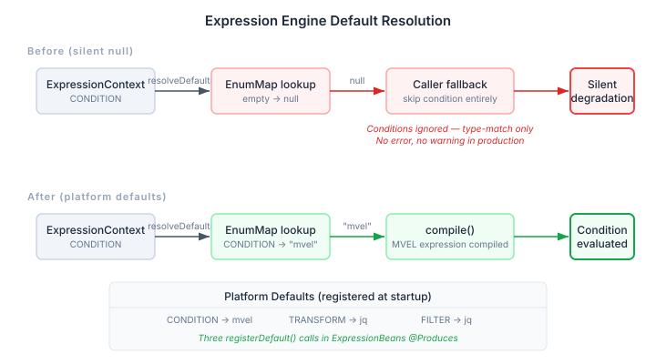

# The Defaults Nobody Registered

CaseHub's expression module has an `ExpressionEngineRegistry` — a pluggable dispatch layer that maps type keys like `"mvel"` or `"jq"` to compiled expression engines. Three engines register themselves at startup. The registry works. You can call `compile("mvel", expression, ...)` and get a compiled expression back.

The registry also has a second API surface: context-aware defaults. Instead of hard-coding which engine evaluates a condition filter, callers ask the registry what the platform default is for a given `ExpressionContext` — CONDITION, TRANSFORM, or FILTER. The design spec from months ago defined the mappings: CONDITION goes to MVEL, TRANSFORM and FILTER go to JQ.

The engines were registered. The defaults were not.

## The Shape of the Bug

`resolveDefault(ExpressionContext.CONDITION)` returns null in production. Not an exception — null. The `EnumMap` that backs the defaults is empty because nobody calls `registerDefault()` during bootstrap. The `ExpressionBeans` producer creates the registry, populates it with engine instances via CDI discovery, and returns it. Three `@Produces` methods for the engines, one for the registry. All clean. All tested. All missing the three lines that wire context to engine.

This is an easy class of bug to write. The engine registration is discovery-based — CDI finds the beans, the constructor loops through them, the map populates itself. The default registration is imperative — someone has to call `registerDefault()` explicitly. The mechanism exists. The call site doesn't.

What makes it interesting is how it fails. The `CorpusSelectionEventObserver` — the component that evaluates trigger conditions on CloudEvents — asks the registry for the default CONDITION engine. It gets null. Instead of throwing, it logs a warning and falls back to type-match-only evaluation. The trigger fires on every matching event type regardless of the condition expression. Filters stop filtering.

```java
String engineType = registry.resolveDefault(ExpressionContext.CONDITION);
if (engineType == null) {
    LOG.warning("Trigger '" + triggerName + "' has a condition but no default CONDITION"
            + " engine is registered — trigger will fire on event type match only");
}
```

The warning is correct and helpful — in a log. In production, with dozens of event types flowing through, a warning per trigger per startup gets buried. The system appears to work. Events arrive. Triggers fire. Subscriptions match. The only visible symptom is that conditions are being ignored, and that's only visible if you're specifically checking whether a filter narrowed the result set.

## Why Silent Degradation Is Worse Than a Crash

A `NullPointerException` at startup would have surfaced this immediately. The defensive fallback — designed to be resilient — instead masked the configuration gap for months. The registry has been deployed since the expression module was built. The default mechanism was added later as part of the subscription engine design. The `registerDefault()` calls that should have accompanied it were never written.

This is a pattern worth watching for in any registry that has both discovery-based and imperative registration paths. CDI, Spring auto-configuration, and service loader all handle the discovery side automatically. The imperative side — the configuration that says "for this context, use that implementation" — depends on someone writing the glue code. It's the kind of code that doesn't have a natural home. It's not the engine's responsibility. It's not the registry's. It falls to the wiring layer, and wiring layers are exactly where gaps hide.



## The Fix

Three lines in the `@Produces` method that creates the registry. Both Quarkus and Spring get the same treatment:

```java
var registry = new DefaultExpressionEngineRegistry(engines.stream().toList());
registry.registerDefault(ExpressionContext.CONDITION, "mvel");
registry.registerDefault(ExpressionContext.TRANSFORM, "jq");
registry.registerDefault(ExpressionContext.FILTER, "jq");
return registry;
```

The defaults live in the wiring layer — `ExpressionBeans` for Quarkus, `ExpressionSpringAutoConfiguration` for Spring — not in the core registry class. The registry is framework-neutral and shouldn't encode platform policy. The wiring layer is where platform policy belongs.

## The Broader Pattern

Expression evaluation runs through two distinct paths in CaseHub. The subscription engine's `SubscriptionEngine` takes the explicit path — each subscription carries its own `ExpressionEvaluator` with the engine type baked in, so it calls `compile("mvel", ...)` directly. No default lookup, no gap.

The event-driven path — `CorpusSelectionEventObserver`, and anything else that evaluates conditions declared in YAML configuration — takes the implicit path. Configuration says "evaluate this condition" without specifying which engine. The caller asks the registry what the platform default is. That's where the null lives.

Both paths are valid. The explicit path is self-contained — the engine type travels with the expression. The implicit path is more convenient for configuration-driven systems where specifying `engine: mvel` on every condition is noise. But the implicit path only works when the defaults are actually registered.

Any platform that offers context-aware defaults in a registry needs to treat the default registration as a first-class startup concern — not something a consumer might do, but something the platform guarantees. If the mechanism exists, the population must be mandatory. An empty default map should be a startup failure, not a runtime null.
