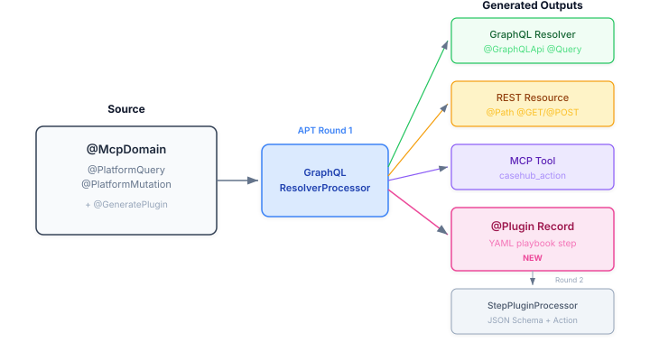
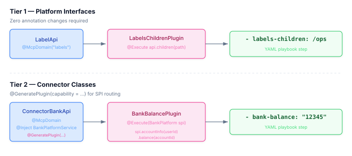

# One Source, Four Surfaces: Generating YAML Playbook Steps from API Annotations

CaseHub has thirteen connector domains — banking, voice, chat, email, calendar, commerce, and more. Each one defines its operations in a Java class annotated with `@McpDomain` and `@PlatformQuery`/`@PlatformMutation`. From those annotations, an APT (annotation processor) already generates three things: a GraphQL resolver, a REST endpoint, and an MCP tool definition. One source class, three generated surfaces.

We just added a fourth: `@Plugin` playbook step types.



## Why generate plugins?

Each connector domain has 5–10 operations. Thirteen domains, roughly 60–80 operations. Each one that should be usable as a YAML playbook step needs a hand-written `@Plugin` record — a Java record class with `@Required`/`@Optional` fields, an `@Execute` method that calls the SPI, and result conversion to a `Map<String, Object>`. The existing hand-written plugins for bank-balance, chat-send, email-messages, tts-synthesise, and stt-transcribe all follow the same structural pattern. That pattern is entirely derivable from the information already present in the API annotations.

The arithmetic is straightforward: 60–80 operations × a record class each = 60–80 files of boilerplate. When the API changes a parameter name, the plugin must change too. When a new connector domain appears, its plugins need writing from scratch. This is exactly the kind of mechanical coupling that annotation processing exists to eliminate.

## The two-tier problem

The design hit an interesting constraint. CaseHub has two kinds of `@McpDomain` types, and they need different treatment.

**Platform interfaces** — `@McpDomain` on a Java interface like `LabelApi` or `AclApi`. No `@Inject` fields. The plugin can call the interface method directly. Generation is trivial: parameter mapping, result conversion, done. No annotation changes needed.

**Connector classes** — `@McpDomain` on a CDI bean like `ConnectorBankApi` with `@Inject BankPlatformService bankService`. The API method does platform routing (`bankService.platform("stripe")`) and capability dispatch (`p.accountInformation(userId).balance(accountId)`) through sub-interfaces. The generated plugin can't delegate to the CDI bean — the YAML test engine uses `MapServiceRegistry`, not CDI, so it can't construct `@Inject`-annotated classes. The plugin needs the resolved SPI type (`BankPlatform`) as its `@Execute` parameter and must reproduce the capability call chain.



The APT can't see method bodies — only signatures and annotations. So for Tier 2, it needs explicit metadata: which capability sub-interface does this method access? The `@GeneratePlugin` annotation carries that:

```java
@PlatformQuery("Get current balance for a bank account")
@GeneratePlugin(capability = AccountInformation.class,
                absorb = true, subject = "accountId")
public AccountBalance balance(
        @QueryParam("platform") String platform,
        @PathParam String accountId) { ... }
```

The APT reads `capability = AccountInformation.class`, decapitalizes to get the accessor name (`accountInformation`), introspects its parameters via Jandex (`String userId`), and generates the full call chain. A compile error fires if the accessor doesn't exist on the SPI type — no silent failures.

## Shape control — making the YAML beautiful

Generated code that merely works isn't enough. The YAML surface has to feel hand-crafted. Three attributes on `@GeneratePlugin` control the shape:

- **`subject`** names the parameter that accepts bare values: `- bank-balance: "12345678"` instead of requiring the map form
- **`absorb`** enables single-line key-value syntax: `- bank-balance: { accountId: "12345", userId: alice }`
- **`name`** overrides the generated plugin name when the default (`bank-list-transactions`) is clunky

Default values propagate too. When the source method has `@DefaultValue("wav")` on a parameter, the generated plugin applies it in a compact constructor — the YAML user sees an optional field with a sensible default, not a required field that happens to work when omitted.

## The APT chain

One subtle piece: the generated `@Plugin` records need processing by `StepPluginProcessor`, which generates JSON Schema, Action classes, and registry manifests. But both processors run in the same compilation — and `StepPluginProcessor` had a `processed = true` guard that prevented it from seeing types generated in later APT rounds.

The fix is the standard multi-round pattern: replace the boolean with a `Set<String>` of processed qualified names. Round 1 generates the `@Plugin` records. Round 2, `StepPluginProcessor` discovers them and emits the schema and binding code. Two processors, one compilation, correct ordering.

## What it looks like

A platform interface method with no annotation changes:

```java
@McpDomain("labels")
public interface LabelApi {
    @PlatformQuery("List child labels under a path")
    List<LabelDescriptor> children(String parentPath);
}
```

generates:

```java
@Plugin(value = "labels-children",
        description = "List child labels under a path")
public record LabelsChildrenPlugin(@Required String parentPath) {
    @Execute
    public Result execute(LabelApi api) {
        var result = api.children(parentPath);
        return Result.of(Map.of("items",
            result.stream().map(Records::toMap).toList()));
    }
}
```

The YAML author writes `- labels-children: /ops/alerts` and the step calls the same interface that drives the REST and MCP surfaces.

## Records.toMap — the flatten utility

Generated plugins return `Result.of(Records.toMap(result))`. This is a new utility in `yaml-step-runtime` that reflectively converts Java records to `Map<String, Object>` — recursive for nested records, unwrapping `Optional`, mapping `List<Record>` elements. Ten lines of reflection that replace per-plugin manual `LinkedHashMap.put()` chains.

The J2CL-safe `yaml-plugin-api` module stays zero-dependency. `Records.toMap` lives in the runtime where reflection is available and expected.

## The practical payoff

The feature ships behind `generatePlugins=true` (default false) — zero impact on existing builds. When a consumer enables it, every `@PlatformQuery`/`@PlatformMutation` method across every `@McpDomain` on the classpath gets a type-safe YAML playbook step. Sixty to eighty generated plugins from the connector domains alone, plus platform interface methods.

Hand-written plugins with MCP equivalents become redundant. The five existing ones (bank-balance, chat-send, email-messages, tts-synthesise, stt-transcribe) can be deleted once the generated equivalents are verified. Processing-only plugins without MCP methods — audio manipulation, speaker identification — stay hand-written. They have no `@PlatformQuery` annotation, so the generator never touches them.

One source. Four surfaces. Zero boilerplate.
