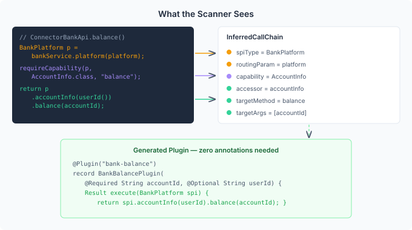
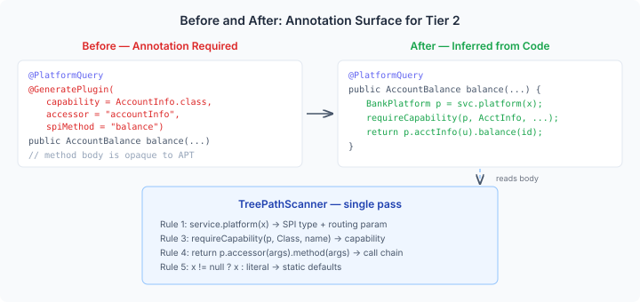

# The Annotation the Code Already Knew

Earlier today I wrote about generating YAML playbook plugins from `@PlatformQuery` annotations — one source class, four generated surfaces. Tier 1 (platform interfaces) worked with no annotation changes. Tier 2 (connector classes) didn't. The APT couldn't see method bodies, so the developer had to tell it what the code already said:

```java
@GeneratePlugin(capability = AccountInformation.class,
                accessor = "accountInformation",
                spiMethod = "balance")
public AccountBalance balance(String platform, String accountId) {
    BankPlatform p = bankService.platform(platform);
    requireCapability(p, AccountInformation.class, "balance");
    return p.accountInformation(userId()).balance(accountId);
}
```

Three annotation attributes that duplicate information visible in the method body. Across thirteen connector domains and sixty-plus operations, that's a lot of boilerplate telling the compiler what it could figure out by reading the next five lines.

## The compiler can read the code

The javac Compiler Tree API (`com.sun.source.util`) gives annotation processors access to the full source AST of classes compiled in the current round. Standard APT only sees signatures and annotations — types, parameters, return values. The Trees API opens the method body: variable declarations, method invocations, return statements, control flow. It's a supported, exported API from the `jdk.compiler` module, not an internal implementation detail.

A `TreePathScanner` walks the AST in a single depth-first pass. We built one that recognises the connector method pattern and extracts the SPI call chain — everything those three annotation attributes were carrying.



## What the scanner recognises

Every connector method in the codebase follows one of two structural patterns. The scanner has a recognition rule for each AST shape.

**Standard routing** — the majority. A `service.platform(routingParam)` call assigns an SPI-typed local variable. A `requireCapability()` call validates the capability. The return statement chains through an accessor to the target method.

```java
BankPlatform p = bankService.platform(platform);
requireCapability(p, AccountInformation.class, "balance");
return p.accountInformation(userId()).balance(accountId);
```

The middle line — `requireCapability` — is a runtime guard. A banking SPI like `BankPlatform` has multiple capability sub-interfaces: `AccountInformation` for balances and transactions, `PaymentInitiation` for transfers. Not every provider implements every capability. Stripe might support account queries but not payment initiation; a regional bank might support both. `requireCapability` checks at call time whether the resolved platform actually supports the capability this method needs, and throws a typed `UnsupportedCapabilityException` with the list of what the platform does support — so the caller gets a diagnostic error — which platform, which capability, what it does support — instead of an opaque exception from somewhere inside the provider.

Every connector method has one. The pattern is uniform: resolve the platform, guard the capability, chain through the accessor to the target method. Three lines, six pieces of information: SPI type, routing parameter, capability class, capability accessor, target method, target arguments. The scanner extracts all of them by visiting `VariableTree`, `ExpressionStatementTree`, and `ReturnTree` nodes in a single pass.

**Helper-method routing** — the voice connector pattern. A helper resolves the platform through a non-standard path, but the SPI call chain is structurally identical once the variable is assigned.

```java
ResolvedVoice resolved = resolveVoice(voice, language);
VoicePlatform platform = resolved.platform();
requireCapability(platform, TextToSpeech.class, "speak");
return platform.textToSpeech().synthesise(text, options);
```

The scanner handles this by tracking all variable declarations — not just `service.platform()` calls. A zero-argument `.platform()` call on any tracked variable sets the SPI type from the variable's declared type.

## What the scanner also catches

Beyond the core call chain, two patterns feed richer plugin generation.

**Static defaults.** When a connector method normalises an optional parameter — `int size = pageSize != null ? pageSize : 50` — the scanner detects the ternary pattern and records the default. The generated plugin gets `@Optional Integer pageSize` with a compact constructor that applies the default. The YAML author can omit `pageSize` and get 50 without knowing it.

**`requireCapability()` cross-validation.** The third argument to `requireCapability` is a string naming the expected method. The scanner captures this and cross-validates against the target method inferred from the return chain. If they disagree — the connector calls `requireCapability(p, Cap.class, "list")` but returns `p.cap().find()` — inference fails with `CAPABILITY_MISMATCH` and the method falls back to annotation-based resolution.

## What falls back

Not every connector method fits the pattern. The scanner explicitly handles these by failing gracefully and deferring to `@GeneratePlugin` annotations:

- **Non-direct return transformation** — Voice `speak()` doesn't return the SPI result. It Base64-encodes audio, extracts metadata, and constructs a DTO. The return expression isn't a method chain on the SPI variable, so the scanner can't infer the call chain. These methods stay hand-written.
- **Multiple return statements** — if/else branching around SPI calls introduces ambiguity about which chain to use. The scanner sets `MULTIPLE_RETURNS` and falls back.
- **No SPI variable** — utility methods like `listVoices()` that query a registry directly, without `service.platform()`. No SPI type is detected; `NO_SPI_VARIABLE` is set.

Lambda expressions and anonymous class bodies are explicitly scoped out — the scanner doesn't recurse into them. A `stream().filter(a -> { return a.isActive(); })` won't trigger a false `MULTIPLE_RETURNS`.

## The annotation surface shrinks



For the majority of connector methods — the standard routing pattern — `@GeneratePlugin` becomes entirely optional. The capability, accessor, and SPI method attributes are inferred from the code. Only shape-control attributes (`absorb`, `subject`, `name`) remain when the developer wants to tune the YAML surface.

```java
// Before: three redundant attributes
@GeneratePlugin(capability = AccountInformation.class,
                absorb = true, subject = "accountId")

// After: only shape control
@GeneratePlugin(absorb = true, subject = "accountId")
```

For methods with no shape overrides — the majority — the annotation disappears entirely. The connector method is the single source of truth: the code says what it does, the generator reads what the code says, and the plugin reflects both.

The fallback path is always there. A method that doesn't match any recognised pattern gets a NOTE in the build summary and falls back to annotation-based resolution. The `@GeneratePlugin` attributes become escape hatches, not the default path.

Each generated plugin carries a source comment — `// resolved via: AST inference` or `// resolved via: @GeneratePlugin annotation` — so when something looks wrong, you know immediately which path produced it.
