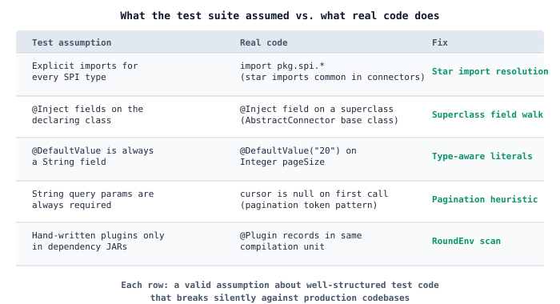
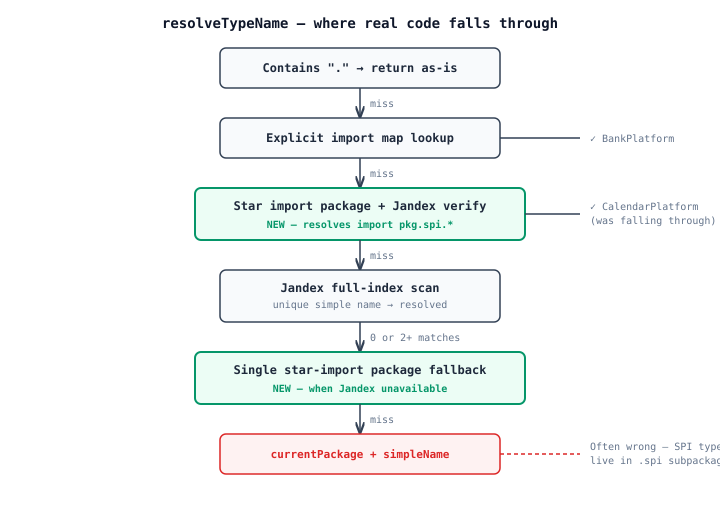

# The Code Your Tests Don't Write

Earlier today I wrote about the AST scanner that reads connector method bodies and infers plugin generation metadata from the code itself. Eighty-seven of a hundred and twenty-one methods generated cleanly. The remaining thirty-four used identical patterns to the working ones — same service injection, same `.platform()` call, same capability chain — and failed silently.

The scanner worked. The tests passed. The code was correct. And a quarter of the real codebase fell through every resolution stage without producing a single diagnostic that explained why.

## Where real code diverges

The test suite for the type resolver compiled all its sources in a single package with explicit imports. Every type had a unique simple name. Every connector class declared its own `@Inject` field. These are reasonable conventions. They are also conventions that real connector codebases don't uniformly follow.



Five gaps, five fixes. Each one is a place where the resolution pipeline made a structurally valid assumption that real code violates routinely.

## Star imports break type resolution

The first gap was the most common. `resolveTypeName` builds an import map from the compilation unit's import declarations. Star imports — `import io.casehub.connectors.calendar.spi.*;` — were explicitly skipped:

```java
if (!fqcn.endsWith(".*")) {
    String simple = fqcn.substring(fqcn.lastIndexOf('.') + 1);
    map.put(simple, fqcn);
}
```

When a connector class uses a star import (common when a single SPI package defines the platform type, capability interfaces, and result types), every type from that package is invisible to the import map. The resolver falls through to a Jandex full-index scan — which works only if the simple name is globally unique. If two packages both define a type with the same simple name, the scan returns multiple candidates and gives up. The fallback prepends the current package — almost always wrong, because SPI types live in a `.spi` subpackage below the connector.



The fix tracks star import packages separately and tries them before the expensive full-index scan. Each candidate is verified against Jandex, so ambiguity is impossible — the star import package that actually contains the type wins. When Jandex is unavailable (the source is in the current compilation unit, not a dependency JAR), a single star-import package is used directly. Java's own compilation succeeded, so the resolution is unambiguous.

## Superclass fields are invisible to field scanning

The Tier 2 Jandex resolution scans the connector class for `@Inject` fields, finds the service type, and looks for a `platform(String)` method. It used `classInfo.fields()` — which returns only fields declared directly on the class. Connector classes that inherit their service field from an `AbstractConnector` base class are invisible.

The fix walks the Jandex superclass chain via `superName()`. An injected field three levels up is still an injected field.

## Three type-system gaps

The remaining three fixes are smaller but instructive — each one is a place where the generator's type model was too simple for real API surfaces.

**Default value literals.** The `@DefaultValue` annotation carries a String. The generator emitted it as a String literal in the compact constructor: `if (pageSize == null) pageSize = "20";` — assigning a String to an Integer. The fix checks the parameter type and emits the appropriate literal: unquoted numerics, `L` for long, `f` for float, `.0` for whole-number doubles. Only String and unknown types keep the quotes.

**Pagination parameters.** The Required/Optional heuristic treats String query parameters without defaults as required. But `cursor` is null on the first page call — it's a token from the previous response. The fix names pagination-convention parameters (`cursor`, `pageToken`, `nextPageToken`, `syncToken`) and marks them unconditionally optional. A name-based heuristic, not a type-based one — because the type system can't distinguish a pagination token from a category filter. Both are `String`. The name carries the intent.

**Plugin skip detection.** The generator checks whether a hand-written plugin already exists with the same name before generating one. The check scanned the Jandex index — covering dependency JARs — but not the `RoundEnvironment` — covering classes in the current compilation unit. A hand-written `@Plugin` record compiled alongside the connector was invisible. The fix mirrors the pattern the GraphQL and REST skip scanners already used: scan both sources.

## The meta-observation

None of these were bugs in the resolution logic. Each rule did exactly what it was designed to do. The problem was the design's scope: it assumed a code structure that was true of the tests and true of some production connectors, but not all.

Star imports are a code style choice. Superclass injection is an abstraction choice. Pagination parameters are a naming convention. None of them are wrong. None of them are unusual. They're just the kind of variation that doesn't appear in hand-crafted test fixtures, because test authors write the simplest code that demonstrates the feature.

The gap between "passes tests" and "works on all real code" is almost never about correctness. It's about the assumptions embedded in how the test code is written — assumptions so natural that they're invisible until production code violates them.
