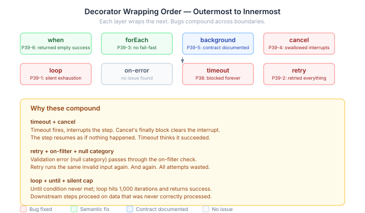

# Seven Decorators, Seven Contracts

A decorator in a playbook runtime is a small piece of wrapping logic — `timeout`, `retry`, `cancel`, `when`, `loop`, `forEach`, `background`. Each one modifies how a step executes. Chain several together and the interactions multiply fast: timeout wraps retry, cancel wraps the step that timeout is monitoring, loop contains the retry that contains the step. Every decorator needs a stated contract — what it promises, what it doesn't, and what happens at the edges. Without that, the runtime appears to work until a composition hits an unspecified boundary, and then fails silently.

We had seven decorators. None had a contract. All of them worked in the happy path. Five of them had bugs that only surfaced in composition, concurrency, or edge-case conditions.

## The bugs that compound

The interesting thing about decorator bugs is that they don't just break individually — they compound across wrapper boundaries.

**Timeout + cancel.** `wrapTimeout` runs the step on a virtual thread, waits with `future.get(adjustedMs, MILLISECONDS)`, then cancels on timeout. `wrapCancel` watches for a signal, interrupts the step thread when it fires, and clears the interrupt flag in its `finally` block with `Thread.interrupted()`. Here's the problem: cancel clears *any* interrupt. When timeout fires first and interrupts the step, cancel's finally block clears that interrupt. The step carries on as though nothing happened. Timeout thinks it timed out; the step doesn't know it was supposed to stop.

The fix is a one-field change — an `AtomicBoolean cancelFired` that the watcher sets before interrupting. The finally block only clears the interrupt when the cancel signal actually caused it. But you'd never find this bug by testing cancel or timeout in isolation. It only appears in the composition.

**Timeout + uninterruptible steps.** A subtler version of the same theme. `wrapTimeout` used `try-with-resources` on the executor. `ExecutorService.close()` calls `awaitTermination(Long.MAX_VALUE)`. If the step ignores `Thread.interrupt()` — a busy loop, a native call, anything that doesn't check the interrupt flag — the timeout blocks forever. The caller asked for a 50ms timeout and gets an infinite wait.

```java
// Before: blocks forever if the step ignores interrupts
try (var executor = Executors.newVirtualThreadPerTaskExecutor()) {
    Future<Result> future = executor.submit(() -> inner.execute(ctx));
    return future.get(adjustedMs, TimeUnit.MILLISECONDS);
    // close() calls awaitTermination(MAX_VALUE) — blocks here
}

// After: return immediately, let the orphaned thread die
var executor = Executors.newVirtualThreadPerTaskExecutor();
Future<Result> future = executor.submit(() -> inner.execute(ctx));
try {
    Result result = future.get(adjustedMs, TimeUnit.MILLISECONDS);
    executor.shutdown();
    return result;
} catch (TimeoutException e) {
    future.cancel(true);
    executor.shutdownNow();
    return Result.failed("Step timeout after " + timeout);
}
```

Virtual threads make this safe — no thread pool to corrupt, no resources held beyond the orphaned thread's stack. The key insight: a timeout decorator that doesn't return on time isn't a timeout.

## The quiet failures

Three of the bugs were about silent success where failure should have been reported.

**Loop exhaustion.** An `until` loop that never meets its condition hits a 1,000-iteration cap and returns the last successful result. Downstream steps proceed on data that was never correctly processed. The fix: return failure when an until loop exhausts without satisfaction.

**Retry filter bypass.** When you specify `retry: {max: 3, on: [transient]}`, you're saying "retry transient failures, stop on everything else." The implementation checked `failCat != null && !onCategories.contains(failCat)` — which means a failure with no category (null) passes through the filter and gets retried. Validation errors, type mismatches, anything without an explicit category gets the same treatment as a transient network blip. One character fix: `failCat == null ||` instead of `failCat != null &&`.

**Skipped steps.** `when: false` returned `Result.of(Map.of())` — an empty success, identical to what a step that executed and produced no output returns. Callers couldn't tell whether the step ran and had nothing to say, or never ran at all. This matters for tracing: a trace that shows EXECUTED for a skipped step is lying.

The solution was a new `Result.Skipped` variant on the sealed interface. The design question was whether `isSuccess()` should return true or false. If false, every block, loop, and retry that checks `!isSuccess()` stops on a skipped step — a block containing a conditionally-skipped step would halt. That's wrong. `isSuccess()` returns true (flow control continues), and `isSkipped()` distinguishes the cases.

## forEach parallel: fail-fast and concurrency

The parallel `forEach` submitted all tasks and waited for all results. If the first task failed, the remaining four kept running until completion. With virtual threads and no concurrency bound, a forEach over a thousand items spawns a thousand concurrent threads with no backpressure.

Two fixes: fail-fast via an `AtomicReference<Result>` that each task checks before starting, with remaining futures cancelled on first failure. And a `concurrency` parameter backed by a `Semaphore` that gates task starts.



## What contracts buy you

Each of these decorators now has a stated contract and a conformance test. The contract isn't documentation for its own sake — it's the specification that makes composition predictable. When timeout says "returns within the specified duration regardless of step behaviour," that's a guarantee that retry and cancel and loop can rely on. When retry says "uncategorised failures are not retried when an `on` filter is active," that's a guarantee that validation errors won't trigger infinite retry loops in production.

The alternative is hoping that every combination works. With seven decorators and free composition, that's a lot of combinations to hope about.
