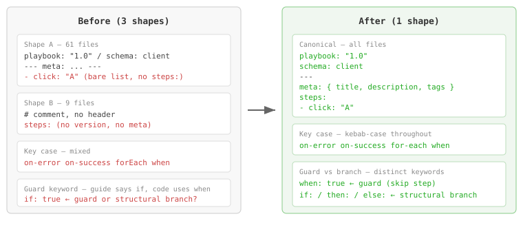

# One Shape, or the LLM Guesses

A DSL with two valid file shapes and mixed key casing is a DSL that works fine for humans and fails quietly for machines. Humans see `forEach` and `for-each` and understand they're the same thing. An LLM generating a playbook picks one, and if the validator only accepts the other, the error message says "unknown key" — which is true and useless.

We had exactly this problem. The playbook corpus had two file shapes: a three-document YAML format (header, metadata, bare step list) used by most files, and a single-document format with an explicit `steps:` key used by the agent-interaction patterns. Both worked because the parser normalised bare lists into `steps:` internally. Both were valid. Neither was canonical.

The key case story was worse. Every compound keyword in the decorator namespace was kebab-case — `on-error`, `on-success`, `on-failure` — except `forEach`, which was camelCase. One outlier in a namespace of thirty keywords. The kind of thing you don't notice until you're writing a schema that has to be unambiguous.

## The guard keyword that the guide invented

The language guide documented `if` as the guard decorator — the keyword that conditionally skips a step. The code used `when`. These are different operations. `when: "${order.valid}"` is a decorator that skips a single step. `if: "${order.valid}"` with `then:` and `else:` is structural branching over step lists. The guide conflated them, which meant an LLM reading the guide would generate `if: true` to conditionally skip a step, and the runtime would interpret it as a structural branch with no `then:` clause and throw.

The fix was to reconcile the guide against the code — not the other way around. The code had the right distinction. The guide had a shortcut that was fine when only humans read it.

## What canonical form actually looks like

Every playbook file now uses a two-document YAML format: front matter (version, schema) and content (metadata, steps). The parser already normalised bare lists internally — the canonical form makes the YAML match what the runtime expects.

The `forEach` → `for-each` rename touched the entire keyword namespace: Walker, StepKeywords, DecoratorChain, FusionPass, ForEachExpander, the JSON schema, and every playbook file. Java class names stay PascalCase — `ForEachExpander` is a Java convention, `for-each` is a YAML convention. The boundary between the two is the string literal.

## Why the schema lied, and why we caught it now

The JSON schema validation test had a quiet escape hatch: bare-list documents (the third YAML document in the old format) hit an `instanceof List` check and returned early. The validator never saw the step content. When we migrated to the two-document form, the step list moved into the content map under `steps:`, and the validator finally looked at it.

What it found: `log` was declared as `type: object` but used as a string shorthand throughout the corpus. `loop` was declared as `type: integer` but accepted strings and booleans for conditional loops. `when` and `if` were declared as `type: string` but accepted booleans for literal conditions. The schema was aspirational, not descriptive.

We fixed the schema to match the runtime. A schema that rejects valid playbooks is worse than no schema at all — it teaches authors to distrust validation.

## The LLM authoring constraint

This work is a prerequisite for LLM-generated playbooks. An LLM authoring a playbook from the guide needs exactly one valid form for each construct — no "both work, pick one". The guide is the prompt. If the guide says `if` and the code uses `when`, the LLM generates a valid-looking playbook that fails at runtime with an error that doesn't mention the real problem.

The canonical form eliminates an entire class of ambiguity. The schema validates what the runtime accepts. The guide describes what the code does. These three things are now the same thing, and that's the whole point.
