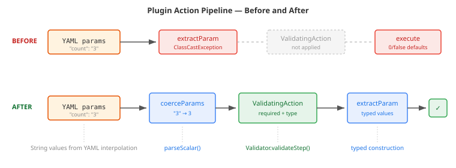

# The Generator's Last Mile

A code generator that produces Java source from annotations has one job: the generated code should behave identically to what a developer would write by hand. When it doesn't, the failure mode is insidious — the code compiles, the tests that exist pass, and the bug hides until production traffic hits the path the generator got wrong.

I found three such bugs in our annotation processor this week. Each is a different species of generator failure, and each teaches something worth carrying to any code generation system.

## The parameter the generator understood but skipped

Our `@McpDomain` annotation processor generates plugin step types from SPI interfaces. An SPI method like this:

```java
List<String> listItems(@ContextParam("tenancyId") String tenancyId, String filter)
```

generates a plugin record with a `filter` field and an `@Execute` method that delegates to the SPI. The generator correctly excluded `tenancyId` from the record fields — playbook authors don't supply tenant identity, the runtime does. But the generated delegate call looked like this:

```java
public Result execute(TenantApi api) {
    return Result.of(api.listItems(filter));  // tenancyId is missing
}
```

The generator knew the parameter was special. It had specific handling for `@ContextParam` — the REST generator resolved it correctly via `currentPrincipal.tenancyId()`. But the plugin generator's approach was: skip what I don't understand.

The fix is to declare `CurrentPrincipal` as an execute method parameter and let the runtime resolve it via `ServiceRegistry.lookup()`:

```java
public Result execute(TenantApi api, CurrentPrincipal __principal) {
    return Result.of(api.listItems(__principal.tenancyId(), filter));
}
```

The lesson: a generator that silently drops parameters it doesn't recognise is worse than one that fails to compile. The compiler catches a missing argument. A wrong overload resolution is a runtime surprise.

## The naming convention that wasn't injective

Plugin step names are derived from the domain path and method name. `derivePluginName("connectors/voice", "speak")` produces `voice-speak` — the last path segment plus the method in kebab-case.

This works until a second domain ending in the same segment appears. `messaging/voice` with a `speak` method also produces `voice-speak`. `CompositePluginRegistry` uses `ConcurrentHashMap.put()`, so the second registration silently overwrites the first. No warning, no error, no compile-time signal that two domains just collided.

The naming function was deterministic but not injective. For any single domain it's predictable. Across the full output space, it has collisions.

The fix uses short names by default and full domain paths only when a collision exists — detected at compile time via a two-pass scan of all domains in the APT round:

```java
static String derivePluginName(String domain, String methodName, Set<String> collisions) {
    String shortName = derivePluginName(domain, methodName);
    if (collisions.contains(shortName)) {
        return domain.replace('/', '-') + "-" + toKebabCase(methodName);
    }
    return shortName;
}
```

No naming change for the 99% case where collisions don't exist. When they do, both colliding names get the full path — `connectors-voice-speak` and `messaging-voice-speak`. The collision surfaces at compile time, not at runtime when the first plugin silently disappears.

## The validation that applied to some actions but not others

`ValidatingAction` wraps step actions with input validation — checking required fields, verifying types, rejecting bad values before the action executes. Every YAML-defined action gets this wrapping. `@Plugin`-generated actions do not.

The registration path in `PluginScanner.scanAndRegister()` builds the action via `createAction()` and passes it directly to the registry. The `extractParam` method handles type conversion but has no required-field checking. A missing `@Required String name` silently becomes `null`. A missing `int count` silently becomes `0`. The plugin record constructs successfully with corrupted data.

Worse, `extractParam` assumed all values arrive pre-typed. YAML interpolation can produce `"42"` where the record expects `int`. The existing code:

```java
return ((Number) value).intValue();  // String isn't a Number → ClassCastException
```

The fix has two parts. First, coerce String values to their declared types before validation runs — using `ParameterType.parseScalar()` which already existed but was never called in this path:



Second, wrap every `@Plugin` action in `ValidatingAction` at the registration point. The validation is now path-independent — whether the action originated from YAML declaration or Java annotation, it gets the same input checking.

## The underlying pattern

All three bugs share a shape: the generator produced something that satisfied its local contract (compiles, correct type, valid name) while violating a property that only matters at system scale (tenant isolation, name uniqueness, input validation). Each worked fine in isolation. Each failed when composed.

This is the generator's last mile. Getting the shape right is the first 90%. Getting the semantics right across all registration paths, all naming contexts, and all parameter categories is the remaining 90%.
