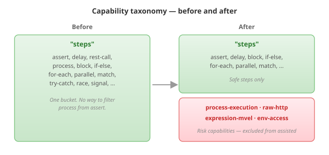

# The Catalogue Is the Security Surface

When an LLM can write your playbooks, the step catalogue stops being a developer convenience and becomes a security boundary. CaseHub playbooks include steps that execute shell commands (`process`), make arbitrary HTTP calls (`rest-call`), evaluate MVEL expressions with full Java reflection, and read environment variables. All fine when a developer writes them in an IDE. Not fine when the validator MCP tool hands that catalogue to a model and says "write me a playbook."

The obvious reaction is to build a trust layer: define tiers, annotate steps with minimum trust levels, create a filtering registry that checks caller permissions. We nearly went down that road. Then we looked at what was already there.

## The filter that was already doing the job

`SchemaFilteredRegistry` wraps a `PluginRegistry` and filters by capability set. Every step carries a `capability` string on its `Definition` — things like `"steps"`, `"orchestration"`, `"correlation"`, `"spotlight"`. Two built-in schemas define which capabilities are available: `client` for UI-facing playbooks, `server` for backend orchestration. A domain schema inherits from either and adds its own capabilities.

The filtering works. What doesn't work is the classification. `process` — which runs `rm -rf /` if you ask it to — has capability `"steps"`. Same as `assert`. Same as every safe structural step in the platform. The schema system can't distinguish them because they're in the same bucket.

## Reclassifying, not restructuring

The fix is four capability constants:



`process` moves from capability `"steps"` to `"process-execution"`. `rest-call` moves to `"raw-http"`. MVEL gets `"expression-mvel"`. Environment variable access gets `"env-access"`. These are added to the existing `server` and `client` schemas — developers see no change. A new `assisted` schema includes everything `server` has except the four risk capabilities.

The validator MCP tool creates its filtered registry with one line:

```java
SchemaFilteredRegistry.forSchema(registry, schemas, "assisted")
```

That's the entire trust boundary. The LLM sees `availableActions()` returning safe steps and managed connectors. It never sees `process`, `rest-call`, or MVEL.

## Why this works better than a trust layer

A separate trust system — `TrustTier` enum, `minimumTrust` on every definition, a `TrustFilteredRegistry` composing with `SchemaFilteredRegistry` — would have been a second filtering axis. Two registries, two sets of rules, two places to check when a step isn't showing up. The capability taxonomy already does this job. It just needed the right constants.

The `@Plugin` annotation already has a `capability` attribute. It defaults to `"steps"`. Changing it to `"process-execution"` on the `ProcessPlugin` record is a one-line change that propagates through the entire system: the annotation processor picks it up, the CDI scanner reads it, the schema filter respects it.

Managed connector plugins — the bank, voice, commerce, email APIs — keep their domain-specific capabilities and remain available under the `assisted` schema. They call managed SPIs with known inputs and outputs; the side-effect risk is handled by the existing consent infrastructure (`ConsentTier`, `WorkerAction`), which is orthogonal to the step catalogue.

## The design decision that matters most

The authoring context is determined by the calling tool, not by the playbook. An LLM cannot declare itself a developer by writing `trust: developer` in the front matter. The validator tool controls the context. CLI and IDE usage defaults to `developer` — the unfiltered registry, today's behaviour, no breaking change.

Two contexts for now: `developer` and `assisted`. A middle tier for customer-facing authoring can be added when that persona exists — it's a new schema entry with its own capability set, not a structural change.

---

The lesson is familiar but easy to forget: before building a new security layer, check whether the existing infrastructure already has the filtering machinery. It usually does. The gap is usually in the classification, not the filter.
