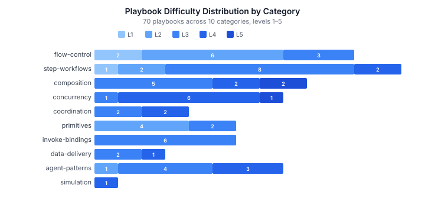

# The Test That Teaches Nothing

Seventy playbook examples. Four test files. Six of seven execution tests asserting exactly one thing: `result.succeeded: true`.

That's not a test. It's a rubber stamp.

## The catalogue nobody reads

The playbook catalogue is onboarding material. Each example demonstrates a language feature — retry, parallel branches, correlation scopes, state machines. Someone evaluating the platform reads these to understand what the language can express. Someone building their first playbook reads them to learn the patterns.

A test that says "it ran" teaches the reader nothing about what it did. The retry example has three retry configurations. The test checks whether the playbook completed. It doesn't tell you that step A retried three times, or that exhausting retries fails the playbook, or that a step succeeding on the first attempt doesn't retry at all. The reader has to infer all of that from the YAML — the test adds zero signal.

Worse: the catalogue gate expected three examples to *fail* compilation. Shipped examples, in the onboarding path, that the system's own validation rejected. The gate was written to tolerate this.

## What tests should be for examples

A test on a teaching example has a dual purpose. It verifies correctness, but more importantly, it *explains behaviour*. The test name is the lesson title. The assertions are the lesson content.

```yaml
- name: "retry re-executes failed step up to N times"
  steps:
    - run-playbook: .../retry.playbook.yaml
      capture: result
    - assertThat: result.output.retryCount
      equals: 3
```

Compare that with:

```yaml
- name: "retry playbook works"
  steps:
    - run-playbook: .../retry.playbook.yaml
      capture: result
    - assertThat: result.succeeded
      equals: true
```

The first version teaches. Someone scanning test names sees *what the feature does*. Someone reading assertions sees *how to verify it*. The test is documentation that happens to be executable.

The second version is a smoke test wearing a teaching hat. It confirms the YAML parses and the runner doesn't crash. That's worth having — as a secondary assertion alongside a real one, not as the entire test.

## Tutorial metadata

The playbook examples were organised by directory — `flow-control/`, `coordination-primitives/`, `concurrency-patterns/` — but had no machine-readable metadata for learning paths. No difficulty progression. No "read this before that" ordering. No concept tag for index generation.

Each example now carries a structured `meta:` header:

```yaml
meta:
  title: "Correlation Scope"
  description: "Async request/response correlation..."
  tags: [correlation, request-reply, async]
  level: 4
  layer: concurrency-patterns
  teaches: "async request/response correlation by key"
  builds-on: channel
```

`level` is a 1–5 difficulty progression. `layer` matches the directory. `teaches` is the one-line concept. `builds-on` names the prerequisites — the playbooks the reader should understand first. The header is YAML, not comments. Machine-readable. Parseable by any tool that wants to generate a tutorial index, a difficulty-ordered reading list, or a prerequisite graph.



The gate now validates these headers exist. A new playbook without `level`, `layer`, and `teaches` fails the build.

## Dropping rules

The original direction document called for named rules — R1, R2, R3 — in each playbook header. Each rule would be a one-sentence business guarantee: "a payment over the limit requires confirmation." A lint would check that every rule ID had a corresponding named test.

I dropped it. The rules are natural language. The lint can verify that a test named "R1" exists. It cannot verify that the test actually tests what R1 claims. The enforcement is structural, not semantic — it checks that a string pattern appears in a test name. That's ceremony without substance.

The `teaches` field already describes what the playbook demonstrates. The lint can enforce that tests have behavioural assertions — checking that `assertThat` targets something beyond `succeeded` and `stepCount`. That's a weaker but honest constraint. It says "your test must assert something specific" without pretending to verify *what* that something is.

## The sibling key problem

The three failing playbooks shared a root cause. YAML step parameters like `headers`, `body`, and `response-format` were written as sibling keys:

```yaml
- rest-request:GET: /api/users
  headers: { Accept: application/json }
```

The Walker treated unknown sibling keys as action candidates, failed to resolve `headers` as an action, and threw. The fix wasn't restructuring the YAML — the compact form is correct and reads naturally. The fix was enabling `absorbSiblings` on the validation stubs so the Walker folds unknown siblings into the action's parameter map instead of rejecting them.

One line changed in `ValidatePlaybookPlugin`. Three playbooks passed. The gate went from expecting three failures to expecting zero.

## What comes next

The headers and gate are landed. Category-level tests — one per directory, with behavioural assertions — are the next batch. The runner needs to expose orchestration primitive state (counter values, flag states) in its result map so tests can assert on them without playbooks needing explicit output steps. And the assertion-quality lint itself — the Java test that scans `.test.yaml` files and fails the build when tests assert only `succeeded` — is the final piece.

The underlying principle is simple: an example is not documentation until its test explains it. If the reader has to guess what the example does, the example failed.
