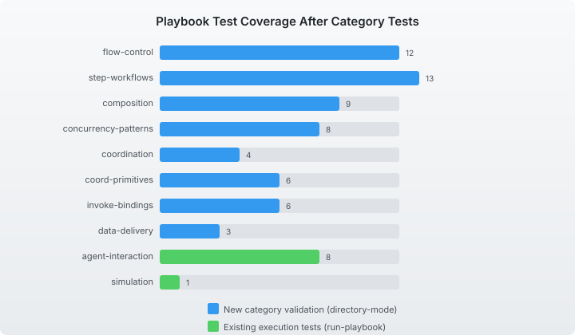

# The Test That Teaches Nothing

Seventy playbook examples. Four test files. Six of seven execution tests asserting exactly one thing: `result.succeeded: true`.

That's not a test. It's a rubber stamp.

## The catalogue nobody reads

The playbook catalogue is onboarding material. Each example demonstrates a language feature — retry, parallel branches, correlation scopes, state machines. Someone evaluating the platform reads these to understand what the language can express. Someone building their first playbook reads them to learn the patterns.

A test that says "it ran" teaches the reader nothing about what it did. The retry example has three retry configurations. The test checks whether the playbook completed. It doesn't tell you that step A retried three times, or that exhausting retries fails the playbook, or that a step succeeding on the first attempt doesn't retry at all. The reader has to infer all of that from the YAML — the test adds zero signal.

Worse: the catalogue gate expected three examples to *fail* compilation. Shipped examples, in the onboarding path, that the system's own validation rejected. The gate was written to tolerate this.

## What tests should be for examples

A test on a teaching example has a dual purpose. It verifies correctness, but more importantly, it *explains behaviour*. The test name is the lesson title. The assertions are the lesson content.

```yaml
- name: "retry re-executes failed step up to N times"
  steps:
    - run-playbook: .../retry.playbook.yaml
      capture: result
    - assertThat: result.output.retryCount
      equals: 3
```

Compare that with:

```yaml
- name: "retry playbook works"
  steps:
    - run-playbook: .../retry.playbook.yaml
      capture: result
    - assertThat: result.succeeded
      equals: true
```

The first version teaches. Someone scanning test names sees *what the feature does*. Someone reading assertions sees *how to verify it*. The test is documentation that happens to be executable.

The second version is a smoke test wearing a teaching hat. It confirms the YAML parses and the runner doesn't crash. That's worth having — as a secondary assertion alongside a real one, not as the entire test.

## Tutorial metadata

The playbook examples were organised by directory — `flow-control/`, `coordination-primitives/`, `concurrency-patterns/` — but had no machine-readable metadata for learning paths. No difficulty progression. No "read this before that" ordering. No concept tag for index generation.

Each example now carries a structured `meta:` header:

```yaml
meta:
  title: "Correlation Scope"
  description: "Async request/response correlation..."
  tags: [correlation, request-reply, async]
  level: 4
  layer: concurrency-patterns
  teaches: "async request/response correlation by key"
  builds-on: channel
```

`level` is a 1–5 difficulty progression. `layer` matches the directory. `teaches` is the one-line concept. `builds-on` names the prerequisites — the playbooks the reader should understand first. The header is YAML, not comments. Machine-readable. Parseable by any tool that wants to generate a tutorial index, a difficulty-ordered reading list, or a prerequisite graph.


The gate now validates these headers exist. A new playbook without `level`, `layer`, and `teaches` fails the build.

## Dropping rules

The original direction document called for named rules — R1, R2, R3 — in each playbook header. Each rule would be a one-sentence business guarantee: "a payment over the limit requires confirmation." A lint would check that every rule ID had a corresponding named test.

I dropped it. The rules are natural language. The lint can verify that a test named "R1" exists. It cannot verify that the test actually tests what R1 claims. The enforcement is structural, not semantic — it checks that a string pattern appears in a test name. That's ceremony without substance.

The `teaches` field already describes what the playbook demonstrates. The lint can enforce that tests have behavioural assertions — checking that `assertThat` targets something beyond `succeeded` and `stepCount`. That's a weaker but honest constraint. It says "your test must assert something specific" without pretending to verify *what* that something is.

## The sibling key problem

The three failing playbooks shared a root cause. YAML step parameters like `headers`, `body`, and `response-format` were written as sibling keys:

```yaml
- rest-request:GET: /api/users
  headers: { Accept: application/json }
```

The Walker treated unknown sibling keys as action candidates, failed to resolve `headers` as an action, and threw. The fix wasn't restructuring the YAML — the compact form is correct and reads naturally. The fix was enabling `absorbSiblings` on the validation stubs so the Walker folds unknown siblings into the action's parameter map instead of rejecting them.

One line changed in `ValidatePlaybookPlugin`. Three playbooks passed. The gate went from expecting three failures to expecting zero.

## Covering the catalogue

The gap between "all playbooks validate" and "all playbooks are tested" turned out to be wider than I expected. The YAML test engine registers about fifteen runtime plugins — agent session operations, the assert/emit/run-playbook tools, and three APT-generated plugins. Everything else — counter-add, flag-set, log, click, rest-request, gauge-set, the entire coordination primitive vocabulary — exists only as validation stubs. They let the Walker resolve step names during compilation. They don't execute.

That rules out `run-playbook` with behavioural assertions for most categories. The retry playbook uses `click` steps. The flag playbook uses `flag-set`. The state machine playbook uses `sm-create` and `sm-transition`. None of these are real runtime plugins — they're names in a stub list.

What *does* work is directory-mode validation. Each category gets a test that validates all its playbooks at once — compilation succeeds, tutorial headers are present, no errors. It's not a behavioural test in the sense I originally wanted. But it catches real problems: a new playbook with a typo in a step name, a missing tutorial header, a structural error the Walker rejects.



The agent-interaction-patterns directory is the exception. Its playbooks use agent session plugins that actually execute with corpus stubs, so those tests assert on `stepEvents` counts — verifying that the right number of session lifecycle steps ran.

## The lint

The assertion-quality lint is a Java test that scans every `.test.yaml` file and fails if any test case's only assertions target `result.succeeded`, `result.stepCount`, or `result.valid`. Three fields. That's the trivial set.

```java
private static final Set<String> TRIVIAL_TARGETS = Set.of(
        "result.succeeded", "result.stepCount", "result.valid"
);
```

If your test asserts on `result.stepNames`, `result.hasFork`, `result.poolDeclarations`, `result.errors`, `result.validatedCount`, or any other field — the lint passes. The constraint is narrow by design. It doesn't prescribe what a good assertion looks like. It only rejects the ones that are demonstrably empty of information.

A per-file `lint: skip` opt-out exists for structural gates like the catalogue-parsing-gate, where asserting "zero errors" on the full directory is the point.

## Primitive state enrichment

The runner now snapshots orchestration primitives — counters, flags, gauges — before closing the execution scope. `DefaultExecutionScope.snapshotPrimitives()` iterates the primitive map, reads each value through its type-safe accessor, and returns a `Map<String, Map<String, Object>>` keyed by primitive category.

```java
if (val instanceof OrcCounter c) {
    counters.put(entry.getKey(), c.get());
} else if (val instanceof OrcFlag f) {
    flags.put(entry.getKey(), f.get());
} else if (val instanceof OrcGauge<?> g) {
    gauges.put(entry.getKey(), g.get());
}
```

The snapshot flows through `PlaybookRunResult.primitiveStates()` into the `run-playbook` result map as top-level `counters`, `flags`, and `gauges` keys. When the coordination primitive plugins eventually become real runtime implementations instead of validation stubs, the tests can assert on actual primitive values — `result.counters.requests equals 3` — without any changes to the test framework.

The infrastructure is wired. The plug point is the stub-to-implementation gap in the action registry.

## The underlying principle

An example is not documentation until its test explains it. If the reader has to guess what the example does, the example failed. That's the bar — and the lint enforces it at the structural level, even though the semantic level is still the author's job.
