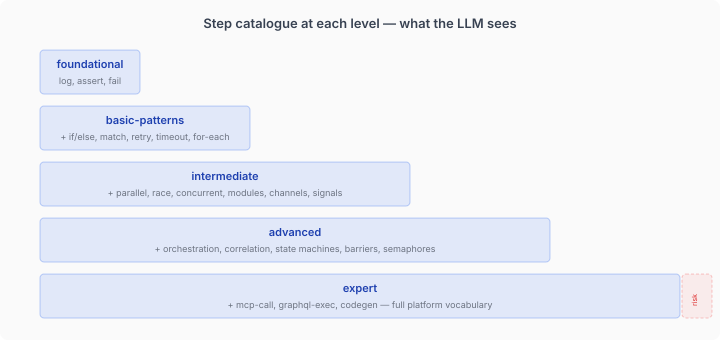

# The Vocabulary Your Author Needs

Give an LLM the full CaseHub step catalogue — over a hundred operations spanning sequential flow, concurrency primitives, orchestration, MCP invocations, and state machines — and ask it to write a playbook that logs "hello" then logs "world". What you get back is usually correct. It's also usually overengineered: a `parallel` block wrapping two `log` steps, or a `block` with an unnecessary `retry` decorator, or a `concurrent` section that defeats the sequential requirement entirely. The model isn't wrong about the syntax. It's wrong about the selection.

This is the vocabulary problem. A language with a large keyword space is harder to use correctly than a language with a small one — not because the keywords are individually complex, but because the combinatorial surface grows faster than the model's ability to discriminate between appropriate and inappropriate choices. The more you can do, the more ways there are to do the wrong thing.

## Filtering by capability level

The step catalogue is already trust-filtered via `SchemaFilteredRegistry` — the [previous entry](2026-11-17-mdp05-the-catalogue-is-the-security-surface.md) covered that. Trust filtering is a security boundary: the LLM never sees `process`, `rest-call`, or MVEL under the `assisted` schema. But trust filtering doesn't help with vocabulary overload. All the safe steps still appear.

Level filtering is the next layer. Five named levels, each mapping to a set of capabilities:



`foundational` gives the LLM `steps`, `variable-resolution`, and `control-flow` — enough for sequential playbooks with variables and simple conditionals. `basic-patterns` adds decorators: retry, timeout, for-each. `intermediate` adds concurrency. And so on. Each level includes everything below it.

The implementation follows the existing `SchemaFilteredRegistry` pattern — a `LevelFilteredRegistry` wraps a `PluginRegistry` and filters by capability set. The filter composition is trust first, then level:

```java
var trustFiltered = SchemaFilteredRegistry.forSchema(registry, schemas, "assisted");
var levelFiltered = LevelFilteredRegistry.forLevel(trustFiltered, levels, "foundational");
```

Trust removes dangerous steps. Level removes irrelevant ones. What's left is the vocabulary the author actually needs.

## Named levels, not integers

The playbook metadata already has `meta.level: 1` on every reference playbook. We could have used those integers directly. We didn't, because the number carries no meaning — `catalogue(1, "assisted")` doesn't tell you what you're asking for. `catalogue("foundational", "assisted")` does.

Named levels are registered in a `PlaybookLevelRegistry`, following the same pattern as `PlaybookSchemaRegistry`. The registry maps names to ordinals and capability sets. It supports `resolveByOrdinal(1)` for backward compatibility with existing metadata, but the name is the primary key.

This matters because the catalogue API isn't just a filter — it's the LLM's view of the language. When the LLM requests `catalogue("foundational", "assisted")`, the response includes the filtered step entries, their parameter schemas, and example YAML for each. The level name appears in the response, in error messages, and in the authoring metric results. `foundational` communicates intent. `1` doesn't.

## Bare list enforcement

The last piece is ceremony. We'd already converged on a canonical two-document playbook form — front matter and content. But the content still accepted a `steps:` wrapper key around the step list. Both forms worked. Both were valid.

This is exactly the kind of ambiguity that costs an LLM a round trip. It generates a playbook with `steps:`, the validator accepts it, and the next playbook in the conversation omits it — both correct, neither consistent. Or worse: the LLM reads examples without `steps:` and generates code with it, and nothing breaks, but the generated output doesn't match the examples it learned from.

The validator now rejects `steps:` with an informative error:

> Remove the 'steps:' wrapper — use a bare list instead

The simplest valid playbook is two lines:

```yaml
- log: hello
- log: world
```

No front matter, no preamble, no wrapper. The runtime parser still accepts `steps:` for backward compatibility with developer playbooks. The validator doesn't. The LLM sees the rejection once and never produces the verbose form again.

## Measuring whether it works

The design includes an authoring metric: for each level, give a model the filtered catalogue and a task description, and measure whether it produces a valid playbook on the first attempt. Run it with the validator tool (the LLM can iteratively validate and correct) and without (the LLM gets only the catalogue and documentation). The difference between the two modes isolates whether the language itself is learnable versus whether the tooling compensates for language complexity.

This isn't implemented yet — it's the next batch of work. But the registry infrastructure that makes it possible is in place: the catalogue query returns exactly the vocabulary the metric plugin will inject into the LLM's system prompt, and the validator returns structured diagnostics the metric can evaluate programmatically.

The hypothesis is specific: a model writing at `foundational` level with the filtered catalogue should produce valid playbooks at a higher rate than a model given the full expert catalogue. If that holds, the vocabulary reduction is doing its job. If it doesn't, the level boundaries need adjusting — not the filtering infrastructure.
