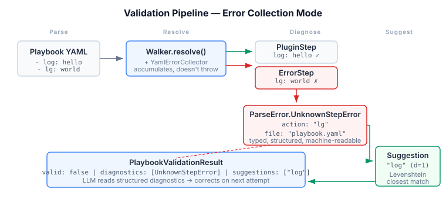

# Structured Errors Are the Conversation

A string error message is a dead end. The validator throws, the caller catches, formats the string into a response, and the LLM reads "unknown key 'lg'." It knows something is wrong. It doesn't know what's close. It can't distinguish a typo from a structural violation from a trust boundary rejection. Every error looks the same: a sentence in English.

Structured diagnostics change the interaction. Instead of a string, the validator returns a typed `ParseError` — `UnknownStepError` with the referenced action, `StructureError` with the offending construct, `DuplicateStepError` with the collision. Each carries a `SourceLocation`, a category, and enough context for the caller to decide what to do about it. Including, critically, what to suggest.

## Collecting instead of throwing

The CaseHub Walker — the step resolver that turns YAML maps into a typed `ResolvedStep` tree — has always been fail-fast. The first unknown key throws an `IllegalArgumentException`. Useful when the caller wants "stop on first error." Useless when the caller wants "tell me everything that's wrong."

The new overload accepts a `YamlErrorCollector` and collects instead of throwing:

```java
var collector = new YamlErrorCollector();
var resolved = Walker.resolve(steps, registry,
    annotations, collector, "playbook.yaml");
// resolved contains PluginStep, BlockStep, ... and ErrorStep
// collector.errors() has every ParseError found
```

The original overloads are unchanged — backward compatibility is a non-negotiable on a zero-dep foundational module. The new path wraps each `resolveOne()` call in the step loop with a `try`/`catch`. When a step fails, it becomes an `ErrorStep` — a new variant in the `ResolvedStep` sealed hierarchy — carrying the original YAML and the `ParseError` that describes the failure. Structural steps recurse through the same collecting path, so errors inside a `block`, `if/then`, or `parallel` produce granular `ErrorStep` children, not a single error for the entire structure.



The important design choice is that the collecting path is a parallel code path, not a refactored version of the original. `resolveOne()` itself still throws at ~30 sites. The collector catches those throws at the loop level and classifies them. Two cases get specific handling inside `resolveOne()`: unknown keys produce `UnknownStepError` (not generic `StructureError`), and duplicate names produce `DuplicateStepError` without replacing the step — the name collides, but the step itself resolves correctly.

## "Did you mean?"

Once errors are structured and typed, suggestion generation becomes mechanical. For an `UnknownStepError`, compute the [Levenshtein distance](https://en.wikipedia.org/wiki/Levenshtein_distance) against every action in the registry. If the closest match is within half the string length, suggest it:

```java
var suggestions = ValidationSuggestionGenerator
    .generate(diagnostics, registry);
// [{index: 0, suggestion: "Did you mean 'log'?",
//   exampleYaml: "- log:\n    message: \"value\""}]
```

Each suggestion includes example YAML built from the matched `Definition`'s input parameters. Required parameters get type-appropriate placeholders. The LLM sees the corrected step name and a working example in a single response — one round trip instead of a guessing loop.

This is layer 2 of three planned suggestion layers. Layer 1 is the structured error itself (always present). Layer 3 is optional LLM-generated fix suggestions — the agent rewrites the playbook using the catalogue and diagnostics. Layers 1 and 2 are deterministic and free; layer 3 costs an inference call and is gated behind `ValidationContext.llmSuggestions()`.

## The gap that string errors hide

An unrelated bug surfaced the same day: the `capture:` decorator, which saves a step's output under a named prefix for downstream variable resolution, was silently broken for top-level steps. Inside a `block`, the evaluator correctly wires captures into the `VariableResolver` between child steps. But `PlaybookRunnerCore.run()` — the top-level execution loop — passed the same resolver to every step. Captures were stored in the `CaptureCollector` and returned in the final result, but never registered as variable prefixes.

The fix is five lines. After each step, check for a `capture` decorator and add the output as a new object scope on the resolver:

```java
Object captureVal = step.decorators().get("capture");
if (captureVal != null) {
    String name = String.valueOf(captureVal);
    Map<String, Object> captured = Map.copyOf(result.output());
    resolver = resolver.withObjectScope(name, captured::get);
}
```

The reason it went undetected: existing tests used `capture: result`, which collides with the built-in `result` scope that provides the last step's output. The built-in scope masked the missing capture wiring. Custom capture names — `capture: order`, `capture: enrichment` — failed with "Unknown prefix" at the first reference.

This is the kind of gap that only structured diagnostics would have surfaced cleanly. A string error saying "unknown variable prefix" tells the user they made a typo. A typed `UnknownStepError` tells the tool chain that the prefix was never registered — the gap is in wiring, not in spelling.
