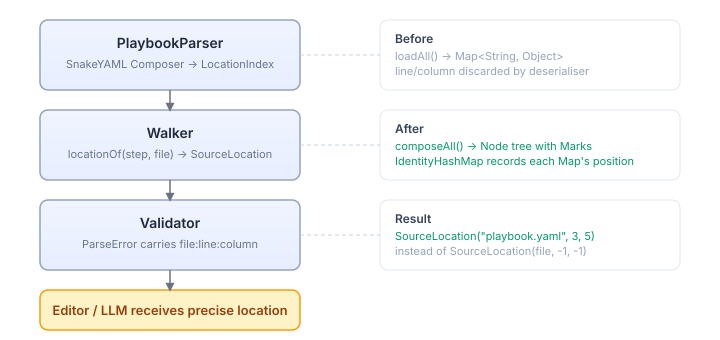

# The Line Number Your Tools Need

SnakeYAML's `loadAll()` does two things in one call: it parses YAML into a node tree with full position metadata, then immediately deserialises that tree into `Map<String, Object>` and throws the metadata away. The maps you get back are correct. They're also anonymous — no way to know which line of the original file a particular mapping started on.

For a runtime that just executes playbooks, this doesn't matter. For a validator that reports errors back to an editor or an LLM — where "unknown key 'lg'" needs to point at line 3, column 5 — it's a gap that makes every diagnostic worse than it needs to be.

## Composing instead of loading

The fix is straightforward: switch from `loadAll()` to `composeAll()`. SnakeYAML's Composer API returns `Node` objects — `MappingNode`, `SequenceNode`, `ScalarNode` — each carrying a `Mark` with the line and column where it starts. The node tree is isomorphic to what `loadAll()` would produce; the difference is that position data survives.

The trade-off is that you have to convert nodes to maps yourself. SnakeYAML's internal `SafeConstructor` handles this automatically during `loadAll()`, resolving scalars to the right Java types based on YAML tags. With the Composer API, that resolution is on you:

```java
private static Object resolveScalar(ScalarNode scalar) {
    String value = scalar.getValue();
    if (!scalar.isPlain()) return value;  // quoted → always string
    if ("null".equals(value) || "~".equals(value)) return null;
    if ("true".equalsIgnoreCase(value)) return Boolean.TRUE;
    // ... integers, doubles, the usual YAML implicit types
    return value;
}
```

For playbook YAML this is about twenty lines of type resolution — booleans, integers, doubles, null, everything else is a string. No octal, no sexagesimal timestamps, no YAML 1.1 edge cases. The simplicity of the domain keeps the conversion small.

## Identity-based position tracking

The interesting design question: how do you get positions from the parser to the Walker, three call layers away, without threading marks through every method signature?

The answer is an `IdentityHashMap`. As the parser converts each `MappingNode` into a `LinkedHashMap`, it records the map instance's identity and its source position in a `LocationIndex`. When the Walker later encounters an unknown key or a duplicate step name, it looks up the step map by identity in the index:

```java
var error = new ParseError.UnknownStepError(
    null, first.getKey(),
    locations.locationOf(step, playbookFile),  // line 3, col 5
    null);
```



The fallback matters. When the step map isn't in the index — because it was constructed programmatically by a test rather than parsed from YAML — `locationOf` falls back to `new SourceLocation(playbookFile, -1, -1)`. The file path is always present; only line and column degrade to unknown. This keeps every existing test passing without changes.

## The schema as vocabulary filter

A related precision question: when the validator constructs a JSON Schema for the LLM, should it emit every structural keyword the language supports? If the playbook's level is `foundational`, the LLM shouldn't see `parallel`, `race`, or `invoke` in the schema — not because they'd cause errors, but because they'd cause overengineering. The schema should reflect only the vocabulary the author is expected to use.

`StepSchemaComposer.compose()` now takes a `Set<String> capabilities`. Each structural variant in the schema is gated:

| Capability | Structural keywords included |
|---|---|
| _(always)_ | block, plugin actions |
| control-flow | if/then/else, match/cases |
| concurrency | parallel, race |
| modules | invoke |
| orchestration | pause, resume |
| decorators | timeout, retry, for-each, ... |

The two-arg overload passes all capabilities for backward compatibility. The three-arg overload lets a `PlaybookLevel` control what appears. A `foundational` schema emits two oneOf variants (block + plugins) and no decorator properties. The schema is smaller, the LLM's combinatorial surface is smaller, and the resulting playbooks are more likely to be correct on the first attempt.

## Domain as a navigable axis

One more precision layer: discovery. With a hundred steps in the catalogue, a flat list is fine for a machine. For an LLM doing assisted authoring — or a human browsing an MCP model — domain grouping lets you narrow before you search.

A `domain` field on `Definition` groups steps by logical origin. MCP-sourced steps inherit their `@McpDomain` name automatically; plugin-sourced steps can set it via the builder. The `PluginRegistry` gains `availableDomains()` and `actionsInDomain(String)` — both respect level filtering when accessed through `LevelFilteredRegistry`, so the two axes compose cleanly.

The design question was whether domains should reuse the MCP `@McpDomain` taxonomy or have their own. Reuse won: when a step originates from an MCP domain, its natural grouping IS the MCP domain. No second taxonomy needed. Steps without an MCP origin (pure plugins, script sources) use `null` for ungrouped, queryable via `actionsInDomain(null)`.

## What precision opens up

Precise source locations unlock editor integration — red squiggles at the right line. Precise schemas unlock better LLM authoring — fewer keywords means fewer wrong choices. Precise domain grouping unlocks navigable discovery — drill into "agent" to find `session-open`, not scan a hundred entries.

None of these are individually complex. Each is a few dozen lines. The pattern is the same at every layer: take information that was present but discarded, and carry it to where it's needed.
