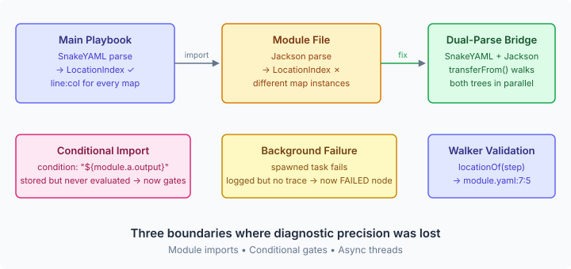

# Diagnostics Break at Boundaries

Inside a single playbook, the diagnostic infrastructure works. SnakeYAML's compose API gives every map and list a source position. The Walker looks up the step by identity, the error carries file:line:column, the editor gets a red squiggle in the right place. All clean — until a module import creates a boundary.

Module files are loaded by Jackson, not SnakeYAML. Jackson deserialises into its own `LinkedHashMap` instances. Those instances aren't in the `LocationIndex` because they were never created by the composer. When the Walker finds an unknown step inside an imported module, `locationOf(step)` falls through to `SourceLocation(playbookFile, -1, -1)`. The file is wrong (points at the main playbook, not the module) and the line is unknown. Every imported step error becomes "somewhere in the playbook, something is wrong."

Three boundaries, three places where diagnostic precision disappeared.

## The dual-parse bridge

The fix for module files is a dual parse. For each module, read the YAML as a string, then parse it twice: Jackson for the structured `YamlModuleFile` (module metadata, parameters, outputs — all the typed fields), and SnakeYAML's compose API for the raw maps with location tracking. Two parse trees from the same input, structurally identical, but with different map instances.

`LocationIndex.transferFrom()` bridges them. It walks both trees in parallel — key by key through maps, index by index through lists — and for each node in the SnakeYAML tree that has a recorded position, it registers the corresponding Jackson node with that same position:

```java
public void transferFrom(LocationIndex sourceIndex,
                          Object sourceObject, Object targetObject) {
    SourceLocation loc = sourceIndex.locations.get(sourceObject);
    if (loc != null) locations.put(targetObject, loc);
    if (sourceObject instanceof Map<?, ?> sourceMap
            && targetObject instanceof Map<?, ?> targetMap) {
        for (var key : sourceMap.keySet()) {
            // ... recurse into matching children
        }
    }
    // ... same for lists
}
```

After this, the Jackson-created step maps — the ones that actually flow through the expansion pipeline and into the Walker — have LocationIndex entries pointing at the module file's real line numbers. An unknown step in `greetings.yaml` line 7 now says `greetings.yaml:7`, not `playbook.yaml:-1`.



## The gate that never closed

A second boundary: conditional imports. The module system supports a `condition:` field on imports — include this module only if `${module.other.output}` is truthy. The `ModuleExpander` stored the condition. It never evaluated it.

Every conditional module was always included, regardless of its condition value. The `importConditions` map faithfully recorded what the condition was, then the expansion loop continued without checking it.

The evaluation needed to happen during expansion, not at runtime, because module output references (`${module.alias.output}`) are only resolvable against previously-expanded modules. But variable references (`${var.enabled}`) aren't available at expansion time — those live in the playbook's runtime resolver.

The solution: attempt evaluation with the module output source. If the condition resolves fully (no remaining `${` references) and is falsy, skip the module. If the condition references an unknown prefix, `VariableResolver` throws `UnresolvedVariableException` — catch it and include the module (defer to runtime). If the referenced module exists but the output key doesn't, the custom condition source returns empty string rather than null, so the reference resolves to empty rather than staying unresolved. Empty is falsy. The module is skipped.

```java
if (imp.condition() != null) {
    importConditions.put(imp.as(), imp.condition());
    try {
        String resolved = condResolver.resolveString(
                imp.condition(), imp.as() + ".condition");
        if (!resolved.contains("${") && !isConditionMet(resolved)) {
            continue;  // skip this module
        }
    } catch (UnresolvedVariableException ignored) {
        // var.*, events.* — not available at expansion time
    }
}
```

Three evaluation outcomes: skip (resolved and falsy), include (resolved and truthy), defer (unresolvable). The existing tests with `${var.enabled}` conditions hit the third path and pass unchanged.

## The trace that vanished

The third boundary is temporal: background step failures. The `background: true` decorator spawns a virtual thread and returns immediately with an empty success. The actual step runs asynchronously. If it fails, the `backgroundFailureHandler` logs a warning. The execution trace — the structured `StepTraceNode` tree that records what happened — sees only the synchronous success. The failure exists only in the log.

The fix adds `onBackgroundFailure(String stepName, Result result)` as a default method on `StepExecutionListener`. The existing `backgroundFailureHandler` already fires on failure; wiring it to the listener is three lines in the constructor:

```java
if (listener != null) {
    listener.onBackgroundFailure(name, result);
}
```

`StepTraceCollector` implements this by appending a FAILED node directly to `rootChildren` — bypassing the stack-based push/pop that handles synchronous steps, since the background task has no position in the synchronous stack. The node appears at the root level, type `"background"`, outcome `FAILED`, with the error message in its detail map.

The step name passed to the handler is currently `"background"` — the spawn identifier, not the original YAML step name. The decorator chain doesn't carry the `ResolvedStep` reference; only the decorator map flows in. Propagating the step name would mean threading `ResolvedStep` through the decorator chain, which is a larger change. The spawn identifier is accurate enough for now — it tells you a background task failed, what failed, and where in the trace it happened.

## The pattern

Each of these is structurally the same problem. Information that exists on one side of a boundary — a source position, a condition value, a failure result — doesn't cross to where it's consumed. The parser has positions but the module loader doesn't carry them. The expander has conditions but doesn't evaluate them. The background thread has failures but the trace collector doesn't see them.

The fixes are small. `transferFrom` is 15 lines. The condition evaluation is 12 lines inside the expansion loop. The background trace wiring is 3 lines in a constructor plus a 6-line method. None required new infrastructure. The infrastructure was already there — `LocationIndex`, `StepExecutionListener`, `VariableResolver`. The gap was always at the boundary, not in the building blocks.
