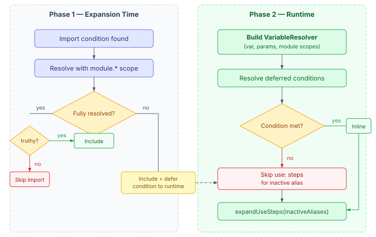

Playbook modules have supported conditional imports since last week — a module can declare `condition: "${module.sales.panelId}"` and the import is skipped if the referenced output is falsy. That works because module outputs are available during expansion: the expander has already processed earlier imports, so it can resolve module-scoped variables and decide immediately.

But conditions that reference runtime variables — `condition: "${var.enabled}"` or `condition: "${params.feature_flag}"` — couldn't be resolved at expansion time. The `var` and `params` scopes don't exist yet. The expander stored the condition in `importConditions` but included the module unconditionally. The condition was recorded and then forgotten.

## Two-phase evaluation

The fix splits import processing into two phases, matching the natural boundary between what's knowable at each point.



**Phase 1 (expansion time)** resolves what it can. The `ModuleExpander` builds a resolver with only the `module.*` scope — outputs from previously processed imports. If a condition resolves fully and is falsy, the import is skipped immediately. If it resolves fully and is truthy, the module is included. If it *can't* resolve — the variable prefix isn't recognised — the module is included optimistically and the condition is tagged as deferred.

**Phase 2 (runtime)** picks up the deferred conditions after the `VariableResolver` is built with the full scope set: `var`, `params`, and `module`. Each deferred condition is resolved again. Falsy results mark the alias as inactive. The `expandUseSteps` call — which inlines module steps into the playbook — skips `use:` references to inactive aliases.

The key structural change: `expandImports()` no longer inlines `use:` steps. It returns the step sections and import conditions as raw data. The `run()` method builds the resolver, evaluates deferred conditions, then calls `expandUseSteps` with the inactive set. This moved the inlining decision to a point where all the information is available.

## What the YAML looks like

```yaml
imports:
  - module: greetings
    as: g
  - module: premium-features
    as: prem
    condition: "${var.premium_enabled}"

- use: g.welcome
- use: prem.onboarding   # skipped when premium_enabled is falsy
```

The `use: prem.onboarding` step vanishes from the step list before `Walker.resolve` ever sees it. No special step-level logic, no wrapper blocks, no runtime condition checks during execution. The step simply isn't there.

## The inactive alias pattern

I considered wrapping conditional steps in a `block` with a `when` condition, but that pushes evaluation into the step execution loop — a different layer with different concerns. The cleaner approach treats it as a module-level decision: either a module's steps are present or they aren't.

`PlaybookModuleBridge.expandUseSteps` gained an `inactiveAliases` parameter. When it encounters `use: alias.X` and the alias is inactive, it emits nothing — the same as if the `use:` line wasn't there. The parameter threads through `expandBranches` too, so `use:` references inside `if/then/else` and `parallel` blocks are also filtered.

```java
String alias = ref.substring(0, dot);
if (inactiveAliases.contains(alias)) {
    continue;
}
```

Three lines. The module is either active or it isn't.

## Truthiness lives in one place

`ModuleExpander.isConditionMet` was package-private — a simple truthiness check that treats null, blank, `"false"`, `"no"`, and `"0"` as falsy. Making it `public static` lets the runtime reuse the same logic without duplicating the definition. One truthiness rule, two evaluation points.

## What this opens up

Conditional modules with runtime variables are the composition primitive that playbook authors need for feature flags, environment-specific behaviour, and tenant configuration. A playbook can import a module that adds payment processing steps, gated on `${params.payments_enabled}`, and the steps are present or absent based on the caller's configuration — not baked into the playbook definition.

The same mechanism works for `${var.*}` declarations inside the playbook itself. A playbook that declares `vars: debug_mode: false` and conditionally imports a debugging module gets the behaviour you'd expect: the module is included when `debug_mode` is true, skipped when false, and no runtime overhead either way.
