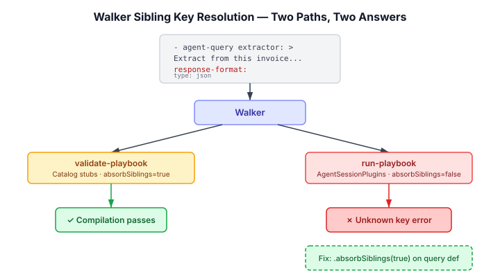

# The Two Walkers Problem

A playbook that compiles cleanly should execute cleanly. That sounds obvious enough to not need stating, but it failed in practice for structured output — and the root cause was a split in how the Walker resolves step definitions.

CaseHub playbooks go through two gates before they run. The first is compilation via `validate-playbook`, which checks that every step name resolves to a known action and every sibling key is either a reserved decorator or absorbed by the matched definition. The second is execution via `run-playbook`, which does the same resolution but then actually invokes the action.

The problem: these two gates were using different plugin registries.

## Compilation Stubs vs Execution Definitions

The `ValidatePlaybookPlugin` builds a catalog of stub definitions for validation — one per known step type, all with `absorbSiblings = true`. The intent is reasonable: validation doesn't need to know what a step *does* with its sibling keys, only that the step name is valid. Any sibling key the step doesn't recognise gets absorbed silently, and compilation passes.

The `RunPlaybookPlugin` runs the full pipeline. It uses `AgentSessionPlugins` — real definitions with real action lambdas — to register `agent-query` as a step type. These definitions had `absorbSiblings = false` (the default). The Walker saw `response-format` as an unknown key and rejected it.



The result: a playbook with `response-format:` on an `agent-query` step passed `validate-playbook` and failed `run-playbook`. The execution test had accepted this as known behaviour, asserting on the error message rather than on success. That assertion was the smell — a test that proves something *doesn't work* is a liability masquerading as coverage.

The fix was one line: `.absorbSiblings(true)` on the query definition in `AgentSessionPlugins`. The test changed from `assertThat: output.error contains "response-format"` to `assertThat: output.succeeded equals: true`.

## The Recursive Null Problem

A separate but related pattern surfaced in `Records.toMap()` — the utility that reflectively converts Java records to `Map<String, Object>` for step output. The original implementation preserved null values in the output map. That's defensible — absent and null have different semantics — but it poisons any downstream code that calls `Map.copyOf()`, `Map.of()`, or any null-intolerant collection API.

The obvious fix is a `toMapNonNull()` variant that skips null entries. I added one, but the initial implementation had a subtle bug: nested records were converted via the original `convert()` method, which recursively called `toMap()` — the null-preserving version. A record three levels deep would have its top-level nulls stripped but its nested nulls preserved.

```java
// Before — toMapNonNull delegates to toMap for nested records
private static Object convert(Object value) {
    // ...
    if (value.getClass().isRecord()) {
        return toMap(value);  // ← null-preserving, regardless of caller
    }
    // ...
}
```

The fix was to collapse both public methods into a shared private `toMap(Object, boolean)` and thread the `omitNulls` flag through `convert`:

```java
public static Map<String, Object> toMap(Object record) {
    return toMap(record, false);
}

public static Map<String, Object> toMapNonNull(Object record) {
    return toMap(record, true);
}

private static Object convert(Object value, boolean omitNulls) {
    // ...
    if (value.getClass().isRecord()) {
        return toMap(value, omitNulls);  // ← propagates caller's intent
    }
    // ...
}
```

This also eliminated the duplicated validation preamble. Both methods now delegate to a single implementation with a boolean flag — the kind of refactoring that feels trivial but prevents a class of bugs where a new code path forgets to carry the caller's intent through a recursive traversal.

## The Common Thread

Both fixes are about data contracts at plugin execution boundaries. The Walker's job is to resolve step definitions and assemble params maps. The plugin's job is to execute with those params. When the resolution contract (what keys are accepted) or the data contract (what values are safe) diverges between paths, the system gives inconsistent answers depending on how you approach it.

Compilation and execution should share the same acceptance rules. Record-to-map conversion should propagate its null policy consistently through nesting. These aren't deep architectural issues — they're the kind of contract mismatches that accumulate silently until something downstream breaks in a way that doesn't obviously trace back to the source.
