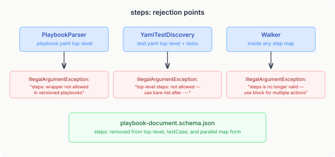

We removed `steps:` from the playbook format months ago. The Walker rejects it. The PlaybookParser throws if you try. We wrote a lint. We migrated every `.playbook.yaml` file. Done.

Except it wasn't done.

## The Format That Forked

The problem with format migrations is that they only cover the files you remember. Playbooks went through `PlaybookParser`, which enforces the bare-list multi-document format. Test files went through `YamlTestDiscovery`, which nobody updated. Nine `.test.yaml` files still used top-level `steps:`. One multi-test file still used `tests[].steps`. Five more test fixtures in the test engine module. The `playbook-document.schema.json` still declared `steps:` as valid. And the parallel step type had its own map form with `steps:` inside it.

That's four separate locations where the deprecated format survived — each with its own parser path, its own schema, its own conventions. The lint caught one. The others were invisible to it.

## Why One Format Matters

The argument for a single format isn't aesthetic. It's that every divergence is a maintenance tax someone pays later. A new contributor reads a test file, sees `steps:`, copies the pattern into their playbook, and hits the lint. Now they're confused about which format is right. They look at the schema, which says both are valid. They look at a multi-test file, which uses a third variant. Three formats for the same concept, each correct in its own context.

The fix isn't complicated — multi-document YAML, bare list after `---`. The same pattern playbooks already use:

```yaml
name: My test
---
- click: A
- click: B
```

For multi-test files, the same pattern repeats — each test case is a metadata document followed by a bare step list:

```yaml
name: Test suite
simulate:
  agent:
    - prompt: "hello"
      response: "world"
---
name: First test
---
- run-playbook: my-playbook.yaml
  capture: output
- assertThat: output.succeeded
  equals: true
---
name: Second test
---
- click: A
- click: B
```

No `steps:` wrapper. No `tests:` wrapper. Each document is either metadata or a step list — the parser distinguishes by type.

## The Last Holdout

The parallel step had its own private use of `steps:` that nothing else knew about:

```yaml
# Old map form
- parallel:
    steps:
      - click: A
      - click: B
    advance-after: 1
    cancel-remaining: true
```

The `steps:` key here served a structural purpose — it separated the branch list from the policy keys (`advance-after`, `cancel-remaining`). But policy keys don't need to be inside the parallel value. They're step-level concerns — siblings, not children:

```yaml
# New form
- parallel:
    - click: A
    - click: B
  advance-after: 1
  cancel-remaining: true
```

This matches how every other decorator works in the language. `timeout`, `retry`, `when` — all sibling keys on the step map. The parallel policies were the exception, hidden inside a nested object nobody questioned because it worked.

## Linting Covers Every Level Now

The rejection points after the migration:



Three parsers, one schema, zero paths where `steps:` slips through. The Walker also rejects the parallel map form — if someone passes `parallel: { steps: [...] }`, they get a clear error telling them to use sibling keys instead.

## The Deeper Pattern

Format migrations that touch only one parser path always leave survivors. The question isn't whether you caught the main path — it's whether you audited every alternative path that reads the same input format. `PlaybookParser` and `YamlTestDiscovery` both read YAML files with step lists, but they were written by different people at different times, and only one got the migration. The `StepSchemaComposer` generates schemas at runtime — it had its own copy of the parallel map form that nobody thought to update.

The fix for this class of problem isn't vigilance. It's the lint itself — `Walker.REMOVED_KEYS`, `PlaybookParser.rejectStepsWrapper()`, and `YamlTestDiscovery`'s rejection all fail fast with actionable messages. Every surviving use got caught the moment we ran the tests after adding the rejection. The order matters: add the lint first, then let the test suite show you what you missed.
