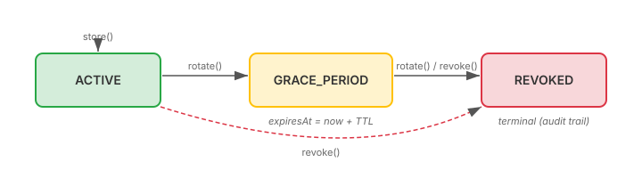

# The Gap Between Store and Rotate

API key rotation is one of those things that sounds trivially simple until you actually try to do it without dropping requests.

CaseHub's `StaticCredentialStore` shipped as a straightforward CRUD store — `store()`, `find()`, `delete()`. When you wanted to "rotate" a key, you called `store()` with a new credential. The old key vanished immediately. If a client was mid-request with the old key — tough luck, 401. In a monolith that might be a minor annoyance. In a distributed system where credential propagation takes minutes or hours across services, it's an outage.

The gap between "replace a credential" and "rotate a credential" is a grace period. And a grace period requires something the original SPI didn't have: state.

## The Three-State Lifecycle

A credential in a rotation-capable store isn't just "present" or "absent". It has a lifecycle:



**ACTIVE** is the current credential — at most one per actor/provider/tenant, enforced by a partial unique index at the database level. **GRACE_PERIOD** is the previous credential, still valid for a configured window (default 24 hours) after rotation. **REVOKED** is a terminal state for security incidents — the credential is invalidated immediately but retained for audit.

The distinction between REVOKED and "expired GRACE_PERIOD" matters. An expired grace period is a normal lifecycle event — the propagation window closed. A revocation is a security decision. You want to know, six months later, which credentials were explicitly invalidated versus which aged out naturally.

## Rotation Without Dropped Requests

The rotation flow is a single atomic operation:


When `rotate()` is called, the current ACTIVE credential moves to GRACE_PERIOD with an `expiresAt` timestamp, and a new ACTIVE credential is inserted. Both keys are valid simultaneously. Clients holding the old key continue to authenticate successfully until the grace period expires.

If you rotate again during an active grace period — say you realise the first rotation was to a compromised key — the GRACE_PERIOD credential is immediately revoked before the current ACTIVE moves to grace. The partial unique indexes enforce that at most one ACTIVE and one GRACE_PERIOD credential exist for any given actor/provider/tenant tuple. The database won't let you violate this invariant even if the application logic has a bug.

```java
default StaticCredentialRecord rotate(String actorId, String provider,
        String tenancyId, String newCredential) {
    throw new UnsupportedOperationException("rotate not supported");
}
```

The default throws — this is deliberate. Rotation without an actual store backing it is meaningless. The pattern follows `revoke()`, which also throws by default because a silent no-op during a security incident is worse than a loud failure.

## The Reverse Lookup Problem

The original SPI could look up credentials by identity: give me the API key for actor X on provider Y. That's the outbound direction — your service calling someone else's API. The inbound direction is the opposite: an HTTP request arrives with an API key, and you need to figure out who sent it.

`lookup(String credential)` fills this gap. It takes a raw credential value, hashes it (SHA-256 in the JPA implementation), and queries for matching ACTIVE or non-expired GRACE_PERIOD records. The name `lookup` rather than `resolve` avoids a collision with `CredentialResolver.resolve()` in the same package — that SPI handles outbound credential resolution by logical reference name, a complementary but distinct concern.

## Hashing at the Store Boundary

The hashing decision was straightforward once we framed it correctly. All credential types in the system — API keys, bot tokens, personal access tokens — are high-entropy secrets (128+ bits). SHA-256 is entirely appropriate here. Brute-forcing a 128-bit key space is infeasible regardless of hash speed, so the performance characteristics of bcrypt or Argon2 (designed for low-entropy passwords) would only add latency to every authentication request with no security benefit.

The more interesting decision was *where* to hash. The SPI stays hash-agnostic — `store()` and `lookup()` accept raw credential strings. The JPA implementation hashes on the way in and queries by hash. The in-memory implementation (used only in tests) keeps raw values and uses `MessageDigest.isEqual()` for constant-time comparison.

This boundary means the hashing algorithm is an implementation detail of the store, not a contract of the SPI. If a future credential type with lower entropy needs a different algorithm, the change is scoped to the store implementation.

## The PK Migration

The original table used a composite primary key: `(actor_id, provider, tenancy_id)`. One row per credential. Rotation requires multiple rows for the same actor/provider/tenant — an ACTIVE and a GRACE_PERIOD credential existing simultaneously. The composite PK had to go.

The migration is a three-step split:

1. **V3** (SQL): Add the new columns — `id`, `credential_hash`, `status`, `expires_at`
2. **V3.1** (Java): Backfill existing rows with UUIDv7 IDs and SHA-256 hashes. This runs in Java rather than SQL to avoid logging raw credential values in PostgreSQL's statement log and to use the platform's UUIDv7 generator rather than PostgreSQL's `gen_random_uuid()` (which produces v4).
3. **V3.2** (SQL): Drop the old composite PK, promote `id` to PK, drop the raw `credential` column, add indexes.

The partial unique indexes are PostgreSQL-specific. H2 tests rely on application-level enforcement via `SELECT FOR UPDATE` within the transactional `rotate()` method — the row lock prevents concurrent rotation from violating the at-most-one-ACTIVE invariant.

## What Existing Callers See

The backward compatibility story is clean. The 7-argument `StaticCredentialRecord` constructor still works — it defaults `state` to ACTIVE and `expiresAt` to null. `find()` and `findAll()` now filter to ACTIVE-only, which is exactly what existing callers expect — they were getting all credentials before, but there was only ever one per tuple, so the behavioral change is invisible. `delete()` removes all rows for the tuple (ACTIVE, GRACE_PERIOD, and REVOKED), which matches the old "hard delete" semantics.

The one semantic change worth noting: `credential()` returns null on records retrieved from the JPA store. The raw credential isn't stored after hashing, so it can't be reconstructed. Test code that reads back stored credentials to verify values needs to be aware of this — but since the in-memory store still returns raw values, existing tests using `InMemoryStaticCredentialStore` are unaffected.
