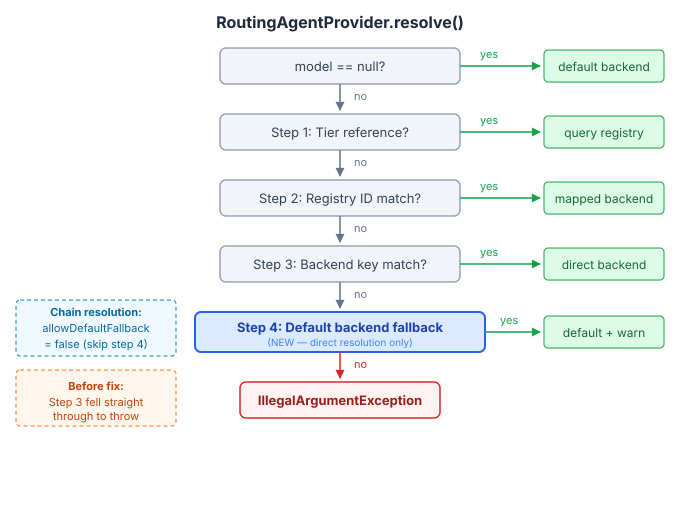

# When the Router Won't Route

We hit a wall running the speech-demo in a container: every LLM request failed with `No model or backend for: claude-haiku-4-5@20251001`. The router had a registered Claude backend and a configured default — it just refused to use it.

Two independent bugs compounded to make the router completely non-functional outside environments with a full agent-config.yaml.

The first was a schema mismatch in `ModelDescriptor`. The record's compact constructor calls `Objects.requireNonNull(apiModelId, "apiModelId")`, but the seed catalog YAML doesn't include `apiModelId` on most entries — it defaults to the model `id`. The manual parser in `SeedCatalogModelSource` handles this correctly (line 74: `node.has("apiModelId") ? node.get("apiModelId").asText() : id`), but `AgentManifestLoader` deserialises the same file through Jackson, which passes `null` for absent fields. The `requireNonNull` throws, the seed catalog fails to load, and no model-to-backend mappings exist.

The fix is one line in the compact constructor: `apiModelId = apiModelId != null ? apiModelId : id`. This aligns the Jackson path with what the manual parser already does, and makes the record behave sensibly — if you don't specify an API model ID, it defaults to the model's own ID.

The second bug is in `RoutingAgentProvider.resolve()`. The method has a four-step resolution chain: tier reference, registry ID lookup, backend key match, and then... throw. When all four steps fail, it throws `IllegalArgumentException` without ever checking the configured `defaultBackendKey`. The null-model path at the top of the method does use the default — but the "nothing matched" path at the bottom doesn't.



```java
// Step 4: Fall back to default backend
var defaultBackend = registry.resolve(defaultBackendKey, "default");
if (defaultBackend.isPresent()) {
    LOG.warnf("No specific mapping for model '%s' — falling back to default backend '%s'",
              model, defaultBackendKey);
    return new ResolvedRoute(defaultBackend.get(), model);
}
throw new IllegalArgumentException("No model or backend for: " + model);
```

The fallback passes the original model string through to the backend, which can interpret it however it wants — the Claude backend, for instance, will try to use it as an API model ID directly. A warning log ensures operators can see when the fallback fires.

One subtlety: the fallback must not fire for model chain resolution. When a chain like `ModelChain.of("opus", "sonnet")` is exhausted, the intent is "try these specific models in order" — silently falling back to the default would mask the exhaustion. The fix uses a `boolean allowDefaultFallback` parameter: `true` for direct resolution, `false` for chain entries.

The two bugs are independent but their combination is total. The first prevents any model mappings from loading; the second prevents the router from recovering. Fix either one and the system works — but only by luck rather than design. The seed catalog gives you mappings (so the router finds the model in step 2), and the default fallback catches anything unmapped (so step 4 doesn't throw). Both defences need to be in place.
