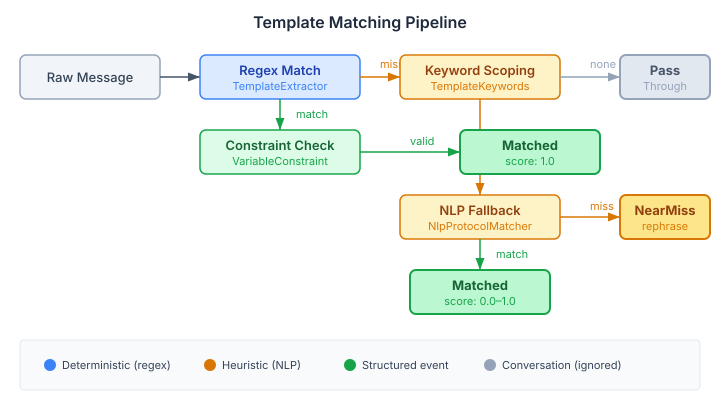

# The Protocol Extraction Pipeline

LLM agents produce prose. Protocols need structured events. That gap has been sitting there since we first wired agents into playbook channels — agents saying "I approve the design" while the protocol engine waits for `{ type: "vote", decision: "approve" }`.

The obvious fix is to force agents into structured JSON output. It works, but it's brittle and unnatural. An agent forced to emit `{"decision": "approve", "subject": "design", "rationale": "solid error handling"}` can't also talk naturally on the same channel. Every message becomes a protocol action or nothing.

What I wanted instead was a translation layer — templates declared in the playbook definition that extract structured events from prose deterministically, with NLP fallback for natural variation.

## The Architecture

The pipeline has four stages, each more expensive than the last:



**Regex first.** `TemplateExtractor` compiles patterns like `"I ${decision} this ${subject}[ because ${rationale}]"` into regex with named capture groups. Optional segments become non-capturing groups. The last variable in a segment gets greedy matching; earlier ones are lazy. This handles exact structural matches — the cheapest path.

**Constraint validation.** Even when regex matches, the extracted values might be invalid. A template declaring `decision: { type: enum, values: [approve, reject, abstain] }` should reject `decision=maybe`. `VariableConstraint` — a sealed interface with `StringConstraint` and `EnumConstraint` variants — validates extracted values immediately after regex extraction. Case-insensitive matching, following the same pattern the NLP tier already uses in `StructuralPattern.resolveVariableValue()`.

**Keyword scoping.** When regex fails, we don't immediately throw every template at the NLP matcher. That's how you get false positives — "Let's schedule a meeting" shouldn't fuzzy-match against a voting template just because both contain common words. `TemplateKeywords` extracts the meaningful words from each template's literal segments (stripping variables, stop words, and punctuation), then scores the input's keyword affinity against each template. Only templates above an affinity threshold become NLP candidates.

**NLP fallback.** The `NlpProtocolMatcher` SPI accepts the scoped candidate templates and the input, returning the best structural match with a confidence score. The implementation is pluggable — when the message-extraction module is on the classpath, `TwoTierMessageMatcher` provides lemma-based structural matching. When it's absent, the pipeline is regex-only. No classpath detection magic; the CDI layer wires what's available.

## Three Outcomes, Not Two

The interesting design question was what to do with unmatched input. The obvious answer — ignore it — loses information. Not every unmatched message is conversation.

"I'm fine with this design" is probably a failed vote. "Let's discuss this offline" is conversation. The difference is keyword affinity. The first shares vocabulary with the voting template ("design"); the second shares nothing.

`TemplateMatchResult` is a sealed type with three variants:

- **Matched** — structured event with type, fields, score, original input
- **NearMiss** — keyword affinity detected but no match. Carries a rephrase suggestion: "To vote, say: I [approve/reject/abstain] this [subject] because [rationale]"
- **PassThrough** — no affinity, pure conversation. Visible on channel, invisible to protocol steps

Near-miss detection is configurable — protocols can opt out if they prefer silent pass-through for everything.

## Playbook Integration

Templates are declared in playbook YAML alongside existing metadata:

```yaml
templates:
  vote:
    pattern: "I ${decision} this ${subject}[ because ${rationale}]"
    variables:
      decision: { type: enum, values: [approve, reject, abstain] }
  escalate:
    pattern: "Escalating to ${target}[ due to ${reason}]"
```

The compiler parses this into a `TemplateSpec` — a `ProtocolDefinition` paired with per-template variable constraints. `PlaybookRunnerCore` creates a `TemplateMatchingFilter` from the spec at playbook load time, registers it with the service registry, and steps that consume channel messages can look it up.

The key constraint: templates compile once at load time, not per message. `ProtocolEvaluator` pre-computes keyword sets for each template at registration. The per-message path is a regex match attempt, possibly an affinity score, possibly an NLP call — but no compilation.

## What This Opens Up

The extraction pipeline is a building block. Protocol-backed playbooks can now declare their vocabulary as templates, and agent responses get translated into structured events without forcing agents out of natural language. The near-miss path means agents get helpful feedback when they're close but not quite right — a rephrase prompt instead of silence.

The NLP matcher SPI is deliberately empty right now — the bridge to `TwoTierMessageMatcher` is a wiring concern for a higher-level module. The pipeline works regex-only today, with the NLP path as a clean extension point.

The piece I'm most interested in next is how near-miss detection interacts with multi-turn protocols. An agent that gets a rephrase prompt should be able to self-correct on the next turn — which means the protocol needs to track that a near-miss happened and expect a retry. That's not in the pipeline yet, but the `NearMiss` variant in the result type was designed with it in mind.
