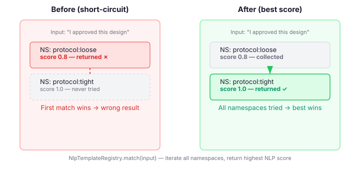

# Three Cuts to the NLP Template Matcher

The NLP template matcher — `StructuralMatcher` and `NlpTemplateRegistry` — had three bugs hiding behind the fact that most tests use a single namespace with single-word enum values and exact-match inputs. A skeptical review of the matching pipeline surfaced all three. Each was XS in scope but would have produced wrong results in production configurations with multiple namespaces or richer enum vocabularies.

## Global match short-circuited across namespaces

`InMemoryTemplateRegistry.match(input)` iterates namespaces and returns the first `Matched` result. For the regex tier this is correct — all regex matches score 1.0, so first-match-wins is harmless. But `NlpTemplateRegistry` inherited this loop without overriding it. When the NLP tier matches the same input against multiple namespaces at different scores, the first namespace wins regardless of score.

The fix is a one-method override: `NlpTemplateRegistry.match(input)` now iterates all namespaces via the public API, tracks the highest-scoring match, and returns it. A score-1.0 match still short-circuits — once you have a perfect structural alignment, there's nothing better to find.

## Adjacent CLAUSE variables compiled silently

A template like `"${agent} ${action} ${target}"` — three variables with no literal between them — compiled without error. At match time, `captureClause` reads tokens until it finds the next literal anchor. With no anchor between the first two variables, the first CLAUSE absorbs everything and the second gets nothing. The match silently fails with `Unmatched`.

We added `validateNoAdjacentClauses()` to `StructuralMatcher.compile()`. It scans the compiled element list and throws `IllegalArgumentException` naming both variables when two CLAUSEs are adjacent with no LITERAL between them. The error message explains the constraint: the structural matcher needs a literal anchor to know where one variable ends and the next begins. Template authors see the problem at registration time, not as a mysterious `Unmatched` at runtime.

The regex compiler was intentionally left unchanged — it handles adjacent variables via lazy quantifiers and literal whitespace separators, which works correctly.

## Multi-word enum values checked only the first token

`captureClause()` validated enum constraints by checking only the first captured token's lemma against the enum values. A multi-word enum like `"strongly approve"` would check only `"strongly"` — which isn't in `{approve, reject}` — and silently reject the match.

The fix joins the lemmas of all captured tokens and compares against lemmatised enum values. `"strongly approved"` → lemmas `"strongly approve"` → matches enum value `"strongly approve"`. The tokenizer is now stored as a field in `StructuralMatcher` so enum values can be lemmatised at match time.

## The pattern

All three bugs share a shape: code that works for the simplest case (one namespace, one-word enums, well-separated variables) but breaks when the input gets richer. The existing test suite exercised the simple cases thoroughly — 114 tests, all passing. The bugs were invisible because nothing tested the edges where real protocol configurations would land.

The testing lesson is familiar but worth repeating: coverage of the happy path doesn't prove correctness of the combinatorial space. Two namespaces competing via NLP, a template with adjacent variables, an enum with a two-word value — none of these are exotic. They're the configurations a protocol author would reach for in the second week.
