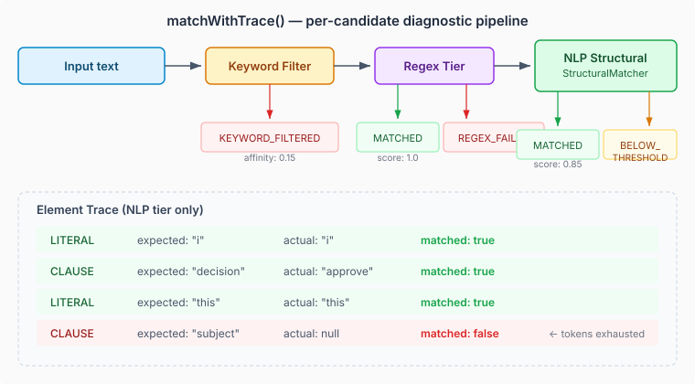

# From Unmatched to Understood

The template matcher had a communication problem. It could tell you what matched — template name, extracted fields, confidence score. But when something *didn't* match, the answer was `Unmatched("the design looks good to me")`. The input you already had. No information about which templates were considered, which structural element failed, how close the best candidate was, or what to try instead.

This matters most in BLOCKING enforcement mode, where a governance act gets rejected and the agent has zero guidance on how to rephrase. The debugging cycle was guess-and-retry — which drives people toward hard-coded regex patterns, which defeats the purpose of having a structural matcher in the first place.

Three changes close the gap.

## Honest scores

`ProtocolMatchResult.Matched` carried `templateName` and `params` but no score. When the NLP path matched with 0.85 confidence, the score was discarded at the boundary — `ProtocolEvaluator` wrapped the NLP result without preserving `NlpMatch.score`, and downstream `TemplateMatchingFilter` hardcoded 1.0 for every match regardless of origin.

The fix adds `double score` to `Matched` with a backward-compatible constructor that defaults to 1.0 for regex matches. NLP matches now carry their actual confidence through to `TemplateMatchEvent`. Six lines of production code, but the downstream effect is significant — anything that makes decisions based on match confidence was previously working with fabricated data.

## The trace API

`matchWithTrace()` on `UnifiedTemplateRegistry` returns the match result alongside a full diagnostic trace. Zero overhead on the hot path — `match()` is completely untouched.

The trace captures three tiers of data per candidate template:

- **Keyword affinity** — did this template pass the pre-filter? With what score? (`-1.0` for the regex tier, which skips keyword filtering entirely)
- **Structural element walk** — for each element in the template (literal, variable, clause): what was expected, what was found in the input, did it match?
- **Outcome** — why this candidate was rejected: `KEYWORD_FILTERED`, `REGEX_FAILED`, `STRUCTURAL_FAILED`, `BELOW_THRESHOLD`

The element walk is the part that actually answers "why didn't it match." A trace entry like `LITERAL expected="i" actual="the" matched=false` tells the template author exactly which structural element diverged. Previously this information existed inside `StructuralMatcher.match()` — computed, used for scoring, then thrown away. `matchWithTrace()` collects it without changing the algorithm.

The types live in `template-registry-api` alongside the existing `TemplateMatch` sealed type. `ElementKind` was extracted from `StructuralMatcher`'s inner enum to a shared top-level type so both modules can reference it. `InMemoryTemplateRegistry` implements the regex tier (opaque — no element detail, just MATCHED or REGEX_FAILED), and `NlpTemplateRegistry` overrides with the full NLP pipeline including element traces.

## NearMiss: guided rejection

`TemplateMatch.NearMiss` existed in the type system but nothing produced it. Both `InMemoryTemplateRegistry` and `NlpTemplateRegistry` returned only `Matched` or `Unmatched`.

The design decision was about when to fire: keyword affinity alone is a bag-of-words overlap — "the design looks good to me" passes on the word "design" even when the structure is completely different from "I ${decision} this design." That felt unreliable. The better signal is structural: if the `StructuralMatcher` attempted a match and produced a partial score above zero, some elements actually matched the input. That's genuine near-miss evidence, not just lexical coincidence.

So the rule: NearMiss fires when structural matching was attempted (keyword affinity passed the pre-filter), the structural matcher scored above zero (some elements matched), but the score fell below the match threshold. The `suggestedFormat` shows the template pattern with variable positions marked — `"I [decision] this [subject]"` — giving the agent a concrete rephrase target.

This surfaces through the existing enforcement pipeline without new types. `DispatchAdvisory` in qhorus already has an `evidence` map — the NearMiss `suggestedFormat` and `suggestedTemplate` go there. A linked qhorus issue covers the wiring.

## What this opens up

The trace API and NearMiss together give the template authoring workflow a feedback loop it didn't have. An author can register a template, run test inputs through `matchWithTrace()`, and see exactly why each one matched or didn't — which literal anchor failed, which keyword was missing, what the partial score was. When the system rejects a governance act, the agent gets a rephrase suggestion instead of silence.

The keyword filter itself is still bag-of-words — a separate issue tracks replacing it with a statistical grammar tool (there's existing integration in the casehub connectors STT/TTS path) and potentially an LLM fallback tier for cases where even grammar-level matching misses semantic equivalence.
