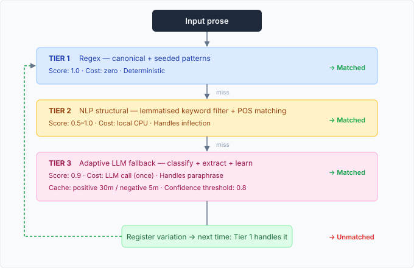
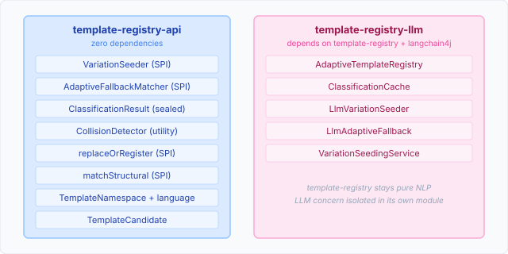

# Crossing the Paraphrase Cliff

The template registry's NLP matcher handles inflection beautifully. "I approved this design" matches "I ${decision} this ${subject}" because OpenNLP lemmatises "approved" back to "approve" — same word, different form. But "I'm in favour of this design" is a brick wall. Different words entirely. The structural matcher can't bridge that gap, and no amount of lemmatisation will turn "in favour of" into "approve".

I'd been calling this the paraphrase cliff. We had a `ParaphraseCliff` test suite documenting exactly where the boundary fell — six semantic equivalents of "I approve this design" that all returned `Unmatched`. The schema publication feature mitigates this by telling LLMs the exact sentence shapes a protocol expects, so a well-prompted agent won't paraphrase. But agents drift from schemas in multi-turn conversations, and human users never got the memo.

The question was whether to live with the cliff or cross it.

## Three tiers, not one

The solution Claude and I designed has three tiers, each cheaper than the last for recurring input:

**Tier 1 (regex)** and **Tier 2 (NLP structural)** are unchanged — they handle exact matches and inflected forms, respectively. The new **Tier 3** fires only when both fail. It sends the unmatched input to an LLM with the namespace's template patterns and asks: "is this semantically equivalent to any of these? If yes, which template, what are the field values, and what normalised pattern would match this phrasing?"

The key insight: the LLM returns a `suggestedVariation` — a normalised pattern string with `${variable}` placeholders preserved. If the variation passes the collision guard and confidence threshold, the registry registers it as a new pattern. Next time someone says the same thing, Tier 1's regex catches it. The LLM is called once per novel phrasing. Every subsequent occurrence is free.

This creates a system that gets better over time. The first time someone says "thumbs up on this architecture", there's an LLM call. The second time, the regex handles it in microseconds.

## The classification cache

Not every match can be learned. "I'm in favour of this design" substitutes a synonym for an enum-constrained variable — "in favour of" isn't in `{approve, reject, abstain}`. The LLM can classify it and extract `{decision: "approve"}`, but the suggested variation `"I'm in favour of this ${subject}"` drops the `${decision}` placeholder (the enum value is baked into the phrasing). We can't register that as a structural pattern.

For these cases, the classification cache handles repeat occurrences. Positive results cache for 30 minutes; negative results (genuinely unrelated input) cache for 5 minutes. The cache key is a typed record — not string concatenation — because namespace names contain colons and a concatenated key would be ambiguous.

## Where the design review earned its keep

I had two decisions that felt right but were wrong. The design review — a fresh session that hadn't seen my reasoning — caught both.

**The atomicity gap.** I'd chosen `deregister()` + `register()` for learned variation registration, arguing it used existing API and needed no SPI changes. Claude's reviewer pointed out the gap: between those two calls, the namespace is absent from the snapshot. Any `match()` call landing in that window returns `Unmatched`. For governed protocol communications, that's a correctness bug. The fix was `replaceOrRegister()` — a single CAS swap in the immutable snapshot. It was already filed as a separate issue but never implemented. We built it as part of this work.

**The dependency coupling.** I'd planned to put the LLM implementations in `template-registry`, which currently depends only on OpenNLP. The reviewer correctly noted that adding `langchain4j-core` would change the module's architectural character. A new `template-registry-llm` module keeps the NLP module pure and isolates the LLM dependency.

## The collision guard

LLM-generated variations don't know what other templates exist. If template A is "I approve this design" and template B is "I support this proposal", an LLM asked to paraphrase A might produce "I support this design" — matching both. The `CollisionDetector` catches this: after generating variations, every candidate is tested against all existing templates via `matchStructural()`. Collisions are logged and rejected.

`matchStructural()` is a new SPI method that bypasses Tier 3 — collision detection must not trigger LLM calls. Without it, checking a variation for collisions would trigger the adaptive fallback for every test, creating an infinite loop of classification.

## What it opens up

Template matching can now tolerate the full range of how people (and LLMs that drift from their prompts) express the same intent. A protocol author writes one canonical pattern. The seeder generates structural rearrangements at registration time. The NLP matcher handles inflection across all of them. And the adaptive fallback catches everything else, learning as it goes.

The classification cache means genuine semantic paraphrases — where the phrasing bakes in a variable value — are handled without repeated LLM calls, even when they can't be registered as structural patterns.

The language field on `TemplateNamespace` defaults to `"en"` for now. Every semantic interface accepts it, so adding a second language won't require a redesign — just a new namespace per language with the appropriate NLP models.
