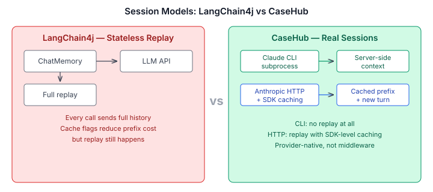
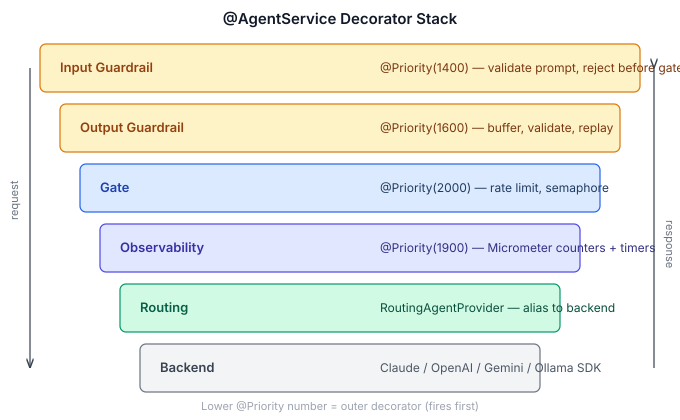

# Designing @AgentService — why CaseHub isn't building another AiServices

LangChain4j's `AiServices` solved a real problem in 2023: Java developers had no clean way to call an LLM. You annotated an interface, passed a `ChatModel`, and got a proxy. It was the right answer at the time.

The market moved. Anthropic, OpenAI, and Google all ship mature Java SDKs with streaming, tool use, structured output, and caching. The normalisation layer that made LangChain4j valuable stopped being necessary — and started getting in the way. Provider-specific features (real sessions, prompt caching modes, explicit breakpoints) don't fit `ChatModel.chat() → ChatResponse`. They arrive as bolted-on config flags and special message attributes that break the promise of vendor-neutrality.

CaseHub went a different direction. `AgentProvider` calls vendor SDKs directly — `AnthropicNativeChatModel` talks to the Anthropic SDK, `OpenAiNativeChatModel` to the OpenAI SDK, `GeminiNativeChatModel` to the Google GenAI SDK. No middleware. When a vendor adds a capability, the backend can adopt it immediately. The abstraction is at the invocation level (routing, sessions, guardrails), not the vendor level.

That's the foundation. `@AgentService` is the type-safe declarative surface on top of it.

## What @AgentService actually looks like

```java
@AgentService(
    model = "fast",
    descriptor = "coach",
    tools = {Calculator.class},
    mcpServers = {"filesystem"},
    timeout = 30,
    simulationEligible = true
)
public interface PlanningCoach {

    @Query("Break this goal into concrete tasks")
    List<Task> decompose(String goal);

    @Query("Stream analysis updates")
    Multi<AgentEvent> streamAnalysis(String context);

    AgentSession openConversation();
}
```

One annotation, three return types. `model = "fast"` resolves through the manifest alias chain — YAML, not code. `descriptor = "coach"` resolves through `AgentResolver` — the system prompt comes from eidos, not a hardcoded annotation. Tools are declared on the interface because tool binding is part of the contract — the interface tells you everything about this agent's capabilities.

The return type determines invocation mode. `List<Task>` → blocking with JSON schema structured output. `Multi<AgentEvent>` → streaming. `AgentSession` → multi-turn session backed by `SessionPool`. All three from the same interface.

Compare AiServices:

```java
Assistant a = AiServices.builder(Assistant.class)
    .chatLanguageModel(model)
    .chatMemory(MessageWindowChatMemory.withMaxMessages(10))
    .tools(new Calculator())
    .build();
```

Builder-based, runtime proxy. Model passed explicitly. Memory is an in-memory message list. Tools wired in code, not visible from the interface. No streaming. No real sessions. No descriptor separation. No simulation support.

## The session question

This was the design decision that took the most investigation. LangChain4j's `AiServices` emulates multi-turn via `ChatMemory` — an in-memory list of messages replayed in full on every API call. The LLM sees the conversation each time, but every call pays the full token cost of the history. Caching was added after the fact: `cacheSystemMessages`, `cacheAutomatically`, per-message `cache_control`, configurable TTL — all opt-in booleans bolted onto a stateless architecture.

Claude and I pulled the latest LangChain4j source to verify what they'd actually shipped. The caching support is comprehensive — they've exposed more of the Anthropic and OpenAI SDK caching knobs than CaseHub currently does. That was a useful wake-up call, and I filed [#988](https://github.com/casehubio/platform/issues/988) to close the gap. But it's a wiring gap, not an architectural one — CaseHub uses the same SDKs directly and can wire any feature through without waiting for a middleware layer.



The genuine differentiator is the Claude CLI subprocess path. `ClaudeAgentSession` holds a live process — first turn is `connect(prompt)`, subsequent turns are `query(prompt)`. The LLM holds full conversational context server-side. No replay, no caching needed — the state persists in the process. CaseHub has this; LangChain4j doesn't and structurally can't, because real sessions are inherently provider-specific and can't be normalised away.

For `@AgentService`, this means multi-turn methods get real sessions where the provider supports them, with cached replay as the fallback. The proxy delegates to `SessionPool`, which manages admission, idle timeout, and leak detection. The developer doesn't choose the session strategy — it's resolved by the backend.

## Guardrails as a cross-cutting concern

LangChain4j couples guardrails to `AiServices` — bypass the proxy and you bypass the guardrails. That's a design choice that follows from their architecture: `AiServices` is the only intelligent entry point.

CaseHub has multiple invocation paths — `@AgentService`, playbooks, direct `AgentProvider` calls. Guardrails need to fire on all of them. The natural answer is a CDI decorator on `AgentProvider`:



Input guardrails fire at `@Priority(1400)` — before the gate at `@Priority(2000)`. A rejected prompt never consumes a rate limit token. Output guardrails fire at `@Priority(1600)`, buffering the complete response stream before validating. The buffer-then-validate approach means the consumer either gets the full validated response or a failure — no partial output followed by a mid-stream error.

The SPIs are deliberately minimal:

```java
@FunctionalInterface
public interface InputGuardrail {
    GuardrailResult validate(AgentSessionConfig config);
}

public sealed interface GuardrailResult
    permits GuardrailResult.Pass, GuardrailResult.Fail, GuardrailResult.Reprompt {
    record Pass() implements GuardrailResult {}
    record Fail(String reason) implements GuardrailResult {}
    record Reprompt(String repromptMessage) implements GuardrailResult {}
}
```

Sealed result type — exhaustive switch, no missing cases. `Reprompt` enables the output guardrail to rephrase and retry. The decorator handles the retry loop; the guardrail implementation just validates.

One structural concern Claude flagged during the decision review: the gate releases its semaphore via `Multi.onTermination()` — when the inner stream completes. With output buffering, the inner stream terminates during buffering (before replay to the consumer). The semaphore releases milliseconds early. Under heavy concurrent load with slow consumers, this could allow one extra concurrent invocation past the limit. I accepted this — validation is local and fast, the overshoot is bounded, and tightening it would add complexity for negligible benefit.

## The capability inventory

Halfway through the design I stepped back and inventoried every agent-related capability across both repos. `@AgentService` was only surfacing six attributes. The platform had at least ten more capabilities that a developer might want to declare on an agent service.

The result was an expanded annotation surface for Phase 2: per-method `temperature`/`maxTokens` overrides ([#989](https://github.com/casehubio/platform/issues/989)), budget limits via `AutonomyBudgetPolicy` ([#990](https://github.com/casehubio/platform/issues/990)), retry with backoff via `PolicyEnforcer` ([#991](https://github.com/casehubio/platform/issues/991)), fallback implementations for resilience ([#992](https://github.com/casehubio/platform/issues/992)), and `@RequiresConfirmation` for human-in-the-loop on high-risk methods ([#993](https://github.com/casehubio/platform/issues/993)).

The agency repo gets the domain-specific built-in guardrails — PII detection and content policy ([agency#549](https://github.com/casehubio/agency/issues/549)). Platform owns the structural validators (JSON schema, max token limit) because they validate against platform types.

This matters because it's the difference between "CaseHub's version of AiServices" and "a type-safe entry point into a production agent runtime." AiServices gives you model + memory + tools. `@AgentService` gives you routing, personality, tools (local + remote MCP), budget, governance, simulation, confirmation, real sessions, and cross-cutting guardrails — all from an interface declaration. Phase 2 delivers the full set.

## Module layout

I initially proposed six new modules following the `-core`/Quarkus/`-spring` pattern for every concern. The push-back was right — too many modules. The consolidated layout is four new modules plus types added to existing `agent-api`:

| New module | What it does |
|---|---|
| `agent-service-generator` | APT processor — generates proxy classes from `@AgentService` interfaces |
| `agent-service` | Quarkus CDI — `@Produces` the generated proxy beans |
| `agent-service-spring` | Generated auto-configuration |
| `guardrail` | Quarkus `@Decorator` on AgentProvider + built-in guardrails |
| `guardrail-spring` | Hand-written `BeanPostProcessor` |

The key insight that makes consolidation work: the APT-generated proxy class IS framework-neutral source code — constructor injection, no CDI or Spring imports. No separate `-core` module needed. For guardrails, the input loop is trivially small (~10 lines), and the output stream buffering logic goes in a `GuardrailStreamOperator` utility in `agent-api` — both frameworks call the same utility, no reactive code duplication.

## What's next

Phase 1 delivers the core: `@AgentService` with model/descriptor/tools/mcpServers/timeout/simulation, guardrails with input/output decorators and built-in validators, and prompt caching parity. The implementation plan has five batches across eleven tasks — API foundation, guardrail module, APT processor, CDI/Spring wiring, and caching.

Phase 2 is queued. Six issues covering model parameters, budget, retry, fallback, confirmation, and agency built-in guardrails. Each builds on Phase 1's annotation and proxy infrastructure — none requires architectural changes, just wiring existing platform capabilities through the annotation surface.

The comparison with LangChain4j is documented in `docs/specs/casehub-vs-langchain4j-agent-invocation.md`. Both issues that close the remaining gaps (#984 and #988) are tagged to update that doc when they ship. Honest assessment: LangChain4j's ecosystem is larger and getting started is simpler. CaseHub's advantage is the runtime — real sessions, direct SDK access, cross-cutting guardrails, and a declarative surface that exposes production infrastructure rather than hiding it behind a normalisation layer.
