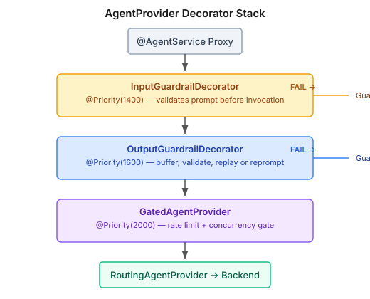

# Building @AgentService — from design to running code in one session

Continued from [Designing @AgentService](2026-11-26-mdp01-agent-service-design.md).

The design laid out nine decisions. This session turned them into running code — annotations, guardrails, an APT processor, CDI wiring, and prompt caching parity across both Anthropic and OpenAI backends.

## The guardrail architecture that can't be bypassed

LangChain4j's guardrails are coupled to `AiServices`. Bypass the proxy, bypass the guardrails. We took a different approach: CDI decorators on `AgentProvider`, the invocation SPI that every path — direct calls, `@AgentService` proxies, playbooks — passes through.

The decorator stack fires in priority order:



Input guardrails at `@Priority(1400)` validate the prompt before anything reaches the LLM. Output guardrails at `@Priority(1600)` buffer the response stream, validate the complete text, then either replay the events or fail. Both fire before the rate-limiting gate at `@Priority(2000)` — a rejected prompt doesn't consume a semaphore slot.

The key design choice for output guardrails was buffer-then-validate over pass-through-with-tail-validation. Consumers see a stream that either passes entirely or doesn't — no partial output followed by a failure event mid-stream. The latency cost is real (consumers don't see streaming events until validation completes), but guardrails are a safety mechanism, not a performance feature.

`GuardrailResult` is a sealed interface — `Pass`, `Fail`, `Reprompt`. Exhaustive pattern matching at compile time. The `Reprompt` variant lets output guardrails rephrase and retry: the decorator calls back through the same `AgentProvider` with the reprompt message, preserving all original config (model, MCP servers, tools, timeout, response format).

## Proxy generation without framework coupling

The APT processor scans `@AgentService` interfaces and generates proxy classes with a `(AgentProvider, AgentResolver)` constructor. No CDI annotations, no Spring imports — the generated code is framework-neutral by design.

```java
@AgentService(model = "fast", descriptor = "coach")
public interface PlanningCoach {
    @Query("Break ${goal} into tasks")
    String decompose(@Param("goal") String goal);
}
```

The processor generates `PlanningCoachProxy` with three invocation modes per method, determined by return type:

- `String` → `agentProvider.invokeBlocking()`, returns the text
- `Multi<AgentEvent>` → `agentProvider.invoke()`, passes through the reactive stream
- `AgentSession` → `agentProvider.openSession()`, no `@Query` required

Mixed interfaces work — a single interface can combine blocking queries, streaming responses, and session methods. The return type is the contract.

The Quarkus module provides `AgentServiceBeans.createProxy(Class<T>)` to instantiate proxies with the injected `AgentProvider` and `AgentResolver`. Spring gets a `GuardrailBeanPostProcessor` that wraps `AgentProvider` beans at the same priority as the Quarkus decorator, using a shared `GuardrailStreamOperator` utility — no reactive code duplication.

## Prompt caching: what OpenAI's store(true) actually does

The original plan called for wiring `promptCacheRetention` to `store(true)` on the OpenAI request builder. We built it, the reviewer caught it: `store(true)` enables OpenAI's stored completions feature for fine-tuning distillation, not prompt caching. Prompt caching on OpenAI is automatic for prompts over 1024 tokens — there's no client-side toggle.

The fix was simple: remove the `store(true)` call. The property stays in the interface for future use (stored completions is a legitimate feature), but wiring it to the wrong API would have silently opted customers into data retention they didn't intend.

On the Anthropic side, `cacheAutomatically` makes the existing `CacheControlEphemeral` on system messages configurable. The default is `true` — preserving the behaviour that was already hardcoded.

## What shipped, what didn't

Six new modules: `agent-service-generator` (APT), `agent-service` (Quarkus CDI), `guardrail` (Quarkus decorators), `guardrail-spring` (BeanPostProcessor), plus guardrail SPIs and the `tools` field on config records in `agent-api`.

POJO return types (`T` and `List<T>` with `ResponseFormat.json()`) are filed as follow-up work. The proxy currently handles `String`, `Multi<AgentEvent>`, and `AgentSession` — structured output parsing is the natural next step. `agent-service-spring` deferred to the spring-generator tooling.

The design called for nine decisions. The implementation honoured all of them — including the ones that turned out to need adjustment when real code met real APIs.
